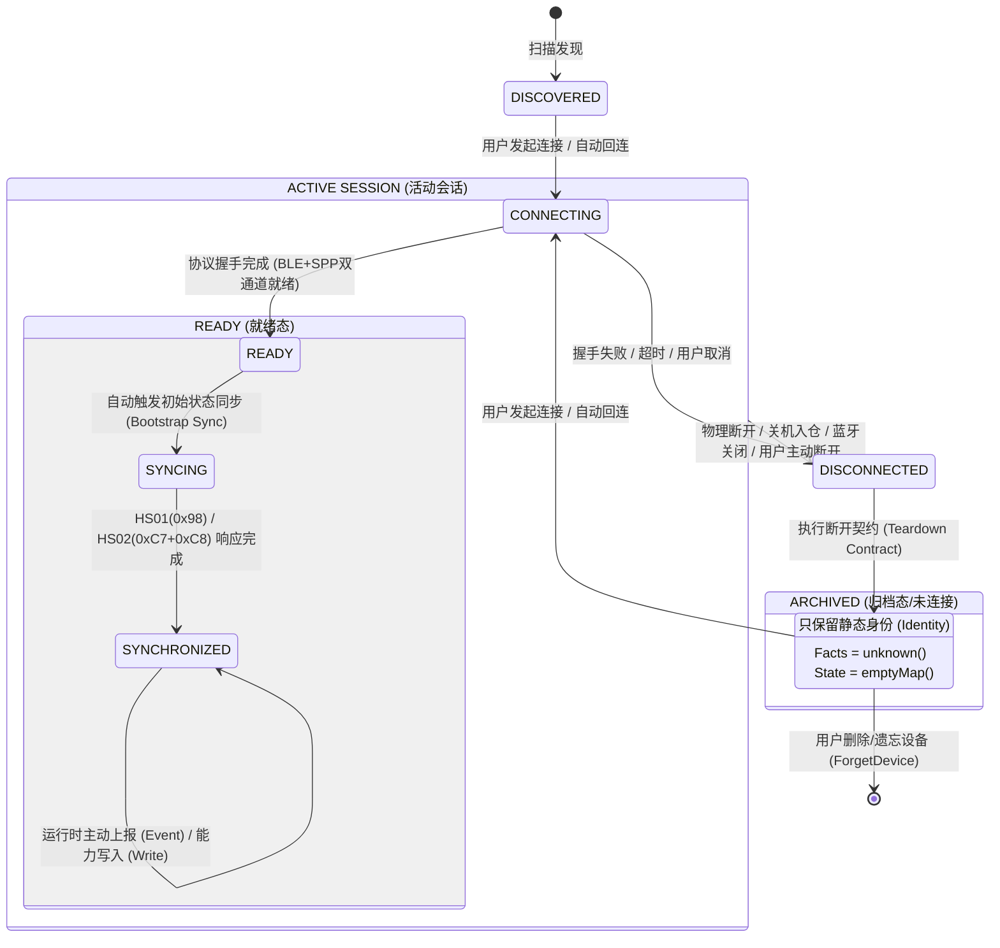

# 设备状态生命周期管理与断开清空架构设计规范

> **设计原则**：**单源可信（SSOT）、状态解耦、会话界内（Session-scoped）、不可逆归档**。  
> **核心目标**：从底层通信到 UI 表现层，建立严密确定的设备状态生命周期模型，彻底杜绝“旧状态残留”、“历史冒充现状”、“多处打补丁”的架构腐化。

---

## 一、 为什么不能“打补丁”？旧架构缺陷根因剖析

在传统的嵌入式或 IoT App 开发中，常见的反模式是在各层“零散缓存状态”并在断连时“到处补漏”：
1. **多重真理源（Multiple Sources of Truth）**：
   - 协议层存一份电量、适配层存一份快照、网关层存一份状态、ViewModel 存一份电量与控件值、持久化层又存一份状态。
   - 结果：一旦断连，任何一处漏清，或者异步到达的旧数据迟到，界面就会显示残留的电量（如断开了还显示 80%）或开关状态。
2. **状态维度混淆（State Dimension Conflation）**：
   - 把设备的“静态身份资产”与“会话内瞬态事实”混在一个对象中。落盘时把电量存进文件，开机时把断电前的电量还原给用户。
3. **断开生命周期被动响应而非契约驱动**：
   - 缺乏自上而下或自下而上的确定性状态机契约，依靠各类的回调方法“见招拆招”。

---

## 二、 状态四维拆解（State Decomposition）

在全新的架构设计中，设备相关的所有数据被严格划分为 **4 个独立生命周期维度**，各维度的生命期、存储位置与销毁策略完全解耦：

| 维度 | 定义与包含内容 | 权威真理源 (SSOT) | 生命周期 | 断开连接时的策略 | 持久化要求 |
|---|---|---|---|---|---|
| **1. 静态身份资产 (Identity Asset)** | `DeviceId(modelId, bleAddress)`、`bleName`、`classicAddress`、`classicName`、用户别名 `alias` | `DeviceRecord.identity()` | **永久存在**（直到用户主动解绑/遗忘设备） | **完整保留**（不抹除名称、型号与地址，作为归档记录） | **必须落盘**（JSON 存储） |
| **2. 会话瞬态事实 (Session Facts)** | 左右耳/充电盒电量 (`BatterySnapshot`)、充电状态、固件版本 (`firmware`)、在仓/出仓状态、佩戴状态 (`WearState`)、耳机颜色 | 协议解析与 `DeviceFacts` | **会话界内 (Session-scoped)**：随 `READY` 产生，随 `DISCONNECTED` 终结 | **彻底销毁**：立即归零为 `DeviceFacts.unknown()`，界面显示 `--` | **严禁落盘**（永不持久化） |
| **3. 能力控制状态 (Capability State)** | ANC 降噪模式、EQ 音效预设、游戏模式、双连接配置及已配对列表、按键设置等 | `DeviceState(Map<String, ControlValue>)` | **会话界内 (Session-scoped)**：就绪后同步拉取，随设备上报增长 | **彻底清空**：立即归零为 `DeviceState(emptyMap())` | **严禁落盘**（永不持久化） |
| **4. 交互在途操作 (In-flight Interaction)** | 写入槽位 `WriteSlot` (SENDING / PROCESSING)、全局写入序号 `activeSeq`、异步回调句柄 | ViewModel 内部锁控状态 | **操作界内 (Operation-scoped)**：单次写入发起至终态 | **立即作废**：清空所有槽位，终止在途序号，熔断后续回调 | **纯内存**（随 UI/会话生命周期消亡） |

---

## 三、 设备状态生命周期状态机模型（Finite State Machine）

设备的生命周期由统一的状态机严格约束，状态流转具有确定性前置条件与收尾契约：



### 状态定义与语义：
1. **DISCOVERED（发现态）**：仅在扫描结果中暂存，未持久化。
2. **CONNECTING（连接中）**：
   - 目标身份已确定，但尚未产生任何设备事实；
   - `DeviceSession` 递增 generation（代数）；
   - 所有会话事实依然是 `unknown()`。
3. **READY（就绪态）**：
   - 底层通讯通道畅通，会话正式建立；
   - 触发一次自举状态拉取（Bootstrap Query：HS01 发 `0x98`，HS02 依次发 `0xC7` + `0xC8`）；
   - 随着自举拉取完成与运行时设备主动上报，`DeviceFacts` 与 `DeviceState` 逐步丰富。
4. **DISCONNECTED（断开瞬态）**：
   - 触发全链路 **Teardown Contract（销毁契约）**；
   - **核心不变式**：业务级 `DISCONNECTED` 保证单生产者发布，不重复归档。
5. **ARCHIVED（归档态）**：
   - 保存在 `DeviceRosterRepository` 中；
   - `status.origin = ARCHIVED`，`status.connection = DISCONNECTED`；
   - **实时值彻底置空**，任何试图读取电量或开关的调用均获得未知，防止历史数据冒充现状。

---

## 四、 跨层断开销毁契约（Teardown Contract）

当断开连接发生时（无论原因），系统自底向上（或自顶向下）执行严格的统一清空契约，每一层均保证自洽：

```
+-----------------------------------------------------------------------------------+
| L1: Biz 通信层 (biz_ggec_hs)                                                       |
| 1. Scheduler 终止所有在途指令队列，拒绝新指令                                            |
| 2. FrameAssembler 重置入站分包缓冲区                                                |
| 3. DeviceDomainStore.reset(): 域状态置空，电量归零 (emptyBattery)                     |
| 4. HsSessionImpl.clearPeer(): 抹除对端双模 MAC、录音列表与双连接状态                      |
| 5. 产出最终断开快照: values = emptyMap(), battery = -1, info = UNKNOWN             |
+-----------------------------------------------------------------------------------+
                                          │ onConnectionChanged(DISCONNECTED)
                                          ▼
+-----------------------------------------------------------------------------------+
| L3: Provider 适配与网关层 (HsDeviceLinkAdapter / DeviceGateway)                     |
| 1. applyConnectionLocked(DISCONNECTED):                                           |
|    - 强制作废内部 sessionSnapshot 为 UNKNOWN 快照                                    |
|    - 强制清空 dualConnection = empty, recordFiles = empty                         |
|    - 发布 publishBattery(BatterySnapshot.unknown()) 通知独立观察者                    |
| 2. DeviceGateway.onEndpointSnapshot(DISCONNECTED):                                |
|    - 立即置 connectedTransport = null，熔断后续所有下发路由                              |
+-----------------------------------------------------------------------------------+
                                          │ DeviceSnapshot(connection == DISCONNECTED)
                                          ▼
+-----------------------------------------------------------------------------------+
| L2: Domain 核心层 (DeviceSession / LiveRecord / DeviceRosterRepository)             |
| 1. DeviceSession.onSnapshot():                                                    |
|    - 状态机迁移到 SessionState.Idle()，清空内部活动目标 target                             |
| 2. LiveRecord.apply(roster, target, snapshot):                                    |
|    - 纯函数归档：                                                                   |
|      facts = DeviceFacts.unknown()                                                |
|      state = new DeviceState(Map.of())                                            |
|      status = DeviceStatus.archived(nowMillis)                                    |
|    - 写入 DeviceRosterRepository，更新内存台账与通知观察者                                |
| 3. 持久化层只保存 DeviceRecord 的 Identity 与 Alias，不保存已抹除的 Facts/State           |
+-----------------------------------------------------------------------------------+
                                          │ DeviceRoster (live == false)
                                          ▼
+-----------------------------------------------------------------------------------+
| L4: UI 表现层 (DeviceHomeViewModel / DeviceHomeUiMapper / DeviceHomePage)         |
| 1. DeviceHomeViewModel.onRoster():                                                |
|    - 检测到 isReady == false:                                                      |
|      writes.clear() 清空所有乐观锁槽位                                                |
|      activeSeq.clear() 作废所有在途序号，防止迟到回调复活                                |
| 2. DeviceHomeUiMapper.map():                                                      |
|    - liveActive(roster) 发现无活动设备，返回 null                                    |
|    - 生成断开态 DeviceHomeUiState:                                                  |
|      title = "", sections = List.of() (卡片全部清空销毁)                             |
|      battery = BatterySnapshot.unknown() (电量呈现 "--")                            |
| 3. DeviceHomePage.render():                                                       |
|    - 隐藏内容滚动视图，调用 sections.dispose() 彻底注销内联卡片监听                         |
|    - 显示标准化空态/断开提示页，等待用户重连                                             |
+-----------------------------------------------------------------------------------+
```

---

## 五、 架构防御机制（Guardians Against Regression）

为保证此设计不因后续开发被打补丁破坏，系统设立了三大防御机制：

1. **单生产者原则（Single Producer Invariant）**：
   - 业务断开快照只由 `DeviceSession` 产出并注入台账，底层主动 `disconnect()` 不通知观察者，杜绝多生产者导致的双重归档与竞态条件。
2. **纯函数转换原则（Pure State Transition）**：
   - `LiveRecord.apply` 为无副作用纯函数，强制执行 `disconnected ? DeviceFacts.unknown() : ...`。任何业务快照只要带 `DISCONNECTED`，事实与能力必被擦除，无需依赖各层的局部清理。
3. **自动化架构门禁（Automated Architecture Gates）**：
   - `checkAppMvvmLayers`：验证 ViewModel 与 View 解耦，不持有 Context 与 View。
   - `checkAppLayering`：验证 Domain 层为 Pure Java，无任何 Android 与 JSON 依赖。
   - `checkBizProtocolPurity`：验证 Biz 层不依赖 App 逻辑。
   - 全套 630+ 自动化单元测试对各种“异常掉线”、“主动断开”、“换设备重连”场景建立强断言保护。
