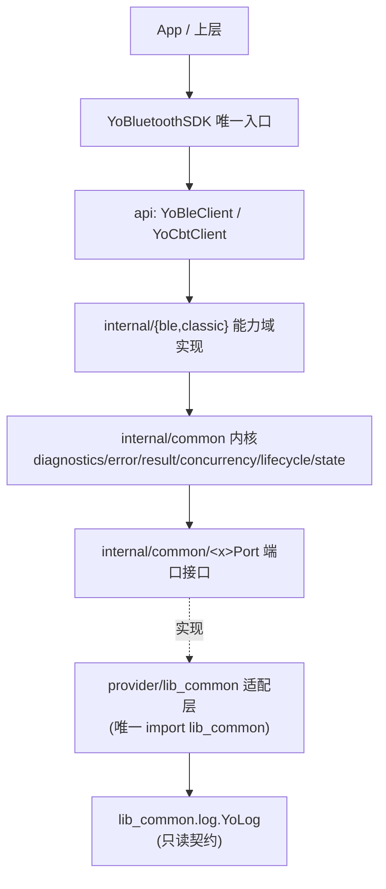

> 历史快照（2026-11 重构前）：本文所述 Provider 安装机制（BluetoothProviderInstaller / setPort）已删除，当前架构见 docs/architecture/2026-11-refactor/design.md。

# lib_bluetooth 架构梳理：需求说明书 + 反思报告 + 润色提示词（v1）

> 适用范围：`lib_bluetooth`（含 `common` / `yoble` / `yocbt` 三域）
> 关注面：**日志总线、异常总线、诊断总线** 三条横切基础设施 + 模块整体架构完备性
> 关联文档：`doc/lib_bluetooth_full_rebuild_prompt_new_architecture.md`（Classic 全量重构）、`doc/ble_01_architecture_design.md`（BLE 架构）
> 本文性质：**先梳理需求、先定提示词，不改业务代码**。它是上述两份文档在「日志 / 异常 / 诊断」横切层的补充与收敛约束。
> 生成日期：2026-11-10

---

## 需求校准（v1.1，2026-11-10 追加，优先于下文冲突表述）

上一版把重点放在“清理冗余/收敛”，方向没错，但表述容易被误读为“打散模块自有架构”。现校准两条铁律：

1. **保留蓝牙模块自身完整、内聚的架构设计与总线**（日志总线 / 异常总线 / 诊断总线 / 事件总线）——不推倒、不碎片化；唯一标准是**严格高内聚、低耦合**。
2. **日志只有“一个模块入口”**：
   - 后端引擎 = `lib_common.log.YoLog`（替代 `android.util.Log`），且只允许经 `provider/lib_common/LogProvider` 接入；
   - 模块内部**每一个需要日志的地方，调用模块自己的日志服务/门面**（`internal/common/diagnostics/YoBluetoothLogger` 及其总线），**不直接 `YoLog.xxx()`**，更不用 `android.util.Log`；
   - 即：`调用点 → 模块日志门面 YoBluetoothLogger → BluetoothLogPort → LogProvider → YoLog`。直调 `YoLog` 只允许出现在 `LogProvider` 一个文件里。

> 一句话：**模块整体用 YoLog 当后端，但模块内不散点直连 YoLog；模块自己的日志/异常/诊断架构要完整保留并做内聚，而不是拆散。**

---

## 实现落地状态（v2，2026-11-10，以代码为准）

- **日志**：已新建 `internal/common/diagnostics/YoBtLogger`，**直接委托** `lib_common.log.YoLog`；已**删除** `YoBluetoothLogger`、`BluetoothLogPort`、`provider/lib_common/LogProvider`、`YoCbtLogger`、`YoCbtLogContext` 等中间/死类——无端口层，符合“不建中间冗余类”。
- **边界**：`provider/lib_common` 仅保留 `PermissionProvider` + `BluetoothProviderInstaller`（权限对接）；`biz_ggec_hs/provider/lib_bluetooth` 作为 **biz→lib 的 Provider** 适配层。
- **Gradle 校验**：新增/加固 `checkLibBluetoothLogSeam`（仅 `YoBtLogger` 可 import `lib_common.log`）与 `checkNoStrayLogging`（禁 `android.util.Log`/`System.out`/`printStackTrace`/散点 `YoLog`）。
- **验证**：`compileDebugJavaWithJavac`、`compileDebugUnitTestJavaWithJavac` 与 4 项边界任务均 `BUILD SUCCESSFUL`。
- **死代码**：本轮清理 63 个冗余/死类（明细见 `docs/00_project_audit.md` 与 `docs/audit/dead_types_round1.txt`、`dead_types_round2.txt`）。
- **待办（下一轮）**：异常总线 `BluetoothDiagnosticsBus`、强类型 `BluetoothEventBus`、BLE/Classic 诊断对称化、业务级防御性补丁清理。

> 下文 Part C/D 中若出现 “`BluetoothLogPort` / `LogProvider`” 链路，视为早期设计草案，**以本落地状态为准**。

---

## Part A · 需求梳理（我们到底要什么）

### A1. 一句话目标

在**保留蓝牙模块自身完整、内聚的架构与总线**的前提下，把日志、异常、诊断三套横切能力做成**单一真相 + 单一模块入口 + Provider 隔离 + 严格高内聚低耦合**的完整体系；
模块整体以 `lib_common` 的 `YoLog` 为唯一日志后端（替代 `android.util.Log`），但模块内所有日志点统一走模块自有日志门面、绝不散点直调 `YoLog`；
清理模块内**重复/死代码**实现（不是拆散模块自有架构）；
BLE 与 Classic 两侧基础设施**对称、可测试、可替换**。

### A2. 为什么现在要梳理（用户原话拆解）

| 用户要求 | 翻译成工程需求 |
|---|---|
| 检查日志总线、异常总线等等 | 审计现存的日志/异常/诊断基础设施，判断是否“体系完备” |
| 有没有一个完整模块的架构设计完善 | 评估三域（common/yoble/yocbt）横切设计是否闭环、是否对称、是否有死代码 |
| 你需要反思 | 给出有证据的自我批判：哪里好、哪里坏、哪里是“为了分层而分层/为写而写” |
| 日志统一用 `lib_common` 的 `YoLog` | 模块整体唯一日志**后端** = `YoLog`（替代 `android.util.Log`）；但日志点走模块自有门面 `YoBluetoothLogger`，不散点直调 `YoLog` |
| 清理冗余其他实现 | 删除死 Logger / 死 LogContext / 死 Trace / 死 Error 类型 |
| 用 Provider 模式调用 `lib_common` 日志服务 | 模块业务层只依赖端口接口，`provider/lib_common` 是**唯一** import `lib_common` 的包 |
| SDK 内部规范自己的架构，严格高内聚低耦合 | 端口/适配器/门面分层，依赖方向单向，域内聚合 |

### A3. 范围

**In Scope**
1. 日志总线：门面、端口、Provider、上下文/追踪贯通、级别与开关单一真源、Tag 规范。
2. 异常总线：Failure/ErrorCode 单一模型、Result 唯一返回类型、异常转译与集中上报、边界兜底。
3. 诊断总线：统一事件时间线、dump 报告、`YoDumpable`，BLE 与 Classic 对称。
4. 跨切约束：包结构、命名、依赖方向、Gradle 校验任务。
5. 冗余/死代码清理清单与迁移映射。

**Out of Scope（本轮不碰）**
- 各能力域功能语义重写（discovery/bond/ACL/SDP/Profile/SPP/GATT 的业务细节）——归 `lib_bluetooth_full_rebuild_prompt_new_architecture.md` 与 `ble_01_architecture_design.md`。
- 应用层适配、旧 API 兼容层。
- `lib_common` 内部日志实现重构（`YoLog` 视为**只读的稳定契约**，只允许消费，不允许改其内部）。

### A4. 硬性约束（不可谈判）

1. **日志后端唯一 = `YoLog`（模块整体用）**：`com.yovo.lib_common.log.YoLog` 是蓝牙模块唯一日志引擎（Logcat + 文件落盘：异步/滚动/保留/降级），替代 `android.util.Log`；但**不得被每个日志点散点直调**——模块内所有日志点只调用模块自有日志门面 `YoBluetoothLogger`，由它经 `BluetoothLogPort → LogProvider` 委托 `YoLog`；直调 `YoLog.*` 只允许出现在 `provider/lib_common/LogProvider.java`。
2. **唯一 Provider 边界**：`com.yovo.lib_bluetooth.provider.lib_common` 是模块内**唯一**允许 `import com.yovo.lib_common.*` 的包；业务/能力域只能依赖 `internal/common/diagnostics/BluetoothLogPort` 等端口。
3. **单一 Failure 模型**：对外 `model/common/Result<T>` + `model/common/Failure`；对内 `internal/common/result/YoResult<T>` + `YoFailure`。两者间**只允许一处**显式映射（`ClassicClientImpl` / `BleClientImpl` 边界），不得出现第三套。
4. **单一 ErrorCode 体系**：`YoErrorCode` 接口为根；`YoCommonErrorCode`、`YoCbtErrorCode`、`YoBleErrorCode` 实现之。禁止另一套与 `YoErrorCode` 无关的枚举。
5. **单一异常总线**：所有“捕获→记录→上报”走同一条 `BluetoothDiagnosticsBus`（见 C3），禁止各处 `printStackTrace` / 裸 `catch` 静默吞。
6. **对称性**：BLE 与 Classic 在日志/异常/诊断三层的**入口形态一致**（同名端口、同名 bus、同名 dump），差异仅体现在 tag 前缀与错误码域。
7. **高内聚低耦合**：端口接口在 `internal/common/*`，实现（Provider）在 `provider/lib_common/*`，业务在 `internal/{ble,classic}/*`，三段不得倒置依赖。
8. **可测试**：横切能力必须有 Fake/Stub（`internal/common/testing`），单测不依赖真机与 `lib_common` 初始化。

### A5. 交付物

1. 本文件（需求 + 反思 + 提示词）。
2. 三份横切架构文档：`common/diagnostics` / 异常总线 / Provider 边界。
3. 代码：日志/异常/诊断基础设施收敛（删除冗余、补端口、补 bus、补 Gradle 校验）。
4. 验收报告：死代码清零清单、依赖方向校验、单测覆盖。

---

## Part B · 现状体检与反思（有证据）

> 方法：只读审查 `lib_bluetooth/src/main/java` 全量，按“日志 / 异常 / 诊断 / 边界”四类取证。以下计数为 grep/import 实测。

### B1. 现状基线

- `lib_bluetooth` 是**多域超大型 SDK**：`internal/` 下按 `common` / `ble` / `classic` 聚合，`classic` 再细分 `device/discovery/pairing/link/service/profiles/spp/protocol/runtime/error/diagnostics/internal` 等 10+ 能力域；`ble` 细分 `scan/connection/gatt/transfer/pairing/channel/peripheral/error/diagnostics` 等。
- 已有两份重量级架构文档（Classic 全量重构 3400+ 行、BLE 架构 259 行），说明**能力域分层设计已有较好骨架**。
- Gradle 已内置两道边界校验：`checkLibBluetoothProviderBoundary`（非 provider 禁止 import `lib_common`）、`checkLibBluetoothApiSurface`（api 目录只允许 `YoBleClient`/`YoCbtClient`，根包只允许 `YoBluetoothSDK`）。**这是全项目最好的设计决策之一。**

### B2. 日志总线现状

**做得对的（保留）**
- 链路已成型：`YoBluetoothLogger` → `BluetoothLogPort`（含 `UNINSTALLED` 兜底）→ `LogProvider.INSTANCE` → `YoLog`。
- `LogProvider` 确实是**唯一** import `YoLog` 的类（全模块 4 处 `import com.yovo.lib_common`，2 处在 `LogProvider`，2 处在 `PermissionProvider`）。
- 全模块**零** `android.util.Log`、零 `System.out/err`、零 `printStackTrace`。基础卫生过关。

**做得不对的（要清理/收敛）**
1. **死 Logger**：`internal/classic/diagnostics/YoCbtLogger.java` 自带 `"YoCbt:"` 前缀与一套重复 API，但 **0 处 import、仅自身引用**，是彻底的死代码。它只会诱使后来者走偏，必须删除。
2. **死 LogContext**：`internal/classic/diagnostics/YoCbtLogContext.java`（connectionId/deviceId/traceId 前缀拼接），**仅自身引用**；而 `YoLog` 本身有 `LogContext`（类 MDC 的 ThreadLocal + `snapshot()` 支持异步）。二者不互通 → **上下文没有真正贯通到落盘日志**。应删除自研 context，统一走 `YoLog.putContext/removeContext/clearContext`。
3. **开关双轨**：`YoBluetoothLogger.enabled`（模块级 boolean）+ `YoLog.isLoggable(LogLevel)`（全局级别），两个开关语义重叠、无优先级约定。
4. **Tag 规范不统一**：`YoCbtLogger` 想加 `YoCbt:` 前缀，但实际全模块用的是 `YoBluetoothLogger(tag,msg)` 自由 tag（`YoCbt:` 前缀根本没生效，因为那个类没人用）。
5. **无 Trace 贯通**：`YoTraceId` 仅 3 处使用；`YoFailure` 自带 traceId，但日志侧不读它 → **错误 traceId 与日志无法对齐**。

### B3. 异常总线现状

**现状：没有“异常总线”，且 Failure 表示至少三套并行。**

- **对外模型**：`model/common/Result<T>` + `model/common/Failure`（抽象）→ `model/classic/CbtFailure`、`model/ble/BleFailure`（+ `CbtErrorCode`、`BleErrorCode`）。API 只 import 这套（实测 `api/*.java` 全部 import `model/common/Result`）。
- **对内模型**：`internal/common/result/YoResult<T>` + `YoFailure`（持 `YoErrorCode` 对象）→ `internal/classic/error/YoCbtFailure`（持 `YoCbtErrorCode`）。internal 侧 35 个文件用 `YoResult`。
- **错误上下文双份**：`internal/common/error/YoErrorContext` 与 `internal/classic/error/YoCbtErrorContext` 并存。
- **异常类型双份**：`YoException`（RuntimeException 包 `YoFailure`）与 `YoCbtException`——两者**各仅 1 处（自身）**，实际没人抛、没人接。
- **死类型清单**（各仅自身 1 处引用 = 未使用）：`YoException`、`YoRecoverability`、`YoCbtErrorContext`、`YoCbtException`、`YoResultCallback`、`YoSuccess`。
- **无集中上报**：失败以 `Result.failure(...)` 返回，异常以 RuntimeException 抛，但**没有统一出口**把“错误码 + 上下文 + 堆栈”同时送到日志/timeline/上层遥测。161 个 `catch` 块各自处理，风格不一。

**结论**：这是“**结果对象有了，总线没有**”——错误能量散落在 161 个 catch 与三套 Failure 里，缺少一个 `recordFailure()` 的汇聚点。

### B4. 诊断总线现状（BLE / Classic 严重不对称）

- **Classic 侧**：`YoCbtConnectionTrace`（按 connectionId 追踪）、`YoCbtDumpReport`、`YoCbtLogContext` **全部仅自身 1 处 = 死代码**；真正跑起来的只有 `YoEventTimeline`（2 处）与 `YoTraceId`（3 处）。
- **BLE 侧**：`YoBleTimelineRecorder`（10 处）+ `YoBleDumpBuilder`（2 处）是活的、成体系的。
- **事件总线不对称**：`YoCbtEventHub`（字符串 key + `Object` 载荷的进程内事件总线）被 11 个 Classic 文件使用；**BLE 侧完全没有对应 `YoBleEventHub`（0 处）**。且 Classic 的 bus 是**弱类型**（`publish(String, Object)`），无编译期约束。
- **公共抽象**：`YoDumpable`（2 处）、`YoEventTimeline`（2 处）已存在，但 Classic 没用起来。

**结论**：诊断能力“BLE 强、Classic 空”，且两域形态不一致；公共 `YoEventTimeline/YoDumpable` 未被 Classic 收编。

### B5. 反思（一句话结论）

> **骨架正确，收敛不足；日志基本统一，异常尚未成“总线”，诊断严重不对称，死代码成堆。**

具体打分（供决策，不作自满）：

| 维度 | 评级 | 说明 |
|---|---|---|
| 日志单一真相 | 🟢 80% | 已统一到 `YoLog`，但残留死 `YoCbtLogger`/死 `YoCbtLogContext` |
| 日志上下文贯通 | 🟡 40% | 未接 `YoLog.LogContext`，traceId 与日志不对齐 |
| 异常总线 | 🔴 25% | 三套 Failure、双份 ErrorContext/Exception、6 个死类型、无汇聚口 |
| 诊断总线 | 🟡 50% | BLE 成形，Classic 空转（死 trace/dump），事件总线弱类型且不覆盖 BLE |
| Provider 边界 | 🟢 90% | Gradle 强校验 + `LogProvider` 唯一 import，做得最好 |
| 高内聚低耦合 | 🟡 60% | 能力域划分不错，横切层（error/diagnostics）内聚差、冗余多 |

### B6. 冗余/死代码清理清单（迁移映射）

| 冗余项 | 证据 | 处置 | 迁移到 |
|---|---|---|---|
| `internal/classic/diagnostics/YoCbtLogger.java` | 0 import | **删除** | 统一用 `YoBluetoothLogger`（模块自有日志门面） |
| `internal/classic/diagnostics/YoCbtLogContext.java` | 仅自身 | **删除** | `YoLog.putContext/clearContext` + `YoTraceId` |
| `internal/classic/diagnostics/YoCbtConnectionTrace.java` | 仅自身 | **删除** | `YoEventTimeline` / 诊断总线 |
| `internal/classic/diagnostics/YoCbtDumpReport.java` | 仅自身 | **删除或重写** | `YoDumpable` + 统一 dump |
| `internal/common/error/YoException.java` | 仅自身 | **删除或收编** | 异常总线边界 `BluetoothDiagnosticsBus` |
| `internal/common/error/YoRecoverability.java` | 仅自身 | **删除或并入 ErrorCode** | `YoErrorCode` 携带 recoverable/retryable |
| `internal/classic/error/YoCbtErrorContext.java` | 仅自身 | **删除** | 统一 `YoErrorContext` |
| `internal/classic/error/YoCbtException.java` | 仅自身 | **删除** | 统一 `YoException`（若保留）或 bus |
| `internal/common/result/YoResultCallback.java` | 仅自身 | **删除** | 现有 `YoResult` 回调即可 |
| `internal/common/result/YoSuccess.java` | 仅自身 | **删除** | `YoResult.success(...)` |
| `YoCbtEventHub`（弱类型） | 11 处 Classic，BLE 无 | **升级为强类型 + 上移 common** | `internal/common/diagnostics/BluetoothEventBus`（泛型/密封事件） |

---

## Part C · 目标架构设计（三条总线 + 一个 Provider 边界）

### C1. 分层与依赖方向（唯一允许的方向）



**禁止**：`common → ble/classic`、`ble ↔ classic`、`业务 → lib_common`（除 provider）、`api → internal`、`provider → 业务`。

### C2. 日志总线（Log Bus）——保留模块自有架构，只收敛入口

**定位**：日志总线是蓝牙模块**自有的完整横切架构**，**保留并强化**；不是外挂、也不打散。三层职责单向：

```text
调用点(业务/能力域) → 模块日志门面 YoBluetoothLogger(模块自有日志服务/总线)
                    → BluetoothLogPort(端口)
                    → LogProvider(唯一适配)
                    → YoLog(唯一后端引擎, 替代 android.util.Log)
```

规则：

- **唯一模块门面**：`internal/common/diagnostics/YoBluetoothLogger` 是模块内**所有**日志点的唯一入口（保留现有类名，不新造 `BluetoothLog`）。业务/能力域只调它，**不调 `YoLog`、不用 `android.util.Log`**。
- **唯一 YoLog 适配点**：仅 `provider/lib_common/LogProvider.java` 可 `YoLog.*`；全模块其余文件 `YoLog.` 直调数必须为 0。
- **级别单一真源**：以 `YoLog.isLoggable(LogLevel)` 为准；模块级 `enabled` 仅作降噪兜底（`false` 全静默；`true` 再按 `YoLog` 级别过滤）。
- **上下文贯通**：`YoBluetoothLogger` 提供 `withContext(deviceId, connectionId, traceId, profileType)` 作用域，内部转调 `YoLog.putContext/removeContext` 并在异步线程前 `snapshot`（只消费 `YoLog` 公开 API，不改其内部）。
- **Trace 对齐**：`YoCbtFailure.traceId` 与日志上下文 `traceId` 同源（`YoTraceId`），可按 trace 串起“错误 + 日志”。
- **Tag 规范**：统一由门面自动拼 `YoBluetooth`(全局) / `YoCbt:` / `YoBle:` 前缀，禁止手写自由 tag。
- **只清理重复/死代码**：删除重复的第二套 logger `YoCbtLogger` 与自研 `YoCbtLogContext`（它们是旁路，不是模块日志架构的组成）；`YoBluetoothLogger + BluetoothLogPort + LogProvider` 这套**模块自有日志架构完整保留**。

### C3. 异常总线（Exception / Failure Bus）

**定义**：`internal/common/diagnostics/BluetoothDiagnosticsBus`（或拆 `BluetoothErrorBus`），是“捕获→记录→上报”的**唯一汇聚口**。

统一模型（收敛为两套，边界一处映射）：

```text
对外:  model/common/Result<T>  + model/common/Failure(抽象)  + CbtFailure/BleFailure
对内:  YoResult<T>             + YoFailure(基类)             + YoCbtFailure/YoBleFailure
错误码: YoErrorCode(接口) ← YoCommonErrorCode / YoCbtErrorCode / YoBleErrorCode
```

Bus 接口（示意）：

```java
public interface BluetoothDiagnosticsBus {
    void recordFailure(YoFailure failure);          // 统一：写日志(error 级) + 追加 timeline + 通知观察者
    void recordEvent(String type, Object payload);   // 领域事件（替换弱类型 EventHub 的 publish）
    void recordException(String tag, Throwable t, YoErrorContext ctx); // 未预期异常兜底
    List<TimelineEvent> timeline();                  // 供 dump 报告
    String dumpReport();                             // 结构化诊断快照
    void addFailureObserver(YoFailureObserver o);    // 供上层遥测（可选）
}
```

规则：
1. **任何 `catch` 都必须经过 Bus**：要么 `recordFailure`（可恢复/已处理），要么 `recordException` + 继续抛（不可恢复）。
2. **边界兜底**：`ClassicClientImpl` / `BleClientImpl` / 各 `*Platform` 回调是第一道边界，负责把平台异常 translate 成 `YoFailure` 并 `recordFailure`。
3. **失败上报幂等**：同一 `YoFailure` 只上报一次（按 traceId 去重），避免 161 个 catch 重复刷屏。
4. **删除** `YoException`/`YoCbtException`/`YoCbtErrorContext`/`YoCbtRecoverability` 等死类型；异常只保留一条链：`YoFailure` → `BluetoothDiagnosticsBus`。

### C4. 诊断总线（Diagnostic Bus）

- **统一时间线**：全模块用 `YoEventTimeline`（有容量上限、线程安全）；Classic 的 `YoCbtConnectionTrace`/`YoCbtDumpReport` 收编进来，删除自研实现。
- **统一 dump**：实现 `YoDumpable` 的组件可被 `client.exportDiagnosticReport()` 汇总；BLE 的 `YoBleDumpBuilder` 与 Classic 重写后的 dump 走同一 `BleDiagnosticReport`/`CbtDiagnosticReport` 结构约定。
- **事件总线强类型化**：把 `YoCbtEventHub`（`String + Object`）升级为 `BluetoothEventBus`（泛型/密封事件类），上移 `internal/common/diagnostics`，**BLE 与 Classic 共用**。
- **对称性要求**：BLE 与 Classic 都必须有 `timeline + dump + eventBus` 三件套，形态一致。

### C5. 包结构与命名规范

```text
internal/common/
├── diagnostics/
│   ├── YoBluetoothLogger.java     # 模块自有日志门面（保留，强化：上下文/级别/Tag）
│   ├── BluetoothLogPort.java      # 日志端口（保留）
│   ├── BluetoothDiagnosticsBus.java
│   ├── BluetoothEventBus.java     # 强类型事件总线（原 YoCbtEventHub 上移）
│   ├── YoEventTimeline.java
│   ├── YoDumpable.java
│   ├── YoTraceId.java
│   └── LogContextScope.java       # 基于 YoLog.putContext 的便捷封装
├── error/
│   ├── YoErrorCode.java           # 根接口（保留）
│   ├── YoCommonErrorCode.java
│   └── YoErrorContext.java        # 唯一上下文（删除 YoCbtErrorContext）
├── result/
│   ├── YoResult.java / YoFailure.java
└── testing/                       # FakeLogPort / FakeDiagnosticsBus / FakeEventBus

provider/lib_common/
├── LogProvider.java               # 唯一 import YoLog
├── DiagnosticsProvider.java       # （新增）Bus 落地 YoLog + 文件
└── PermissionProvider.java
```

命名禁令（沿用主文档附录 D）：能力域前缀统一 `YoCbt` / `YoBle` / `YoBluetooth`；禁止 `CbtXxx`、`BtXxx`、`BlueXxx`、`YoClassicXxx`。

### C6. 不变式清单（Invariants，可直接写单测）

1. `lib_bluetooth` 非 `provider/lib_common/**` 下 `import com.yovo.lib_common` 数量 == 0（Gradle 已校验）；且除 `provider/lib_common/LogProvider.java` 外，全模块 `YoLog.` 直调 == 0（所有日志点只经 `YoBluetoothLogger`）。
2. 全模块 `android.util.Log` / `System.out` / `System.err` / `printStackTrace` 数量 == 0（Gradle 新增校验）。
3. 日志无 `YoCbtLogger` / `YoCbtLogContext` 引用（清理后）。
4. `Failure` 家族只有 `model/common/*` 与 `internal/common/result/*` 两套，无第三套。
5. 每个 `catch` 都能追到 `BluetoothDiagnosticsBus.record*`（可静态扫描或 code review checklist）。
6. BLE 与 Classic 的 diagnostics 目录结构对称（`timeline/dump/eventBus` 均有）。
7. `YoErrorCode` 的实现清单 == `{YoCommonErrorCode, YoCbtErrorCode, YoBleErrorCode}`，无游离枚举。
8. 每个 `YoFailure` 的 `traceId` 可在 `YoLog` 落盘文件中检索到（端到端可追）。

---

## Part D · 润色后的提示词（可直接交给执行 Agent）

> 以下为定稿提示词。请连同本文件 Part B/C 证据一起交付。

```text
# 角色
你是 lib_bluetooth（Android 蓝牙 SDK）的架构收敛工程师。你只做“横切基础设施收敛”，
不做能力域功能重写；产物是代码 + 架构文档 + 验收报告。

# 任务
在保留蓝牙模块自身完整、内聚架构与总线的前提下，审计并加固 lib_bluetooth 的
【日志总线 / 异常总线 / 诊断总线】三条横切能力：模块整体以 YoLog 为唯一日志后端
（替代 android.util.Log），模块内所有日志点统一走模块自有门面 YoBluetoothLogger、
不散点直调 YoLog；只清理重复/死实现（不拆散模块自有架构）；使 BLE 与 Classic
两侧基础设施对称、可测试、可替换，严格高内聚低耦合。

# 已知现状（作为你的起点，不要重复取证，但要复核）
- 死代码：YoCbtLogger、YoCbtLogContext、YoCbtConnectionTrace、YoCbtDumpReport 各仅自身引用；
  YoException、YoRecoverability、YoCbtErrorContext、YoCbtException、YoResultCallback、YoSuccess 各仅自身引用。
- 日志已统一：YoBluetoothLogger → BluetoothLogPort → LogProvider → YoLog（38 文件引用）。
- 异常未成总线：3 套 Failure（model/common、internal/common/result、internal/classic/error），双份 ErrorContext/Exception。
- 诊断不对称：BLE 有 YoBleTimelineRecorder/YoBleDumpBuilder；Classic 的 trace/dump 是死的；YoCbtEventHub 弱类型且 BLE 无对应。
- 边界已经很稳：Gradle 的 checkLibBluetoothProviderBoundary / checkLibBluetoothApiSurface 必须保留并加强。

# 硬性约束
1. 日志后端唯一 = com.yovo.lib_common.log.YoLog（模块整体用它替代 android.util.Log；只消费，不改其内部）；但业务/能力域严禁散点直调 YoLog——直调只允许出现在 provider/lib_common/LogProvider.java。
2. 模块自有日志门面唯一 = internal/common/diagnostics/YoBluetoothLogger（经 BluetoothLogPort → LogProvider → YoLog）；模块内所有日志点只调它；模块自有日志/异常/诊断/事件总线架构完整保留并做内聚。provider/lib_common 是唯一允许 import com.yovo.lib_common 的包。
3. 对外 Result/Failure 与对内 YoResult/YoFailure 之间只允许一处显式映射。
4. 错误码根接口 YoErrorCode；实现仅 YoCommonErrorCode / YoCbtErrorCode / YoBleErrorCode。
5. 异常只保留一条链：YoFailure → BluetoothDiagnosticsBus（recordFailure / recordException）。
6. BLE 与 Classic 的 diagnostics 三件套（timeline / dump / eventBus）必须对称。
7. 禁止 android.util.Log / System.out / System.err / printStackTrace。
8. 不兼容旧内部实现；删除旧死代码时不保留 wrapper/桥接。
9. 每个结论必须有文件路径 + 类名 + 行号级证据。

# 执行顺序
阶段 0 只读冻结：不写业务代码。
阶段 1 复核取证：产出 docs/00_project_audit.md（死代码清单 + 依赖矩阵 + catch 分布）。
阶段 2 文档先行：产出
   - docs/30_log_bus_architecture.md
   - docs/31_error_bus_architecture.md
   - docs/32_diagnostics_bus_architecture.md
   - docs/33_provider_boundary.md
   每份含：职责、端口、实现、数据流、错误流、线程/上下文、测试方案、未验证项。
阶段 3 代码收敛：
   a) 删除 B6 死代码清单全部条目；
   b) 新增 BluetoothDiagnosticsBus + BluetoothEventBus（泛型/密封事件，上移 common）；
   c) 强化模块自有日志门面 YoBluetoothLogger（保留类名；接 YoLog.LogContext / 级别；不散点直调 YoLog）；
   d) 边界（*ClientImpl / *Platform 回调）统一 recordFailure/recordException；
   e) BLE/Classic diagnostics 对称补齐；删除弱类型 YoCbtEventHub。
阶段 4 校验：新增 Gradle 任务 checkNoStrayLogging（禁 android.util.Log/System.out/printStackTrace），
   与现有两道边界任务一起挂到 check。
阶段 5 测试：internal/common/testing 增 FakeLogPort / FakeDiagnosticsBus / FakeEventBus；
   补单测覆盖 C6 八条不变式。
阶段 6 验收报告：docs/34_verification_report.md（死代码清零、Gradle 通过、单测通过、未验证项）。

# 验收标准
- C6 全部不变式通过（可用单测/Gradle 断言）。
- B6 死代码清单零残留。
- BLE/Classic diagnostics 目录对称。
- 无第三套 Failure、无游离 ErrorCode。
- 所有 catch 可追溯至 DiagnosticsBus。
- 架构文档 4 份齐备，且每份含证据与未验证项。

# 禁止
- 不做最小兼容补丁；不为旧死代码留 wrapper；不把横切逻辑塞进能力域；不引入新的自研 Logger/ErrorContext。
- 不在架构文档确认前动业务代码（能力域功能重写属另一份提示词范围）。

# 第一次响应
先声明进入“横切基础设施收敛只读审查阶段”，列出你将复核的证据范围与将产出的 4 份文档，
不要写任何业务代码。
```

---

## Part E · 验收清单（Definition of Done）

- [ ] 模块自有日志/异常/诊断/事件总线架构**完整保留并内聚**（未被打散）；仅删除重复旁路 `YoCbtLogger` / `YoCbtLogContext` / `YoCbtConnectionTrace` / `YoCbtDumpReport`。
- [ ] `YoException` / `YoRecoverability` / `YoCbtErrorContext` / `YoCbtException` / `YoResultCallback` / `YoSuccess` 已删除或收编。
- [ ] `BluetoothDiagnosticsBus` + `BluetoothEventBus` 已落地，BLE/Classic 共用。
- [ ] `YoBluetoothLogger` 接 `YoLog.LogContext` 与 `YoLog.isLoggable`，traceId 端到端可追。
- [ ] 除 `provider/lib_common/LogProvider.java` 外，全模块 `YoLog.` 直调为 0，`android.util.Log` 为 0。
- [ ] Gradle `checkNoStrayLogging` 通过（0 处 android.util.Log / System.out / printStackTrace）。
- [ ] 现有 `checkLibBluetoothProviderBoundary` / `checkLibBluetoothApiSurface` 仍通过。
- [ ] C6 八条不变式有单测。
- [ ] 4 份横切架构文档 + 1 份验收报告入库。
- [ ] 无新增自研 Logger / ErrorContext / 弱类型 EventHub。
