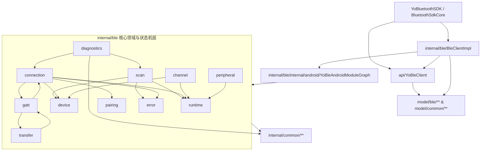

# BLE 模块全量架构设计文档 (`ble_01_architecture_design`)

> 日期：2026-11-10  
> 目标：以 **能力域优先 + 端口/适配器 + 运行时组件** 重建 `lib_bluetooth` 的 BLE（`yoble`）模块，对标 `yocbt`（Classic）与 Nordic / Weliem / Polidea 标杆架构。

---

## 1. 设计总则与强制约束

1. **三模块正交边界**：
   - `common/`：跨 Classic / BLE 稳定复用内核（`YoBluetoothAdapterProvider`、`YoBluetoothCapabilityChecker`、`YoBluetoothStateObserver`、`YoBluetoothPermissionChecker`、`YoExecutors`、`YoStateMachine`、`YoCloseGuard`、`YoEventTimeline`、`YoDumpable`、`YoBluetoothLogger` 等）。
   - `yoble`（`model/ble/**` + `api/YoBleClient` + `internal/ble/**`）：所有 BLE 专属能力（AD 解析、扫描过滤与限流、GATT 连接与重连状态机、串行与优先级队列、Notify/Indicate 多播、长包分片与合包、请求响应协调、ReliableWrite、MTU/PHY/ConnPriority/RSSI、Bond、L2CAP CoC、Advertiser + GATT Server、HCI/GATT 状态映射与诊断）。
   - **禁止**：`yoble` 不得 `import com.yovo.lib_bluetooth.internal.classic.*` 或 `model.classic.*`；`yocbt` 不得 `import` `yoble`；`api/YoBleClient` 与 `model/ble/**` **严禁出现 `android.bluetooth.*`、`android.content.Context`、`BroadcastReceiver`、`Intent`、`internal.*`**。
2. **Gradle API 门面约束（`lib_bluetooth/build.gradle`）**：
   - `com.yovo.lib_bluetooth` 根包仅保留 `YoBluetoothSDK.java`；
   - `com.yovo.lib_bluetooth.api` 仅保留 `YoBleClient.java` 与 `YoCbtClient.java`；
   - `api/*.java` 禁止 `import com.yovo.lib_bluetooth.internal.*`；
   - 非 `provider/lib_common/**` 禁止直接 `import com.yovo.lib_common.*`。
3. **反对“为了划分而划分”的包组织规则**：
   - 每个子包必须对应清晰的能力域、协议层或平台边界，且包内包含一组强相关协作文件，不创建无意义的单一文件子包（参考 `lib_bluetooth_full_rebuild_prompt_new_architecture.md:169-219`）。
4. **线程与生命周期不变式**：
   - `YoBleRuntime` 提供四类职责清晰的执行环境：
     - `stateExecutor`（单线程 `yo-ble-state`）：所有会话状态机、扫描状态、队列出队/完成、路由表、缓存读写**严格在 State 线程串行执行**，无锁零竞态，并支持 `checkStateThread()` 断言；
     - `ioExecutor`（定长池 `yo-ble-io`）：专用于有界阻塞操作（例如 L2CAP 建连）；每条 L2CAP 通道的读循环使用自己的守护线程，避免占满 IO 池；
     - `scheduler`（单线程定时 `yo-ble-scheduler`）：专用于超时定时器、扫描 Lost 检测、退避重连延迟、Android 13 PHY 回调兜底、ConnectionPriority 回调兜底；到期任务回到 state 线程；
     - `callbackDispatcher`：默认主线程 `MainLooper`，可通过配置切换至专用单线程回调执行器 `yo-ble-callback`；
   - 领域可变状态只在 state 线程改写。跨线程只读快照仓库和队列已发布的 pending 计数。`release()` 幂等且非阻塞：组件先在 state 线程收口，运行时排空剩余 state 任务后关闭执行器，不等待线程结束。用户回调异常不吞掉。

---

## 2. 包结构与依赖方向

### 2.1 目标目录拓扑

```text
com.yovo.lib_bluetooth
├── YoBluetoothSDK.java                  # 唯一静态入口（不变）
├── api/
│   └── YoBleClient.java                 # 统一 BLE 公开门面（全量重建）
├── model/ble/                           # 全部公开不可变值对象/配置/观察者/错误模型（零 android.bluetooth.*）
│   ├── BleConfig.java
│   ├── BleErrorCode.java
│   ├── BleFailure.java
│   ├── BleOperationHandle.java          # 支持 cancel() 与 release() 双方法名（内部委派同一幂等逻辑）
│   ├── BleDeviceId.java
│   ├── BleAddressType.java              # PUBLIC / RANDOM_STATIC / RESOLVABLE_PRIVATE / NON_RESOLVABLE_PRIVATE / UNKNOWN
│   ├── BleDeviceType.java               # LE / DUAL / CLASSIC / UNKNOWN
│   ├── BleBondState.java                # NONE / BONDING / BONDED / UNKNOWN
│   ├── BleDeviceIdentity.java
│   ├── BleDeviceSnapshot.java           # 设备聚合快照（身份/RSSI/广播/配对/连接/MTU/PHY/GATT摘要）
│   ├── BleScanFilter.java               # MAC/Name/NameSubstring/ServiceUuid(+Mask)/SolicitationUuid(+Mask)/ServiceData/ManufacturerData/MinRssi/Connectable
│   ├── BleScanConfig.java               # ScanMode/CallbackType/MatchMode/NumOfMatches/Timeout/ReportDelay/LegacyOnly/Phy/Filters/ThrottlePolicy
│   ├── BleScanRecord.java               # AD TLV 解析模型（Flags/UUIDs/Solicitation/ServiceData/ManufacturerData/TxPower/LocalName/Raw）
│   ├── BleScanResult.java               # Identity + RSSI + ScanRecord + CallbackType + Phy + Connectable + Timestamp + AdvertisingSid
│   ├── BleScanObserver.java
│   ├── BleConnectionState.java          # IDLE/CONNECTING/CONNECTED/BONDING_WAIT/DISCOVERING_SERVICES/INITIALIZING/READY/DISCONNECTING/DISCONNECTED/FAILED
│   ├── BleConnectionConfig.java         # autoConnect/directConnectFallbackTimeout/retryCount/backoff/preferredPhy/requestMtu/autoDiscoverServices/refreshCacheOnConnect/bondPolicy/operationTimeout
│   ├── BlePhy.java / BlePhyOptions.java
│   ├── BleConnectionPriority.java       # BALANCED / HIGH / LOW_POWER / DCK
│   ├── BleConnectionParameters.java     # intervalMs / latency / supervisionTimeoutMs
│   ├── BleConnectionSnapshot.java       # DeviceId / State / Connected / Ready / Mtu / MaxPayloadBytes / TxPhy / RxPhy / ConnectionParameters / BondState / LastRssi / RetryCount / Failure / UpdatedAt
│   ├── BleConnectionObserver.java
│   ├── BleWriteType.java                # WITH_RESPONSE / WITHOUT_RESPONSE / SIGNED
│   ├── BleNotificationSetupMode.java    # DEFAULT / COMPAT / QUICK_SETUP
│   ├── BleGattTarget.java               # serviceUuid / serviceInstanceId / characteristicUuid / characteristicInstanceId / descriptorUuid
│   ├── BleGattDescriptorInfo.java
│   ├── BleGattCharacteristicInfo.java   # UUID/InstanceId/Properties/Permissions/Descriptors + isReadable/isWritable/isNotify/isIndicate
│   ├── BleGattServiceInfo.java          # UUID/InstanceId/Type(PRIMARY/SECONDARY)/Characteristics/IncludedServices
│   ├── BleGattDatabaseSnapshot.java     # 设备完整 GATT 树快照 + 查找辅助
│   ├── BleGattObserver.java             # onRead / onWrite / onDescriptorRead / onDescriptorWrite / onNotifyChanged / onCharacteristicChanged / onFailed
│   ├── BleNotificationObserver.java     # 独立 Notify/Indicate 数据回调 + onEnabled / onDisabled / onError
│   ├── BleDataSplitter.java             # 分片策略接口（默认 MTU 512 限制分片）
│   ├── BleDataMerger.java               # 合包策略接口（流式帧合并）
│   ├── BleTransferProgressObserver.java # 长包传输每片进度/完成/失败回调
│   ├── BleRequestResponseConfig.java    # 触发写入 + 等待 Notify/Indicate 响应匹配与超时配置
│   ├── BleAdapterState.java             # 适配器状态，不暴露 Android 整型
│   ├── BleAdapterStateObserver.java
│   ├── BleL2capChannelObserver.java     # API 29+ L2CAP CoC 通道回调
│   ├── BleL2capChannelHandle.java       # L2CAP 同步写、异步写与关闭句柄
│   ├── BleL2capServerObserver.java      # 系统分配 PSM 的 L2CAP 服务端回调
│   ├── BleAdvertiseConfig.java          # Legacy + Extended AdvertisingSet 参数
│   ├── BleAdvertiseData.java            # Broadcast 载荷（ServiceUUIDs/ServiceData/ManufacturerData/IncludeDeviceName/TxPower）
│   ├── BleAdvertiseObserver.java
│   ├── BleGattServerConfig.java         # Service 定义列表（含 Per-Client Shared/Private 标志）
│   ├── BleGattServerObserver.java       # Server 连接/读写/Notify 确认回调
│   ├── BleValueObserver.java            # 通用异步 Result<T> 回调（MTU/PHY/RSSI/Discovery/Bond/L2CAP 等）
│   └── BleDiagnosticReport.java         # 结构化只读诊断报告快照（状态摘要+事件时间线+dump文本）
└── internal/ble/
    ├── BleClientImpl.java               # YoBleClient 门面实现，委派 YoBleModuleCore
    ├── YoBleModuleCore.java             # 组装扫描、连接、配对、L2CAP、外设，并转发适配器与配对广播
    ├── runtime/                         # YoBleRuntime, YoBleRuntimeConfig, YoBleReleaseCoordinator
    ├── error/                           # YoBleErrorMapper, YoBleGattStatus, YoBleHciStatus, YoBleScanAdvertiseStatus
    ├── device/                          # YoBleDeviceSnapshotStore, YoBleCapabilityInspector
    ├── scan/                            # YoBleScanPlatform, YoBleScanController, YoBleScanRecordParser, YoBleScanFilterMatcher, YoBleScanCallbackEmulator, YoBleScanThrottleGuard
    ├── connection/                      # YoBleConnectionPlatform, YoBleConnectionManager, YoBleGattSession, YoBleConnectionStateMachine, YoBleReconnectPolicy
    ├── gatt/                            # YoBleGattOperationQueue, YoBleServiceDiscoveryManager, YoBleNotificationRouter, YoBleLinkTuner, YoBleReliableWriteCoordinator
    ├── transfer/                        # YoBleMtuPayloadCalculator, YoBleDefaultDataSplitter, YoBleLongWriteCoordinator, YoBleRequestResponseCoordinator
    ├── pairing/                         # YoBleBondPlatform, YoBleBondController
    ├── channel/                         # YoBleL2capPlatform, YoBleL2capManager
    ├── peripheral/                      # YoBlePeripheralPlatform, YoBlePeripheralManager
    ├── diagnostics/                     # YoBleDiagnosticsCollector, YoBleDumpBuilder
    ├── internal/android/                # 全部分离隔离的 Android Framework 适配（禁止单一文件无意义子包）
    │   ├── YoBleAndroidModuleGraph.java
    │   ├── YoBleAndroidScanPlatform.java
    │   ├── YoBleAndroidBondPlatform.java
    │   ├── YoBleAndroidL2capPlatform.java
    │   ├── YoBleAndroidPeripheralPlatform.java
    │   ├── compat/                      # YoBleGattCompat (API 24-37 read/write/notify/serviceChanged), YoBleScanCompat, YoBleAdvertiseCompat, YoBleL2capCompat
    │   ├── hiddenapi/                   # YoBleHiddenApiPolicy, YoBleGattCacheRefresher, YoBleBondReflection
    │   ├── receiver/                    # YoBleAndroidReceiverRegistry, YoBleAdapterStateReceiver, YoBleBondStateReceiver
    │   └── gatt/                        # YoBleAndroidConnectionPlatform, YoBleAndroidGattCallbackBridge, YoBleAndroidGattTransport
```

### 2.2 模块依赖方向图



---

## 3. 核心能力域设计要点

### 3.1 扫描域 (`scan/`) 与 AD 解析
1. **订阅式扫描与进程内单扫描器 (`YoBleScanHub`)**：
   - 门面只暴露 `subscribeScan(observer)`，返回 `BleOperationHandle`；调用方 `cancel()` 该句柄即退订。扫描策略由库单点决定（`YoBleScanDefaults`），调用方不传扫描配置，也没有独立的停止入口：停止由订阅句柄的取消驱动。
   - `YoBleScanHub` 是进程内唯一的扫描会话所有者：**首个订阅者启动引擎、最后一个取消后停止**；订阅者之间共享同一个引擎与同一份 `onScanStarted`/`onDeviceFound`/`onBatchScanResults`/`onScanResultLost`/`onScanFailed` 投递。
   - **无产品扫描超时**：`timeoutMillis = 0`，扫描只在订阅者全部离开时停；只有平台内部 25 分钟长扫重启这一条时间约束。
   - **设备级 lost**：单台设备末次广播后超过 `MATCH_LOST_TIMEOUT_MILLIS`（约 10s）即回调 `onScanResultLost` 并从聚合结果中移除，这是设备级过期语义，不是产品扫描超时。
   - 引擎失败**不销毁会话**：只把会话置为 `STOPPED` 并保留订阅者，引擎自行恢复后继续向同一批订阅者投递；下一次订阅重启引擎。
   - **停扫终态按发起代次归属**：每次启动都把回调入口绑定到该代次，作废代次的 `onScanStopped` 被吸收——不改变当前会话状态、不分发给订阅者；`onScanFailed` 的丢弃同样按代次判定（不是按「会话是否已 `STOPPED`」），停扫窗口内新代次的真实失败仍送达订阅者。
   - 锁归属：Hub 的锁只保护会话状态与订阅者集合，持有期间不调用引擎、不投递订阅者回调；启动在锁外进行，再按「代次 + 归属」二次确认后才进入 `RUNNING`，作废的启动由同一个线程补偿停扫；停扫与补偿启动由 Hub 的会话迁移单线程在锁外推进，订阅句柄的取消调用栈上既不调用引擎、也不分发业务回调。
2. **Preflight 检查（对标 RxAndroidBle & Android-Scanner-Compat）**：
   - 校验硬件支持 `FEATURE_BLUETOOTH_LE`（非“关闭 BT 返回 null”）；
   - 校验适配器状态 `STATE_ON`（返回 `BLUETOOTH_DISABLED`）；
   - API < 31 校验 `BLUETOOTH_SCAN`（兼容旧蓝牙权限）+ `LOCATION` 权限 + 系统位置开关（若未设豁免且 Location 开关关闭，精准返回 `LOCATION_SERVICES_DISABLED`，而非泛化 `SCAN_START_FAILED`）；
   - API >= 31 校验 `BLUETOOTH_SCAN`（Manifest 已声明 `neverForLocation`）。
3. **Android 7+ 5-in-30s 防限流保护 (`YoBleScanThrottleGuard`)**：
   - 使用滑窗记录最近 5 次底层 `startScan` 时间戳；若 30 秒内即将触达第 5 次，提供配置化策略：
     - `FAIL_FAST`：提前拦截并返回可恢复错误 `SCAN_THROTTLED`（附建议等待毫秒）；
     - `DELAY_UNTIL_WINDOW_FREE`（默认）：自动通过 `scheduler` 延迟至滑窗释放窗口后再调用底层 `startScan`；
     - 同一引擎上重新启动扫描（失败恢复或订阅重建）时先原子取消旧扫描（含超时任务 `YoTimeoutHandle`）并释放句柄。
4. **AD TLV 完整解析 (`YoBleScanRecordParser`)**：
   - 完整解码 AD Type：`0x01` Flags、`0x02/0x03` 16-bit UUIDs、`0x04/0x05` 32-bit UUIDs、`0x06/0x07` 128-bit UUIDs、`0x08/0x09` Short/Complete Local Name、`0x0A` TxPower、`0x14` 16-bit Service Solicitation UUIDs、`0x15` 128-bit Service Solicitation UUIDs、`0x1F` 32-bit Service Solicitation UUIDs、`0x16/0x20/0x21` 16/32/128-bit Service Data、`0xFF` Manufacturer Specific Data。
   - 对异常截断长度安全防御，绝不抛 `ArrayIndexOutOfBoundsException`。
5. **软硬协同过滤 + 回调模式仿真 (`YoBleScanFilterMatcher` & `YoBleScanCallbackEmulator`)**：
   - 支持硬件下推 `ScanFilter`，同时在软件侧精准补齐：Device Name 正则/子串、Service UUID + Mask、Service Solicitation UUID + Mask、Service Data + Mask、Manufacturer Data + Mask、Min RSSI、RequireConnectable；
   - 支持 `CALLBACK_TYPE_ALL_MATCHES`、`CALLBACK_TYPE_FIRST_MATCH`、`CALLBACK_TYPE_MATCH_LOST` 跨版本仿真与周期清理定时器、重复结果节流去重（`deduplicationWindowMillis`）以及批处理 `flushBatchScanResults()`。
6. **软件批处理与长扫描重启**：`reportDelayMillis > 0` 且硬件不支持 offload batching，或平台返回 `SCAN_FAILED_FEATURE_UNSUPPORTED` 时，以 delay 0 启动扫描，结果在 state 线程按该间隔聚合成 `onBatchScanResults`。`MATCH_LOST` 清扫仍立即回调。超时为 0 或大于 25 分钟时，每 25 分钟停掉平台扫描再拉起，不计入 5-in-30s 限流，也不再次回调 `onScanStarted`。
7. **适配器状态**：`YoBleModuleCore` 发布 `BleAdapterState`。`OFF` 与 `TURNING_OFF` 仍清理扫描、连接、配对、L2CAP 和外设。`observeAdapterState` 订阅时先回放当前状态。

### 3.2 连接与会话状态机 (`connection/`)
1. **严谨的状态机 (`YoBleConnectionStateMachine` 封装 `YoStateMachine<BleConnectionState>`)**：
   - 状态集合：
     `IDLE -> CONNECTING -> CONNECTED -> [BONDING_WAIT] -> DISCOVERING_SERVICES -> INITIALIZING -> READY -> DISCONNECTING -> DISCONNECTED`；任意活跃态在不可恢复异常/超时后进入 `FAILED`。
   - **区分断开语义**：
     - 本地主动调用 `disconnect()`：经 `DISCONNECTING` -> `DISCONNECTED`（正常收尾）；
     - 远端主动断连 (`HCI 0x13 REMOTE_USER_TERMINATED`) / 链路超时丢包 (`HCI 0x08 CONNECTION_TIMEOUT`)：精准透传对应 `BleErrorCode` 与 `rawStatusCode`；
     - 蓝牙适配器全局关闭 (`ACTION_STATE_CHANGED -> STATE_OFF / STATE_TURNING_OFF`)：立即强制清理所有在途 `BluetoothGatt`（解决 Pixel 等设备 BT 关闭不回调 `onConnectionStateChange` 的经典坑）并触发 `DISCONNECTED` + `BLUETOOTH_DISABLED` 原因。
2. **连接稳定性与自动重连 (`YoBleReconnectPolicy`)**：
   - 支持配置 `maxRetries` + 指数退避延迟（`retryDelayMillis`），针对瞬态连接失败（如著名的 **GATT 133 (`0x85`)**、`0x3E HCI_CONN_FAIL_TO_ESTABLISH`、`connectGatt == null`）先关闭释放、强制等待 **`closeDelayMillis` (默认 200ms，对齐 RxAndroidBle/Nordic 实践)** 再发起重试。
   - **AutoConnect**：`autoConnect=false` 时每次直连，带连接超时和有限次重试，链路丢失即终态。`autoConnect=true` 时第一次仍是带超时的直连；进入 `READY` 之后的意外丢链改为 `connectGatt(autoConnect=true)`，库不再加连接超时，退避也不计入 `maxRetryCount`，直到用户断开、适配器关闭或 `release()`。用户断开先进入 `DISCONNECTING`，等断开回调或约 2 秒后再 `close()`。
   - **Bond 并发协同**：若策略要求连接前/中确保加密（`ENSURE_BONDED`）或远端已处于 `BOND_BONDED`，在发现服务前预留可配置的 `bondedDiscoveryDelayMillis`（对标 blessed-android，避免系统正在协商加密 Key 时提前发 GATT PDU 引发竞态）。

### 3.3 GATT 操作队列、服务发现与 Notification 多播路由 (`gatt/`)
1. **`YoBleGattOperationQueue`（每连接独立队列）**：
   - 按 `BleOperationPriority` (`HIGH` / `NORMAL` / `LOW`) + FIFO 序列编号调度。
   - Android BLE 系统栈严格单并发约束：**任何时刻仅允许 1 个在途 GATT PDU**（Read/Write Char/Desc、DiscoverServices、RequestMtu、ReadPhy/SetPhy、ReadRemoteRssi、ReliableWrite Execute/Abort）。
   - **真实可取消句柄**：未出队的 Pending 请求可直接移除并回调 `OPERATION_CANCELLED`。在途操作被取消或超时后立刻通知调用方，但槽位保留到匹配的平台回调，或保留到启动时刻加超时再加 5 秒宽限，避免迟到回调完成下一条同类操作。完成按操作种类和 `BleGattTarget` 一起匹配。
   - **公开清空与拆会话**：`clearPendingOperations` 只清尚未发出的请求。断链和释放才清空在途槽位。
2. **`YoBleServiceDiscoveryManager`**：
   - 发现成功后构建不可变 **`BleGattDatabaseSnapshot`**（含 Service `instanceId`、Characteristic `instanceId` / properties / permissions、Descriptors），解决同 UUID 多特征场景精确寻址问题；
   - **Service Changed 处理**：API 31+ 监听系统 `onServiceChanged`；API 24–30 若远端存在 `0x1801` / `0x2A05` Service Changed CCCD，自动开启 Indication 订阅并在收到通知后主动刷新缓存并重新 `discoverServices()`；
   - 隐藏 API `BluetoothGatt.refresh()` 隔离至 `hiddenapi/YoBleGattCacheRefresher` 并受 `YoBleHiddenApiPolicy`（`DISABLED` / `EXPLICITLY_ENABLED`）控制。
3. **`YoBleNotificationRouter`**：
   - 键为 `(serviceUuid, serviceInstanceId, characteristicUuid, characteristicInstanceId)`，无实例 ID 时按首个匹配特征寻址。
   - **引用计数与多播**：同一特征支持多个上层监听者同时订阅，仅当引用计数 `0 -> 1` 时写 CCCD 开启，`1 -> 0` 时写 `0x0000` 关闭；会诊特征 `PROPERTY_INDICATE` (0x20) 与 `PROPERTY_NOTIFY` (0x10) 自动写 `ENABLE_INDICATION_VALUE` 或 `ENABLE_NOTIFICATION_VALUE`。
   - **SetupMode** 支持 `DEFAULT`（`setCharacteristicNotification` + 写 CCCD）、`COMPAT`（对无 CCCD 或特殊固件兼容）与 `QUICK_SETUP`（不等待 CCCD 写即刻注册路由，规避部分硬件响应慢问题）。

### 3.4 长包传输、ReliableWrite 与请求响应模式 (`transfer/` & `gatt/`)
1. **MTU 载荷上限计算 (`YoBleMtuPayloadCalculator`)**：
   - 有效载荷是 `max(0, min(mtu - overhead, 512))`。`SIGNED` 的 overhead 是 15，其余写类型是 3。MTU 23 的签名写上限是 8，不再抬到 20。
2. **分片长写与合包 (`YoBleLongWriteCoordinator`)**：
   - 默认实现 `YoBleDefaultDataSplitter` 按 `maxChunkSize` 自动切分；也允许调用方自定义 **`BleDataSplitter`**（适配私有帧头/序号协议，服务 EarBuds OTA 与离线日志/录音大包上传）。
   - 支持分片进度反馈 (`BleTransferProgressObserver`)、每片成功才发下一片（`WITH_RESPONSE` 流控或可配写间歇延时适配 `WITHOUT_RESPONSE` 防止内核缓冲区溢出 `GATT_BUSY`）、单包/全包取消与超时。
3. **请求-响应触发等待 (`YoBleRequestResponseCoordinator`)**：
   - 先注册一次性匹配的 Notification 过滤守卫，再入队触发指令（写/读请求），收到匹配 Notify/Indicate 包（或经 `BleDataMerger` 合包判定完整）后完成 Future/回调；若超过超时时间自动清理监听并上报 `OPERATION_TIMEOUT`（解决蓝牙命令发送与异步回包跨回调竞态问题）。
   - `responseMatcher() == null` 时，同一响应目标在 state 线程上串行：前一条结束并释放通知占位后才开始下一条。自定义 matcher 不进入这条车道。
4. **Reliable Write 事务 (`YoBleReliableWriteCoordinator`)**：
   - 支持 `beginReliableWrite(deviceId)` -> 多次校验回显 `write` -> `executeReliableWrite(deviceId)` / `abortReliableWrite(deviceId)`，底层状态异常自动回滚。

### 3.5 链路调优、配对绑定、L2CAP CoC 与外设角色 (`connection/`, `pairing/`, `channel/`, `peripheral/`)
1. **链路参数调优 (`YoBleLinkTuner`)**：
   - `requestMtu(deviceId, mtu)` + `overrideMtu(deviceId, mtu)`（不发协议包直接覆盖分片上限，兼容部分已预先约定超大包固件）；
   - `requestConnectionPriority(deviceId, HIGH/BALANCED/LOW_POWER/DCK)`：API 26+ 等待 `onConnectionUpdated` 并设 **200ms 兜底完成**（防止忽略回调的手机卡死队列）；
   - `setPreferredPhy` / `readPhy` (API 26+)：Android 13 (`SDK_INT == 33`) 设 **1000ms 超时兜底主动调 `readPhy()`** 补发 PHY 状态；
   - `readRemoteRssi`。
2. **BLE 配对与加密 (`pairing/YoBleBondController`)**：
   - 提供 `createBond`、`cancelBondProcess`、`removeBond`（hidden API 策略受控）、`getBondedDevices`、`observeBondState`；
   - 通过 `YoBleBondStateReceiver` 监听 `ACTION_BOND_STATE_CHANGED` 及配对弹窗意图事件；
   - 对 Android < 26 遇到 `0x05/0x08/0x0F/0x89` 鉴权/加密错误支持触发自动配对后重试当前 GATT 请求。
3. **L2CAP CoC 面向连接高速通道 (`channel/YoBleL2capManager`)**：
   - API 29+ 封装 `createL2capChannel(psm)` / `createInsecureL2capChannel(psm)`。建连走 IO 池，建连成功后每条通道用自己的读线程收包，避免读循环占满 `yo-ble-io`。同步 `write` 保留；`writeAsync` 进入该通道自己的写线程，队列上限 32。
   - `openL2capServer(secure, observer)` 使用系统分配的 PSM。`accept` 跑在 `yo-ble-l2cap-accept`，每个接入连接再开读线程。取消会关闭监听 socket。
   - API < 29 安全降级并返回 `BleErrorCode.UNSUPPORTED_OPERATION`，不崩溃、不泄漏 `BluetoothSocket`。
4. **BLE 外设广播与 GATT Server (`peripheral/YoBlePeripheralManager`)**：
   - 支持 Legacy Advertising (API 24+) 与 Extended AdvertisingSet (API 26+) 配置广播与扫描响应包；
   - 支持托管 `BluetoothGattServer`：添加本地服务/特征/描述符、多连接客户端特征值 **Shared vs Per-Client 隔离存储**、Prepared Write (`executeWrite`) 缓冲提交/回滚。`notifyServerCharacteristic` 先检查该客户端的 CCCD 与 `mtu - 3`，再按客户端排队，由 `onNotificationSent` 泵出下一条。`getConnectedClients()` 返回当前接入的客户端。
   - 全程受 `BLUETOOTH_ADVERTISE` / `BLUETOOTH_CONNECT` 权限前检保护。

### 3.6 错误体系与可观测诊断 (`error/`, `diagnostics/`)
- **`YoBleHciStatus`、`YoBleGattStatus` 与 `YoBleScanAdvertiseStatus`**：HCI 原因码与 ATT/GATT 状态码分开映射。扫描失败 1–6 和广播失败 1–5 放在 `YoBleScanAdvertiseStatus`，不放进 GATT 状态表。直连超时在 Android 14+ 可能是状态 147。
- **`BleErrorCode` + `BleFailure`**：扩展公开枚举至完整 30+ 语义化错误码，增加 `rawStatusCode`、`recoverable`、`retryable`、`traceId`、`suggestedAction`。
- **诊断 (`YoDumpable` + `YoEventTimeline`)**：每个 SDK 实例与每个会话内置环形事件时间线，公开 `exportDiagnosticsReport()` 一键导出当前连接、扫描窗口、队列深度与近 256 条时序日志。

---

## 4. 对外公开门面 `YoBleClient` 全量契约概览

`api/YoBleClient.java` 仅依赖 `model/ble/**` 与 `model/common/Result`，覆盖七大能力组：
1. **能力与环境查询**：`isBleSupported()`、`isAdapterEnabled()`、`getAdapterState()`、`observeAdapterState(observer)`、`getDeviceSnapshot(deviceId)`、`getDeviceSnapshots()`、`getConnectedDevices()`、`getBondedDevices()`
2. **扫描订阅**：`subscribeScan(observer)`（首个订阅者启动扫描、最后一个取消后停止；停止由返回的 `BleOperationHandle` 的 `cancel()` 驱动，调用方不传扫描配置，见 §3.1）、`flushBatchScanResults()`、`isScanning()`
3. **连接与链路控制**：`connect(deviceId, config, observer)`、`reconnect(deviceId)`、`disconnect(deviceId)`、`disconnectAll()`、`getConnectionSnapshot(deviceId)`、`observeConnectionState(observer)`、`requestMtu(deviceId, mtu, observer)`、`overrideMtu(deviceId, mtu)`、`requestConnectionPriority(deviceId, priority, observer)`、`setPreferredPhy(deviceId, tx, rx, options, observer)`、`readPhy(deviceId, observer)`、`readRemoteRssi(deviceId, observer)`
4. **服务发现与缓存**：`discoverServices(deviceId, forceRefresh, observer)` 的 `forceRefresh` 只要求平台重新发现服务，不调用隐藏的缓存刷新。`refreshDeviceCache(deviceId, observer)` 在允许隐藏 API 时排队刷新缓存、等待稳定后再发现，并把新的 GATT 数据库交给观察者。`getServices(deviceId)` 读已发布快照。
5. **GATT 读写与长包/事务**：`read(deviceId, target, observer)`、`write(deviceId, target, value, writeType, observer)`、`writeSplit(deviceId, target, value, writeType, splitter, progressObserver)`、`readDescriptor/writeDescriptor`（通过 `target.descriptor(...)` 统一支持并生效）、`beginReliableWrite(deviceId)`、`executeReliableWrite(deviceId, observer)`、`abortReliableWrite(deviceId, observer)`、`getPendingOperationCount(deviceId)`、`clearPendingOperations(deviceId)`
6. **通知与请求响应**：`subscribe(deviceId, target, setupMode, observer)`、`setNotify(...)`、`sendAndWait(deviceId, requestConfig, observer)`
7. **配对、L2CAP CoC、外设端、诊断与释放**：`createBond`、`cancelBond`、`removeBond`、`observeBondState`、`openL2capChannel(deviceId, psm, secure, observer)`、`openL2capServer(secure, observer)`、`startAdvertising(config, advertiseData, scanResponse, observer)`、`stopAdvertising()`、`startGattServer(config, observer)`、`getConnectedClients()`、`notifyServerCharacteristic(deviceId, target, confirm, value)`、`stopGattServer()`、`exportDiagnosticReport()`、`release()`
