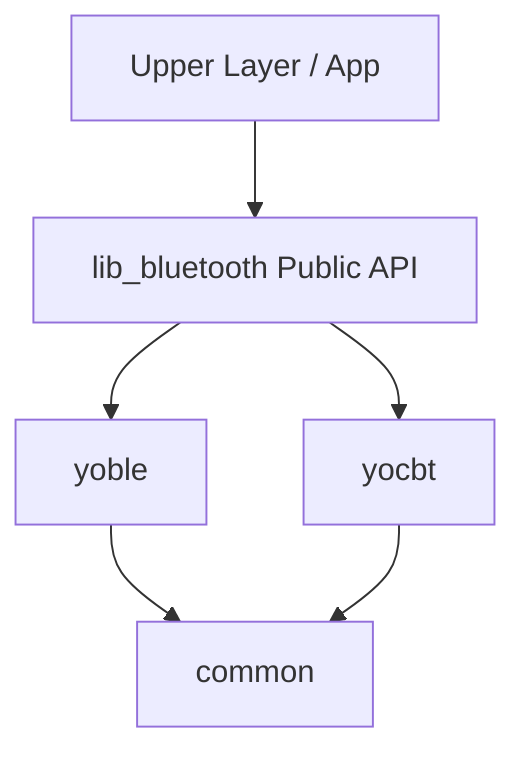
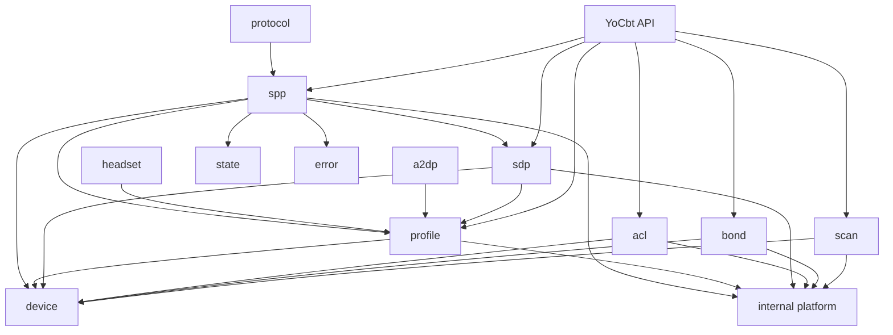

# lib_bluetooth Android SDK 全量重构提示词：经典蓝牙 Profile 完整架构版

> 适用对象：代码 Agent / Cursor / Codex / 人工架构评审  
> 目标项目：`lib_bluetooth`  
> 重点模块：`yocbt` 经典蓝牙  
> 核心目标：基于 Android 官方蓝牙 API、Bluetooth SIG 协议事实、AOSP 行为、现有代码审查与真机联调结果，对 `lib_bluetooth` 做全量架构重构。  
> 重要原则：文档先行、代码后置；不做最小改动；不兼容旧代码；不兼容旧 API；不处理应用层适配；不在架构文档完成前修改代码。

---

## 0. 使用说明

本文档用于指导代码 Agent / Cursor / Codex 对 `lib_bluetooth` Android 蓝牙 SDK 进行**全量架构重构**。

本任务不是补丁任务，不是最小改动任务，不是兼容旧 API 的任务，不是为了让旧应用层临时跑通的任务。

本任务的核心目标是：

- 先完整通读项目代码。
- 先联网查阅 Android 官方蓝牙文档、Bluetooth SIG 资料、AOSP 相关实现与可靠工程资料。
- 先结合 ADB、logcat、HCI snoop log、真实设备联调验证底层行为。
- 先创建多份细粒度架构文档，把整体架构、分层设计、依赖关系、数据流、状态机、错误码、线程模型、生命周期、多 Profile 状态、多 SPP 连接隔离讲清楚。
- 文档确认后，再按文档对 `lib_bluetooth` 做全量重构。

开发期间只关注 `lib_bluetooth` 本身，不需要照顾应用层、Demo 层、旧业务调用、旧 API、旧目录结构或旧 model。

---

## 1. 官方资料前置阅读范围

重构前必须先阅读 Android 官方蓝牙文档与 API 文档，不能只看博客或经验帖。

至少包括：

- Android Bluetooth overview  
  https://developer.android.com/develop/connectivity/bluetooth
- Set up Bluetooth  
  https://developer.android.com/develop/connectivity/bluetooth/setup
- Bluetooth permissions  
  https://developer.android.com/develop/connectivity/bluetooth/bt-permissions
- Find Bluetooth devices  
  https://developer.android.com/develop/connectivity/bluetooth/find-bluetooth-devices
- Connect Bluetooth devices  
  https://developer.android.com/develop/connectivity/bluetooth/connect-bluetooth-devices
- Bluetooth profiles  
  https://developer.android.com/develop/connectivity/bluetooth/profiles
- BluetoothAdapter  
  https://developer.android.com/reference/android/bluetooth/BluetoothAdapter
- BluetoothManager  
  https://developer.android.com/reference/android/bluetooth/BluetoothManager
- BluetoothDevice  
  https://developer.android.com/reference/android/bluetooth/BluetoothDevice
- BluetoothClass  
  https://developer.android.com/reference/android/bluetooth/BluetoothClass
- BluetoothProfile  
  https://developer.android.com/reference/android/bluetooth/BluetoothProfile
- BluetoothA2dp  
  https://developer.android.com/reference/android/bluetooth/BluetoothA2dp
- BluetoothHeadset  
  https://developer.android.com/reference/android/bluetooth/BluetoothHeadset
- BluetoothHidHost  
  https://developer.android.com/reference/android/bluetooth/BluetoothHidHost
- BluetoothHearingAid  
  https://developer.android.com/reference/android/bluetooth/BluetoothHearingAid
- BluetoothLeAudio  
  https://developer.android.com/reference/android/bluetooth/BluetoothLeAudio
- BluetoothSocket  
  https://developer.android.com/reference/android/bluetooth/BluetoothSocket
- BluetoothServerSocket  
  https://developer.android.com/reference/android/bluetooth/BluetoothServerSocket
- Android non-SDK restrictions  
  https://developer.android.com/guide/app-compatibility/restrictions-non-sdk-interfaces
- AOSP Bluetooth source  
  https://android.googlesource.com/platform/packages/modules/Bluetooth/
- AOSP framework BluetoothDevice / BluetoothSocket source  
  https://android.googlesource.com/platform/frameworks/base/+/master/core/java/android/bluetooth/
- Bluetooth SIG specifications  
  https://www.bluetooth.com/specifications/specs/

必须从这些资料中确认以下架构事实：

- Android 的 `BluetoothProfile` 是 Profile service proxy 的基础抽象。
- 使用 `BluetoothAdapter.getProfileProxy()` 获取指定 Profile 的 proxy。
- `BluetoothProfile.getConnectedDevices()` 和 `BluetoothProfile.getConnectionState(BluetoothDevice)` 是具体 Profile proxy 下的 per-device 状态查询。
- `BluetoothAdapter.getProfileConnectionState(profile)` 是按 Profile 聚合查询连接状态，不等价于某个具体设备的某个 Profile 状态。
- A2DP、Headset/HFP、HID、HearingAid、LE Audio、SPP 属于不同 Profile 或 profile-like 能力，不能混成一个“连接状态”。
- “配对”“ACL 底层链路”“Profile 连接”“A2DP 音频活跃”“Headset SCO 音频”“SPP RFCOMM Socket”“业务命令会话”是不同层级，必须分层建模。
- `BluetoothClass` 只能作为设备类型和服务能力 hint，不能替代 SDP / Profile proxy 的真实能力与状态。
- `BluetoothDevice.fetchUuidsWithSdp()` 是异步 SDP 流程，通过 `BluetoothDevice.ACTION_UUID` 返回 UUID。
- 公开 RFCOMM 客户端连接入口是 `createRfcommSocketToServiceRecord(UUID)` / `createInsecureRfcommSocketToServiceRecord(UUID)`。
- AOSP 中存在按 RFCOMM channel 创建 socket 的 hidden API，例如 `createRfcommSocket(int channel)`、`createInsecureRfcommSocket(int channel)`，但 Android 非 SDK 接口限制必须单独隔离、检测、降级和验证。
- Android 12+ 将蓝牙权限拆分为 `BLUETOOTH_SCAN`、`BLUETOOTH_CONNECT`、`BLUETOOTH_ADVERTISE`，运行时权限策略必须在架构中体现。

---

## 2. 项目定位

`lib_bluetooth` 是公司内部自定义 Android 蓝牙 SDK，目标是成为长期可维护、可扩展、可测试、可交付的完整蓝牙基础 SDK。

它不是对 Android 蓝牙 API 的简单工具类封装，而是一个覆盖 BLE 与经典蓝牙能力的完整 SDK。

当前规划主要包含三个子目录：

```text
lib_bluetooth/
├── common/     # BLE 与经典蓝牙共用基础设施
├── yoble/      # BLE 全部能力
└── yocbt/      # 经典蓝牙全部能力，本次重点
```

本次重构重点是 `yocbt`，尤其是：

- 经典蓝牙设备发现
- 已配对设备管理
- ACL 连接状态跟踪
- SDP 服务发现
- Profile 能力建模
- A2DP 连接状态查询与监听
- Headset / HFP / HSP 连接状态、SCO 音频状态查询与监听
- HID / HearingAid / LE Audio / PBAP / MAP / PAN 等 Profile 扩展架构
- 多 Profile 状态快照
- per-device Profile 状态查询
- SPP 多设备多连接
- 单设备多 SPP 连接
- UUID / Channel 双连接入口
- hidden API Channel 连接隔离
- 连接隔离
- 命令收发
- 状态机
- 错误码
- 线程与生命周期

---

## 3. 最高原则

### 3.1 文档先行，代码后置

在完成完整架构文档前，禁止修改任何业务代码。

必须先完成：

- 项目代码通读。
- 现有结构审查。
- Android 蓝牙官方资料调研。
- 蓝牙底层事实调研。
- AOSP / Android Source 相关实现调研。
- Bluetooth SIG Profile / SDP / RFCOMM / SPP 资料调研。
- 真机联调与 ADB 验证。
- 多份细粒度架构文档。
- 全量重构方案。
- 模块依赖图。
- 数据流图。
- 状态机图。
- 错误码体系。
- 测试方案。

只有以上内容完成并被确认后，才能进入代码重构阶段。

### 3.2 不做最小改动

禁止使用“最小改动”思路。

禁止：

- 为了少改文件而保留错误结构。
- 为了少改代码而继续使用旧 model。
- 为了少改调用而保留旧 API。
- 为了少改逻辑而保留万能 manager。
- 为了少改目录而继续平铺。
- 为了短期能跑而绕过架构设计。

允许并鼓励：

- 全量重建目录结构。
- 全量重命名。
- 删除旧代码。
- 拆分类。
- 拆模块。
- 重建 model。
- 重建 API。
- 重建 Profile 管理架构。
- 重建 SPP 多连接架构。
- 重建状态机。
- 重建错误体系。
- 重建线程模型。
- 重建测试结构。

### 3.3 不兼容旧代码

本次 `lib_bluetooth` 重构不需要兼容旧代码。

禁止：

- 为旧 API 保留兼容层。
- 为旧调用方式保留 adapter。
- 为旧 model 做桥接。
- 为旧 manager 做 wrapper。
- 为旧 callback 做转换。
- 为旧目录保留 facade。
- 为旧业务逻辑留后门。

如果旧代码不符合新架构，直接废弃。

所有应用层、Demo 层、业务层，必须在 `lib_bluetooth` 新架构完成后，再单独适配新 API。

### 3.4 只管 lib_bluetooth，不管应用层

本次开发范围只包含：

```text
lib_bluetooth/common
lib_bluetooth/yoble
lib_bluetooth/yocbt
lib_bluetooth/docs
```

不需要修改：

- app 模块
- demo 模块
- 业务页面
- 应用层调用
- 客户集成层
- 旧 SDK 使用方

如果应用层因为 API 变化而编译失败，这是预期结果，不应该为了应用层兼容而污染 `lib_bluetooth` 新架构。

### 3.5 所有判断必须基于证据

任何结论都必须有证据支撑。

证据来源包括：

- 实际代码路径。
- 类名。
- 方法名。
- 调用链。
- Gradle 配置。
- Android 官方文档。
- Bluetooth SIG 资料。
- Android Source。
- ADB 输出。
- logcat 日志。
- HCI snoop log。
- 真机行为。

禁止使用：

- “感觉”。
- “应该”。
- “先这样”。
- “暂时”。
- “后面再说”。
- “兼容一下”。
- “简单处理”。

如果无法确认，必须明确标记为待验证项：

```text
待验证项：
- 问题：
- 当前无法确认原因：
- 需要验证的设备：
- 需要使用的工具：
- 可能影响的模块：
- 后续处理建议：
```

### 3.6 从蓝牙底层事实出发

不要从旧 API 出发，不要从旧目录出发，不要从应用层调用方式出发。

设计顺序必须是：

1. 蓝牙设备物理事实。
2. Android 蓝牙系统 API。
3. BLE / Classic / Dual Mode 差异。
4. 地址模型。
5. 设备身份模型。
6. 设备发现模型。
7. 配对绑定模型。
8. ACL 底层链路模型。
9. SDP 服务发现模型。
10. Profile 能力模型。
11. Profile proxy 生命周期模型。
12. Profile 连接状态模型。
13. A2DP 状态模型。
14. Headset / HFP / HSP 状态模型。
15. 设备多 Profile 快照模型。
16. SPP 连接模型。
17. 多设备多 SPP 连接模型。
18. 单设备多 SPP 连接模型。
19. UUID / Channel 端点模型。
20. SPP 字节流模型。
21. 命令协议模型。
22. 状态机。
23. 错误码。
24. 对外 API。

---

## 4. 当前已知核心问题

必须基于实际代码逐项核查以下问题，不能凭感觉判断。

### 4.1 架构层次混乱

当前代码可能存在平铺目录倾向，很多内容直接塞在 `yocbt` 下，没有形成清晰分层。

必须检查：

- domain / data / platform / api / internal 边界是否清晰。
- Android 系统 API 是否直接泄漏到上层。
- 上层是否直接依赖底层实现类。
- 扫描、配对、ACL、SDP、Profile、SPP、命令协议、状态管理是否耦合在一起。
- manager 是否变成万能类。
- model 是否变成垃圾桶。
- callback 类型是否混乱。
- 错误码是否统一。
- 线程切换是否清晰。
- 生命周期释放是否可靠。
- 设备信息是否混用。

### 4.2 低内聚、高耦合

必须识别：

- 一个类是否承担多个职责。
- 一个 model 是否混入扫描结果、配对状态、ACL 状态、Profile 状态、SPP 状态、协议状态、UI 展示字段。
- SPP 连接是否依赖扫描实现。
- SDP 发现是否和 RFCOMM Socket 强耦合。
- 已配对设备是否和新扫描设备混为一谈。
- ACL connected 是否被当作 Profile connected。
- A2DP connected 是否被当作设备 connected。
- Headset connected 是否被当作 SPP connected。
- 设备身份是否只用 MAC 粗暴判断。
- BLE 地址和经典蓝牙地址是否混用。
- 双模设备是否缺少身份映射策略。
- API 层是否暴露内部细节。

### 4.3 Model 设计混乱

不得将所有类型都塞进一个 `model` 包。

需要重新梳理 model 职责，至少考虑以下分类：

```text
yocbt/
├── device/model/       # 设备身份、设备类型、设备快照、设备能力
├── scan/model/         # 扫描配置、扫描结果、扫描状态、过滤规则
├── bond/model/         # 已配对设备、配对状态、配对事件
├── acl/model/          # ACL 链路状态、ACL 事件、ACL 快照
├── sdp/model/          # SDP 请求、SDP 结果、UUID 信息、服务记录
├── profile/model/      # Profile 类型、Profile 状态、Profile 能力、Profile 快照
├── a2dp/model/         # A2DP 连接状态、活跃设备、codec 状态
├── headset/model/      # Headset/HFP 状态、SCO 音频状态、语音识别状态
├── spp/model/          # SPP 配置、连接端点、连接状态、连接 ID、数据包
├── protocol/model/     # 命令、响应、Packet、Codec、Matcher
├── error/model/        # 错误码、异常、失败原因
└── state/model/        # 通用状态与状态事件
```

最终结构必须基于实际代码与架构设计推导，不能机械照抄。

### 4.4 命名混乱

经典蓝牙相关命名必须统一使用 `YoCbt` 前缀或命名空间。

允许：

```text
YoCbtDevice
YoCbtScanResult
YoCbtScanner
YoCbtBondedDeviceProvider
YoCbtAclStateObserver
YoCbtSdpClient
YoCbtProfileProxyManager
YoCbtA2dpStateProvider
YoCbtHeadsetStateProvider
YoCbtSppClient
YoCbtSppConnectionManager
YoCbtSppConnectionId
YoCbtSppEndpoint
YoCbtErrorCode
YoCbtException
```

禁止混用：

```text
ClassicBluetoothXxx
BtXxx
BluetoothXxx
CbtXxx
YoClassicXxx
BlueXxx
```

除非是 Android 官方类型包装层，否则不要在 SDK 内部随意使用 `BluetoothXxx` 作为业务类名，避免与 Android Framework 类型混淆。

---

## 5. common / yoble / yocbt 模块定位

### 5.1 common 模块定位

`common` 只允许存放 BLE 与经典蓝牙都能复用的公共基础设施。

允许：

```text
common/
├── adapter/
├── permission/
├── result/
├── error/
├── log/
├── threading/
├── lifecycle/
├── state/
├── time/
└── internal/
```

可放内容：

- 蓝牙 Adapter 抽象。
- 蓝牙开关状态监听基础能力。
- Android 版本判断。
- 权限模型。
- 权限检查器。
- 线程调度器。
- 日志接口。
- 统一 Result。
- 统一 Error 基类。
- 生命周期释放接口。
- 状态机基础设施。
- 通用设备标识弱抽象。
- 通用工具类。

禁止：

- 把 SPP 放到 common。
- 把 GATT 放到 common。
- 把 BLE ScanResult 直接放到 common。
- 把 Classic Bluetooth Discovery 直接放到 common。
- 把 A2DP / Headset / Profile proxy 逻辑放到 common。
- 把业务协议放到 common。
- 把所有 model 混合放到 common。

### 5.2 yoble 模块定位

`yoble` 存放 BLE 相关全部能力。

包括但不限于：

- BLE 扫描。
- BLE 广播数据解析。
- BLE 设备模型。
- BLE GATT 连接。
- Service Discovery。
- Characteristic Discovery。
- Descriptor 操作。
- MTU。
- Notification。
- Indication。
- Read。
- Write。
- BLE Pairing。
- BLE Bond。
- BLE 状态机。
- BLE 错误码。

`yoble` 禁止依赖 `yocbt`。

`yoble` 与 `yocbt` 如果要关联同一物理设备，只能通过 `common` 中的弱身份模型或上层设备归并策略完成，不能直接互相调用。

### 5.3 yocbt 模块定位

`yocbt` 存放经典蓝牙相关全部能力，是本次全量重构重点。

必须覆盖：

- 经典蓝牙设备发现。
- 已配对设备管理。
- 设备身份识别。
- 单模经典蓝牙设备建模。
- 双模蓝牙设备建模。
- BLE 地址与经典蓝牙地址区分。
- Class of Device 解析。
- BluetoothDevice.getType() 映射。
- Bond State 监听。
- ACL 底层链路监听。
- SDP 服务发现。
- UUID 管理。
- Profile 能力建模。
- Profile proxy 管理。
- Profile 连接状态查询。
- A2DP 状态查询与监听。
- Headset/HFP/HSP 状态查询与监听。
- HID/HearingAid/LE Audio 等扩展 Profile 状态预留。
- 多 Profile 状态快照。
- RFCOMM Socket 创建。
- Secure RFCOMM。
- Insecure RFCOMM。
- SPP 连接。
- 多设备多 SPP 连接。
- 单设备多 SPP 连接。
- UUID 方式连接 SPP。
- Channel 号方式连接 SPP。
- SPP 数据收发。
- SPP 命令队列。
- SPP 响应匹配。
- SPP 超时与重试。
- SPP 状态机。
- SPP 断连识别。
- 多连接隔离。
- 错误码。
- 日志。
- 权限。
- 线程模型。
- 生命周期释放。
- 测试体系。

---

## 6. 经典蓝牙分层模型

对于经典蓝牙设备，必须把“配对连接”的每一层细颗粒度区分开。

必须区分以下层级：

```text
物理设备层 Physical Device
↓
协议栈能力层 Radio / Transport Capability
↓
系统发现层 Discovery Observation
↓
配对绑定层 Bond
↓
ACL 底层链路层 ACL Link
↓
SDP 服务发现层 SDP
↓
Profile 能力层 Profile Capability
↓
Profile Proxy 层 Android Profile Service Proxy
↓
Profile 连接状态层 Profile Connection State
↓
Profile 业务状态层 Profile Runtime State
↓
SPP RFCOMM Socket 层
↓
SPP Byte Transport 层
↓
业务命令协议层 Command Protocol
```

这些层级不能混用。

### 6.1 Discovery Observation

扫描发现状态只表示系统通过 discovery 观察到了设备。

不代表：

- 已配对。
- ACL 已连接。
- A2DP 已连接。
- Headset 已连接。
- SPP 已连接。
- 支持 SPP。
- 支持 A2DP。
- 支持 Headset。
- 当前可连接。

### 6.2 Bond State

配对状态来自：

- `BluetoothDevice.getBondState()`
- `BluetoothDevice.ACTION_BOND_STATE_CHANGED`

状态包括：

```text
BOND_NONE
BOND_BONDING
BOND_BONDED
UNKNOWN
```

必须明确：

```text
配对 ≠ ACL 连接
配对 ≠ Profile 连接
配对 ≠ A2DP 连接
配对 ≠ Headset 连接
配对 ≠ SPP Socket 连接
配对 ≠ 业务命令可用
```

### 6.3 ACL Link State

ACL 表示经典蓝牙底层物理链路状态。

可通过以下广播监听：

```text
BluetoothDevice.ACTION_ACL_CONNECTED
BluetoothDevice.ACTION_ACL_DISCONNECTED
BluetoothDevice.ACTION_ACL_DISCONNECT_REQUESTED
```

ACL connected 不代表：

- A2DP connected。
- Headset connected。
- SPP connected。
- 业务可用。

它只能说明本机与远端设备存在底层链路。

### 6.4 SDP Capability State

SDP 发现的是服务能力，不是当前连接状态。

SDP 能帮助判断：

- 设备声明了哪些服务 UUID。
- 设备可能支持哪些 Profile。
- 设备可能支持哪些 SPP UUID。
- 是否可能存在 RFCOMM 服务。

SDP 不能说明：

- 当前 A2DP 已连接。
- 当前 Headset 已连接。
- 当前 SPP 已连接。
- 当前音频正在播放。

### 6.5 Profile Connection State

每个 Profile 都必须单独建模。

至少包括：

```text
A2DP
HEADSET
HFP
HSP
AVRCP
HID_HOST
PAN
PBAP
MAP
OPP
HEARING_AID
LE_AUDIO
SPP
UNKNOWN
```

Profile 连接状态必须是 per-device + per-profile 的组合，不能只用一个全局状态。

### 6.6 A2DP Runtime State

A2DP 需要区分：

- A2DP profile connection state。
- A2DP active device。
- A2DP audio playing state。
- A2DP codec state。

具体能力取决于 Android 版本、公开 API、系统权限和设备角色。

### 6.7 Headset / HFP Runtime State

Headset / HFP 需要区分：

- Headset profile connection state。
- SCO audio state。
- Voice recognition state。
- Vendor specific headset event。

不能只用一个 `isHeadsetConnected` 表示全部。

### 6.8 SPP Socket State

SPP 是 RFCOMM socket 字节流。

必须独立建模：

- SPP connection state。
- SPP endpoint。
- SPP security mode。
- SPP connectionId。
- SPP reader state。
- SPP writer state。
- SPP protocol session state。

SPP connected 不代表 A2DP connected。

A2DP connected 不代表 SPP connected。

---

## 7. 必须调研的资料范围

### 7.1 Android 官方 API

至少需要查阅：

- `BluetoothAdapter`
- `BluetoothManager`
- `BluetoothDevice`
- `BluetoothDevice.getType()`
- `BluetoothDevice.DEVICE_TYPE_CLASSIC`
- `BluetoothDevice.DEVICE_TYPE_LE`
- `BluetoothDevice.DEVICE_TYPE_DUAL`
- `BluetoothDevice.DEVICE_TYPE_UNKNOWN`
- `BluetoothClass`
- `BluetoothSocket`
- `BluetoothServerSocket`
- `BluetoothProfile`
- `BluetoothA2dp`
- `BluetoothHeadset`
- `BluetoothHidHost`
- `BluetoothHearingAid`
- `BluetoothLeAudio`
- `BluetoothAdapter.startDiscovery()`
- `BluetoothAdapter.cancelDiscovery()`
- `BluetoothAdapter.getBondedDevices()`
- `BluetoothAdapter.getProfileProxy()`
- `BluetoothAdapter.closeProfileProxy()`
- `BluetoothAdapter.getProfileConnectionState()`
- `BluetoothProfile.getConnectedDevices()`
- `BluetoothProfile.getConnectionState(BluetoothDevice)`
- `BluetoothDevice.getBondState()`
- `BluetoothDevice.getUuids()`
- `BluetoothDevice.fetchUuidsWithSdp()`
- `BluetoothDevice.ACTION_UUID`
- `BluetoothDevice.ACTION_FOUND`
- `BluetoothDevice.ACTION_BOND_STATE_CHANGED`
- `BluetoothDevice.ACTION_ACL_CONNECTED`
- `BluetoothDevice.ACTION_ACL_DISCONNECTED`
- `BluetoothDevice.createRfcommSocketToServiceRecord()`
- `BluetoothDevice.createInsecureRfcommSocketToServiceRecord()`

### 7.2 Profile 相关资料

必须查清楚：

- Android 支持哪些 public BluetoothProfile。
- 哪些 Profile 有公开 proxy 类。
- 哪些 Profile 只能查询，不能普通三方 app 主动连接。
- 哪些 Profile connect/disconnect 需要系统权限、系统签名或 hidden API。
- A2DP 与 AVRCP 的关系。
- Headset / HFP / HSP 的关系。
- Headset SCO audio state 与 profile state 的区别。
- HearingAid 与 LE Audio 在 Android 不同版本中的 API 可用性。
- PBAP / MAP / OPP / PAN 的公开能力边界。

### 7.3 Hidden API / Channel 连接相关资料

必须查阅并验证：

- AOSP 中 `BluetoothDevice.createRfcommSocket(int channel)` 的实现与限制。
- AOSP 中 `BluetoothDevice.createInsecureRfcommSocket(int port)` 的实现与限制。
- Android hidden API / non-SDK interface 限制。
- Android 9+ hidden API 限制对反射调用的影响。
- 不同 Android 版本、不同厂商 ROM 对 hidden API 调用的差异。
- 通过 Channel 连接 RFCOMM 的可用性。
- Secure Channel 连接和 Insecure Channel 连接差异。
- Channel 号来源：SDP、厂商配置、用户指定、调试工具确认。

必须明确：

- Hidden API 只能封装在 `yocbt/spp/platform/internal` 或等价内部层。
- 不能让 hidden API 细节污染 domain 层。
- 不能让上层直接反射调用 Android Framework。
- Channel 连接必须有能力检测、失败上报、降级策略和验证报告。
- 如果目标 Android 版本或 ROM 不允许 hidden API，必须返回明确错误，而不是吞异常。

### 7.4 Android 权限

必须查阅并设计兼容：

- Android 12 以下蓝牙权限。
- Android 12+ 蓝牙权限。
- `BLUETOOTH`
- `BLUETOOTH_ADMIN`
- `BLUETOOTH_SCAN`
- `BLUETOOTH_CONNECT`
- `BLUETOOTH_ADVERTISE`
- `ACCESS_FINE_LOCATION`
- `neverForLocation`
- targetSdk 差异。
- minSdk 差异。
- 权限不足时的错误码。
- 权限检查所在层级。

### 7.5 蓝牙底层事实

必须查阅：

- BR/EDR。
- BLE。
- Dual Mode。
- Single Mode。
- Bluetooth Device Address。
- BLE Public Address。
- BLE Random Address。
- Classic Bluetooth Address。
- 双模设备地址关系。
- Class of Device。
- Major Device Class。
- Minor Device Class。
- Service Class。
- SDP。
- RFCOMM。
- RFCOMM Channel。
- SPP。
- UUID。
- A2DP。
- AVRCP。
- HFP。
- HSP。
- HID。
- PBAP。
- MAP。
- OPP。
- PAN。
- Profile。

必须重点解决：

- 单模 BLE 设备不是经典蓝牙设备。
- 单模经典蓝牙设备不是 BLE 设备。
- 双模设备可能支持 BLE 和经典蓝牙。
- 双模设备在 Android 上可能表现为同一地址，也可能表现为不同地址。
- BLE MAC 和 Classic MAC 不能粗暴混用。
- 设备名不稳定。
- UUID 不是扫描阶段一定可得。
- 已配对设备可以不依赖扫描直接连接。
- 配对不等于 Profile 连接。
- ACL connected 不等于 Profile connected。
- Profile connected 不等于 SPP connected。
- SPP 是 RFCOMM 字节流，不等于业务命令协议。
- 一个设备可以暴露多个 RFCOMM 服务。
- 一个设备可能存在多个 SPP UUID。
- 一个设备可能存在多个 RFCOMM Channel。
- 一个经典蓝牙设备可能同时有 A2DP、Headset、SPP、HID 等多个 Profile 状态。
- SDK 不能在架构上限制为单设备单 Profile 或单设备单 SPP。

---

## 8. ADB / 真机验证要求

如果当前环境可以连接 Android 设备，必须进行真机验证。

建议命令：

```bash
adb devices
adb shell dumpsys bluetooth_manager
adb shell dumpsys bluetooth_manager | grep -i bond
adb shell dumpsys bluetooth_manager | grep -i profile
adb shell dumpsys bluetooth_manager | grep -i adapter
adb shell dumpsys bluetooth_manager | grep -i a2dp
adb shell dumpsys bluetooth_manager | grep -i headset
adb shell dumpsys bluetooth_manager | grep -i hfp
adb shell dumpsys bluetooth_manager | grep -i hid
adb shell settings get global bluetooth_on
adb logcat | grep -i bluetooth
adb logcat | grep -i bt
adb logcat | grep -i a2dp
adb logcat | grep -i headset
adb logcat | grep -i hfp
adb logcat | grep -i sco
adb logcat | grep -i spp
adb logcat | grep -i rfcomm
adb logcat | grep -i sdp
```

如设备支持，应结合 HCI snoop log 分析：

- Inquiry。
- Paging。
- ACL connection。
- Pairing。
- Encryption。
- SDP。
- Profile connection。
- A2DP signaling。
- Headset / HFP signaling。
- SCO audio。
- RFCOMM。
- RFCOMM Channel。
- Socket connect。
- Disconnect。
- SPP data。

必须验证：

1. 经典蓝牙扫描结果字段。
2. BLE 扫描结果字段。
3. 双模设备是否出现一个地址还是两个地址。
4. `BluetoothDevice.getType()` 实际返回值。
5. `BluetoothClass` 实际可用信息。
6. 已配对设备是否能不扫描直接回连。
7. 已配对设备 UUID 是否存在缓存。
8. `fetchUuidsWithSdp()` 是否触发 `ACTION_UUID`。
9. SDP 失败时 Android 返回什么。
10. ACL connected / disconnected 广播触发时机。
11. A2DP connected devices 查询结果。
12. 单设备 A2DP connection state 查询结果。
13. Headset connected devices 查询结果。
14. 单设备 Headset connection state 查询结果。
15. SCO audio state 广播或查询结果。
16. 一个设备同时 A2DP + Headset + SPP 的状态快照。
17. A2DP 断开是否影响 SPP。
18. Headset 断开是否影响 SPP。
19. ACL 断开时各 Profile 状态如何变化。
20. SPP 默认 UUID 是否可连接。
21. 自定义 UUID 是否可连接。
22. Secure RFCOMM 与 Insecure RFCOMM 差异。
23. 连接前不 `cancelDiscovery()` 是否影响连接。
24. 断连时是否能可靠感知。
25. 蓝牙关闭时各模块状态如何变化。
26. 多设备多 SPP 连接是否可并行。
27. 单设备多 SPP 连接是否可并行。
28. 同设备不同 UUID 是否能同时连接。
29. 同设备不同 RFCOMM Channel 是否能同时连接。
30. UUID 连接与 Channel 连接是否能同时存在。
31. Hidden API Channel 连接在目标设备与目标 Android 版本是否可用。
32. Hidden API 失败时异常类型和错误路径。
33. 多连接场景下读写是否隔离。
34. 多连接场景下一个连接断开是否影响其他连接。
35. 多连接场景下 `release(connectionId)` 是否只释放指定连接。

如果无法真机验证，必须明确列出无法验证的内容，不允许假装已经验证。

---

## 9. 必须创建的细粒度架构文档

本次不是输出一个粗略设计文档，而是要创建多个细粒度架构文档。

建议在项目中创建：

```text
lib_bluetooth/docs/
├── 00_project_audit.md
├── 01_bluetooth_foundation.md
├── 02_android_bluetooth_api_research.md
├── 03_overall_architecture.md
├── 04_common_architecture.md
├── 05_yoble_boundary.md
├── 06_yocbt_overall_architecture.md
├── 07_yocbt_device_identity_architecture.md
├── 08_yocbt_scan_architecture.md
├── 09_yocbt_bond_architecture.md
├── 10_yocbt_acl_architecture.md
├── 11_yocbt_sdp_architecture.md
├── 12_yocbt_profile_overall_architecture.md
├── 13_yocbt_profile_proxy_architecture.md
├── 14_yocbt_profile_state_query_architecture.md
├── 15_yocbt_a2dp_architecture.md
├── 16_yocbt_headset_hfp_architecture.md
├── 17_yocbt_profile_extensions_architecture.md
├── 18_yocbt_spp_architecture.md
├── 19_yocbt_spp_multi_connection_architecture.md
├── 20_yocbt_spp_channel_connection_architecture.md
├── 21_yocbt_spp_connection_isolation.md
├── 22_yocbt_command_protocol_architecture.md
├── 23_yocbt_state_machine.md
├── 24_yocbt_error_code.md
├── 25_yocbt_threading_lifecycle.md
├── 26_yocbt_public_api.md
├── 27_yocbt_testing_strategy.md
├── 28_full_rebuild_plan.md
└── 29_verification_report.md
```

每一份文档都必须有明确主题、边界、图、数据流、关键类、依赖关系、验证项。

---

## 10. 文档 00：项目现状审查报告

文件名：

```text
docs/00_project_audit.md
```

必须包含：

1. 当前 `lib_bluetooth` 总目录结构。
2. 当前 `common` 目录结构。
3. 当前 `yoble` 目录结构。
4. 当前 `yocbt` 目录结构。
5. 当前所有 model 清单。
6. 当前所有 manager 清单。
7. 当前所有 callback/listener 清单。
8. 当前所有 public API 清单。
9. 当前扫描流程。
10. 当前 bonded device 流程。
11. 当前 ACL 监听流程。
12. 当前 SDP 流程。
13. 当前 Profile 支持情况。
14. 当前 A2DP 状态查询能力。
15. 当前 Headset/HFP 状态查询能力。
16. 当前多 Profile 状态快照能力。
17. 当前 SPP 连接流程。
18. 当前 SPP 收发流程。
19. 当前多连接支持情况。
20. 当前是否支持单设备多 SPP。
21. 当前是否支持多设备多 SPP。
22. 当前是否支持 Channel 号连接。
23. 当前错误处理方式。
24. 当前状态管理方式。
25. 当前线程模型。
26. 当前资源释放方式。
27. 当前命名问题。
28. 当前违反高内聚低耦合的位置。
29. 当前必须删除或重建的代码。

每一项必须给出：

```text
- 代码路径
- 类名
- 方法名
- 调用关系
- 问题描述
- 影响范围
- 是否保留
- 是否重建
```

---

## 11. 文档 01：蓝牙底层事实文档

文件名：

```text
docs/01_bluetooth_foundation.md
```

必须讲清楚：

1. BR/EDR 是什么。
2. BLE 是什么。
3. Classic Bluetooth 与 BLE 的根本区别。
4. Single Mode 设备是什么。
5. Dual Mode 设备是什么。
6. 经典蓝牙地址是什么。
7. BLE 地址是什么。
8. BLE Public Address 是什么。
9. BLE Random Address 是什么。
10. 双模设备地址为什么不能粗暴混用。
11. Class of Device 是什么。
12. Major Device Class 是什么。
13. Minor Device Class 是什么。
14. Service Class 是什么。
15. 配对 Bond 是什么。
16. ACL Link 是什么。
17. SDP 是什么。
18. RFCOMM 是什么。
19. RFCOMM Channel 是什么。
20. SPP 是什么。
21. UUID 是什么。
22. Profile 是什么。
23. A2DP 是什么。
24. AVRCP 是什么。
25. Headset / HSP 是什么。
26. HFP 是什么。
27. SCO 音频是什么。
28. HID 是什么。
29. PBAP / MAP / OPP / PAN 是什么。
30. 为什么 SPP 不等于业务协议。
31. 为什么一个设备可能有多个 RFCOMM 服务。
32. 为什么一个设备可能有多个 SPP UUID。
33. 为什么一个设备可能有多个 RFCOMM Channel。
34. 为什么一个经典蓝牙设备可能同时存在多个 Profile 状态。
35. 为什么 SDK 不能在架构上假设单设备单连接。

必须形成对 SDK 架构有约束力的结论。

---

## 12. 文档 02：Android 蓝牙 API 调研文档

文件名：

```text
docs/02_android_bluetooth_api_research.md
```

必须讲清楚：

1. `BluetoothAdapter` 的职责。
2. `BluetoothManager` 的职责。
3. `BluetoothDevice` 的职责。
4. `BluetoothClass` 的职责。
5. `BluetoothSocket` 的职责。
6. `BluetoothProfile` 的职责。
7. `BluetoothA2dp` 的职责。
8. `BluetoothHeadset` 的职责。
9. `BluetoothHidHost` 的职责。
10. `BluetoothHearingAid` 的职责。
11. `BluetoothLeAudio` 的职责。
12. `startDiscovery()` 的行为。
13. `cancelDiscovery()` 的必要性。
14. `getBondedDevices()` 的意义。
15. `getType()` 的返回值。
16. `getBondState()` 的意义。
17. `ACTION_ACL_CONNECTED` / `ACTION_ACL_DISCONNECTED` 的行为。
18. `getUuids()` 与 `fetchUuidsWithSdp()` 的区别。
19. `ACTION_UUID` 的行为。
20. `getProfileProxy()` 的行为。
21. `closeProfileProxy()` 的行为。
22. `getProfileConnectionState(profile)` 的局限。
23. `BluetoothProfile.getConnectedDevices()` 的意义。
24. `BluetoothProfile.getConnectionState(device)` 的意义。
25. `BluetoothA2dp` 可公开查询的能力。
26. `BluetoothHeadset` 可公开查询的能力。
27. Headset SCO audio state 的公开能力。
28. `createRfcommSocketToServiceRecord(UUID)` 的行为。
29. `createInsecureRfcommSocketToServiceRecord(UUID)` 的行为。
30. hidden `createRfcommSocket(int channel)` 的行为。
31. hidden `createInsecureRfcommSocket(int channel)` 的行为。
32. `connect()` 阻塞问题。
33. `InputStream` / `OutputStream` 收发模型。
34. Socket close 行为。
35. Android 12+ 权限变化。
36. API level 差异。
37. Hidden API 限制与风险。
38. 不同 ROM 差异风险。

必须明确哪些 Android API 可以直接用于底层，哪些必须被 SDK 封装，哪些禁止暴露给上层。

---

## 13. 文档 03：lib_bluetooth 总体架构文档

文件名：

```text
docs/03_overall_architecture.md
```

必须定义：

1. `lib_bluetooth` 总体目标。
2. `common` / `yoble` / `yocbt` 模块边界。
3. 模块依赖方向。
4. 禁止依赖方向。
5. 公共能力沉淀规则。
6. BLE 专属能力边界。
7. 经典蓝牙专属能力边界。
8. 对外 API 暴露规则。
9. 内部实现隐藏规则。
10. 测试替换规则。

推荐依赖方向：



禁止：

```text
common 依赖 yoble
common 依赖 yocbt
yoble 依赖 yocbt
yocbt 依赖 yoble
yocbt 内部 platform 反向依赖 api
上层直接依赖 platform 实现
```

---

## 14. 文档 04：common 架构文档

文件名：

```text
docs/04_common_architecture.md
```

建议结构：

```text
common/
├── adapter/
├── permission/
├── result/
├── error/
├── log/
├── threading/
├── lifecycle/
├── state/
├── time/
└── internal/
```

必须明确：

1. common 能放什么。
2. common 不能放什么。
3. 哪些 model 是真正通用 model。
4. 权限检查如何抽象。
5. 日志如何抽象。
6. Result 如何设计。
7. Error 基类如何设计。
8. 线程调度如何设计。
9. 生命周期释放如何设计。
10. common 如何支持单元测试。

---

## 15. 文档 05：yoble 边界文档

文件名：

```text
docs/05_yoble_boundary.md
```

本次不重点重构 BLE，但必须明确 BLE 与经典蓝牙边界。

必须说明：

1. `yoble` 当前结构。
2. `yoble` 需要保留的 BLE 专属能力。
3. `yoble` 不应依赖 `yocbt`。
4. `yoble` 不应把 BLE 设备模型暴露给 `yocbt`。
5. BLE 地址模型与经典蓝牙地址模型区别。
6. 双模设备如何通过 common identity 进行弱关联。
7. 哪些内容应从 `yoble` 下沉到 `common`。
8. 哪些内容必须留在 `yoble`。

---

## 16. 文档 06：yocbt 总体架构文档

文件名：

```text
docs/06_yocbt_overall_architecture.md
```

必须重新设计 `yocbt` 目录。

参考结构：

```text
yocbt/
├── api/
├── device/
├── scan/
├── bond/
├── acl/
├── sdp/
├── profile/
├── a2dp/
├── headset/
├── hid/
├── spp/
├── protocol/
├── state/
├── error/
├── log/
└── internal/
```

每个模块都要明确：

1. 职责。
2. 输入。
3. 输出。
4. 上游依赖。
5. 下游依赖。
6. 禁止依赖。
7. 核心类。
8. 核心接口。
9. 数据流。
10. 测试方式。

推荐依赖关系：



---

## 17. 文档 07：YoCbt 设备身份架构

文件名：

```text
docs/07_yocbt_device_identity_architecture.md
```

这是本次重构的底层核心。

必须重新定义经典蓝牙设备身份，不允许继续粗暴使用一个 MAC 表示一切。

必须设计：

```text
YoCbtAddress
YoCbtAddressType
YoCbtDeviceType
YoCbtDeviceIdentity
YoCbtObservedDevice
YoCbtBondedDevice
YoCbtAclDevice
YoCbtResolvedDevice
YoCbtProfileCapableDevice
YoCbtDeviceCapability
YoCbtDeviceClass
YoCbtDeviceAlias
YoCbtDeviceSnapshot
YoCbtDeviceProfileSnapshot
```

必须区分：

1. 经典蓝牙地址。
2. BLE 地址。
3. 未知地址类型。
4. 单模经典蓝牙设备。
5. 单模 BLE 设备。
6. 双模设备。
7. Android `getType()` 返回的 DUAL。
8. 实际物理设备归属。
9. 系统已配对设备。
10. 扫描观察到的设备。
11. ACL 当前连接设备。
12. 可连接设备。
13. 已解析能力设备。
14. 具有 Profile 能力的设备。
15. 当前 Profile 已连接的设备。
16. 当前 SPP 已连接的设备。

必须说明：

1. 什么时候只能认为是 observed device。
2. 什么时候可以认为是 bonded device。
3. 什么时候可以认为是 acl connected device。
4. 什么时候可以认为是 resolved device。
5. UUID 是否属于设备身份。
6. BluetoothClass 是否属于设备能力。
7. BondState 是否属于设备状态。
8. ACL state 是否属于设备链路状态。
9. Profile state 是否属于设备业务状态。
10. name / alias 是否稳定。
11. address 是否能作为跨协议唯一 ID。
12. 双模设备如何合并。
13. 无法确定双模归属时如何处理。

禁止：

1. BLE MAC 和 Classic MAC 直接混用。
2. 只用 name 合并设备。
3. 只用 MAC 判断物理设备唯一性。
4. 把 scan result 当成 connectable device。
5. 把 bonded device 当成 scan result。
6. 把 ACL connected 当成所有 profile connected。
7. 把 A2DP connected 当成整个设备 connected。
8. 把 UUID 直接塞到普通 device model 里。

### 17.1 YoCbtDeviceSnapshot

必须提供某一时刻完整设备快照：

```text
YoCbtDeviceSnapshot
├── identity
├── name
├── alias
├── address
├── type
├── bluetoothClass
├── bondState
├── aclState
├── uuids
├── supportedProfiles
├── profileConnectionStates
├── a2dpState
├── headsetState
├── sppConnections
├── lastSeenTime
└── source
```

`YoCbtDeviceSnapshot` 是只读视图，不应承载业务逻辑。

---

## 18. 文档 08：YoCbt 扫描架构

文件名：

```text
docs/08_yocbt_scan_architecture.md
```

扫描模块必须独立，不允许与 SPP 连接耦合。

建议结构：

```text
yocbt/scan/
├── api/
├── domain/
├── data/
├── platform/
└── internal/
```

必须设计：

```text
YoCbtScanner
YoCbtScanController
YoCbtScanConfig
YoCbtScanFilter
YoCbtScanResult
YoCbtScanState
YoCbtScanSession
YoCbtScanResultMerger
YoCbtDiscoveryReceiver
YoCbtDiscoveryPlatformSource
```

必须覆盖：

1. 扫描启动。
2. 扫描停止。
3. 扫描超时。
4. 重复扫描处理。
5. `ACTION_FOUND`。
6. `ACTION_DISCOVERY_STARTED`。
7. `ACTION_DISCOVERY_FINISHED`。
8. `BluetoothDevice` 提取。
9. `BluetoothClass` 提取。
10. RSSI 提取。
11. name 提取。
12. device type 提取。
13. scan result 去重。
14. scan result 更新。
15. bonded device 合并策略。
16. 权限检查。
17. 蓝牙关闭处理。
18. receiver 注册与释放。
19. 连接前 `cancelDiscovery()` 规则。
20. 扫描失败错误码。

必须明确扫描结果数据流：

```text
scan()
→ permission check
→ adapter state check
→ register receiver
→ startDiscovery()
→ ACTION_FOUND
→ Android BluetoothDevice
→ YoCbtObservedDevice
→ YoCbtScanResult
→ merge/update
→ callback/observer
→ ACTION_DISCOVERY_FINISHED
→ release receiver
```

---

## 19. 文档 09：YoCbt 已配对设备架构

文件名：

```text
docs/09_yocbt_bond_architecture.md
```

已配对设备必须独立建模，不能作为扫描结果附属品。

建议结构：

```text
yocbt/bond/
├── api/
├── domain/
├── data/
├── platform/
└── internal/
```

必须设计：

```text
YoCbtBondedDeviceProvider
YoCbtBondedDeviceRepository
YoCbtBondStateObserver
YoCbtBondStateReceiver
YoCbtBondedDeviceMapper
YoCbtBondedDeviceRefresher
YoCbtBondOperationController
YoCbtBondSnapshot
```

必须支持：

1. 获取系统已配对设备。
2. 过滤经典蓝牙设备。
3. 过滤双模设备中的经典蓝牙能力。
4. bond state 监听。
5. bonded device 转 resolved device。
6. 已配对设备直接回连。
7. bonded device 与 scan result 合并。
8. bonded device UUID 缓存读取。
9. bonded device 主动 SDP。
10. 设备取消配对后的状态更新。
11. bond state 变化后刷新 device snapshot。

必须明确：

1. 已配对设备不依赖扫描。
2. 扫描不到不代表不能连接。
3. 已配对不代表当前 ACL 已连接。
4. 已配对不代表当前 Profile 已连接。
5. 已配对不代表 UUID 一定有效。
6. 已配对不代表一定支持 SPP。
7. 已配对不代表一定支持 A2DP。
8. 已配对不代表一定支持 Headset。

---

## 20. 文档 10：YoCbt ACL 架构

文件名：

```text
docs/10_yocbt_acl_architecture.md
```

ACL 模块必须独立，不能和 Profile 状态或 SPP Socket 状态混用。

建议结构：

```text
yocbt/acl/
├── api/
├── domain/
├── data/
├── platform/
└── internal/
```

核心类：

```text
YoCbtAclStateObserver
YoCbtAclStateReceiver
YoCbtAclConnectionTracker
YoCbtAclDeviceState
YoCbtAclEvent
YoCbtAclSnapshot
YoCbtAclStateRepository
```

必须监听：

```text
BluetoothDevice.ACTION_ACL_CONNECTED
BluetoothDevice.ACTION_ACL_DISCONNECTED
BluetoothDevice.ACTION_ACL_DISCONNECT_REQUESTED
```

必须明确：

- ACL connected 是底层链路状态。
- ACL disconnected 可能导致多个 profile 同时断开。
- ACL disconnected 不一定能精确说明哪个 profile 主动断开。
- Profile 状态仍需要通过各 Profile proxy 查询。
- SPP Socket 断开与 ACL 断开之间不是简单一一对应关系。

ACL 数据流：

```text
register ACL receiver
→ ACTION_ACL_CONNECTED / DISCONNECTED
→ extract BluetoothDevice
→ map YoCbtDeviceIdentity
→ update YoCbtAclStateRepository
→ update YoCbtDeviceSnapshot
→ notify observers
```

---

## 21. 文档 11：YoCbt SDP 架构

文件名：

```text
docs/11_yocbt_sdp_architecture.md
```

SDP 必须独立成模块，不允许写死在 SPP connect 内部。

建议结构：

```text
yocbt/sdp/
├── api/
├── domain/
├── data/
├── platform/
└── internal/
```

必须设计：

```text
YoCbtSdpClient
YoCbtSdpResolver
YoCbtSdpRequest
YoCbtSdpResult
YoCbtSdpRecord
YoCbtSdpCache
YoCbtSdpReceiver
YoCbtUuidSelector
YoCbtProfileUuidMapper
YoCbtSppUuidPolicy
```

必须支持：

1. 主动触发 SDP。
2. `fetchUuidsWithSdp()`。
3. `ACTION_UUID` 监听。
4. SDP 超时。
5. SDP 结果缓存。
6. SDP 失败处理。
7. UUID 为空处理。
8. 指定 UUID 匹配。
9. 默认 SPP UUID fallback。
10. 自定义 UUID 策略。
11. Profile 能力解析。
12. SDP 与设备能力合并。
13. A2DP / Headset / HID 等 UUID 映射。
14. SDP 解析 RFCOMM Channel 的可行性调研。
15. UUID 与 Channel 映射关系维护。

必须明确：

```text
SDP 发现的是服务能力，不等于 profile 当前已连接。
Profile proxy 查询的是 profile 当前连接状态，不等于设备支持能力全集。
BluetoothClass 只是 hint，不能替代 SDP。
```

SDP 到 Profile Capability 数据流：

```text
discoverServices(device)
→ fetchUuidsWithSdp()
→ ACTION_UUID
→ ParcelUuid[]
→ YoCbtSdpResult
→ YoCbtProfileUuidMapper
→ YoCbtProfileCapability[]
→ YoCbtDeviceCapability
→ YoCbtResolvedDevice
```

---

## 22. 文档 12：YoCbt Profile 总体架构

文件名：

```text
docs/12_yocbt_profile_overall_architecture.md
```

`yocbt` 不能只为 SPP 写死。

必须建立 Profile 抽象。

建议结构：

```text
yocbt/profile/
├── api/
├── domain/
├── data/
├── platform/
├── registry/
├── proxy/
└── internal/
```

必须设计：

```text
YoCbtProfile
YoCbtProfileType
YoCbtProfileDescriptor
YoCbtProfileCapability
YoCbtProfileRegistry
YoCbtProfileResolver
YoCbtProfileProxyManager
YoCbtProfileStateRepository
YoCbtProfileConnectionState
YoCbtProfileDeviceState
YoCbtProfileSnapshot
YoCbtProfileEvent
```

Profile 类型至少包含：

```text
SPP
A2DP
HEADSET
HFP
HSP
AVRCP
HID_HOST
PAN
PBAP
MAP
OPP
HEARING_AID
LE_AUDIO
UNKNOWN
```

必须区分：

- Android framework profile constant。
- Bluetooth SIG profile name。
- SDK 内部 profile type。
- SDP UUID 推断出来的 profile capability。
- Android proxy 查询到的 profile connection state。
- 业务自定义 SPP channel / UUID 能力。

禁止：

1. 把所有经典蓝牙能力都塞进 SPP。
2. 把 Profile 类型写死成 SPP。
3. 把 UUID 判断散落在各处。
4. 把 Profile 能力塞进普通 device model。
5. 用一个 `isConnected` 表示所有 Profile 状态。

---

## 23. 文档 13：YoCbt Profile Proxy 架构

文件名：

```text
docs/13_yocbt_profile_proxy_architecture.md
```

必须设计统一 Profile proxy 管理，而不是每个地方直接调用 `getProfileProxy()`。

核心类：

```text
YoCbtProfileProxyManager
YoCbtProfileProxySession
YoCbtProfileProxyHandle
YoCbtProfileProxyState
YoCbtProfileProxyServiceListener
YoCbtProfileProxyCache
YoCbtProfileProxyLifecycle
```

必须支持：

- `getProfileProxy()`。
- `closeProfileProxy()`。
- `BluetoothProfile.ServiceListener` 统一管理。
- proxy 可用状态。
- proxy 失效重连。
- 多 profile proxy 并存。
- 引用计数或生命周期管理。
- release 时关闭所有 proxy。

必须禁止：

- 在业务类里直接零散调用 `getProfileProxy()`。
- 每次查询都创建 proxy 不释放。
- 把 proxy 暴露给 public API。
- profile proxy 生命周期与 SPP socket 生命周期混在一起。

Proxy 生命周期数据流：

```text
requestProfileProxy(profileType)
→ permission check
→ BluetoothAdapter.getProfileProxy(context, listener, frameworkProfile)
→ onServiceConnected
→ store proxy handle
→ mark proxy ready
→ query connected devices / per-device state
→ closeProfileProxy on release
```

---

## 24. 文档 14：YoCbt Profile 状态查询架构

文件名：

```text
docs/14_yocbt_profile_state_query_architecture.md
```

必须支持经典蓝牙设备的多 Profile 连接状态查询与快照。

### 24.1 Profile 聚合状态查询

例如：

```text
getProfileConnectionState(A2DP)
```

表示某个 profile 整体是否有连接，不代表某个具体设备状态。

设计：

```text
YoCbtProfileAggregateState
├── profileType
├── aggregateConnectionState
├── connectedCount
├── queryTime
└── source
```

### 24.2 Per-device Profile 状态查询

例如：

```text
getDeviceProfileState(device, A2DP)
getDeviceProfileState(device, HEADSET)
getDeviceProfileState(device, SPP)
```

设计：

```text
YoCbtDeviceProfileState
├── deviceIdentity
├── profileType
├── connectionState
├── runtimeState
├── active
├── connectedAt
├── lastChangedAt
└── source
```

必须支持：

- 查询某设备当前有哪些 profile 已连接。
- 查询某设备是否 A2DP connected。
- 查询某设备是否 Headset connected。
- 查询某设备是否 SPP connected。
- 查询某设备是否同时 A2DP + Headset + SPP connected。
- 查询某设备所有 profile 的状态快照。

API 示例：

```java
YoCbtDeviceProfileSnapshot snapshot =
    client.getDeviceProfileSnapshot(deviceId);

List<YoCbtProfileType> connectedProfiles =
    client.getConnectedProfiles(deviceId);

YoCbtProfileConnectionState a2dpState =
    client.getProfileState(deviceId, YoCbtProfileType.A2DP);
```

### 24.3 Device Profile Snapshot

必须设计：

```text
YoCbtDeviceProfileSnapshot
├── deviceIdentity
├── bondState
├── aclState
├── supportedProfiles
├── connectedProfiles
├── a2dpState
├── headsetState
├── sppConnectionStates
├── profileStates
├── lastUpdatedAt
└── source
```

### 24.4 状态来源

Profile 状态来源必须标记：

```text
YoCbtProfileStateSource
├── ANDROID_PROFILE_PROXY
├── PROFILE_BROADCAST
├── ACL_BROADCAST_INFERRED
├── SPP_CONNECTION_REGISTRY
├── SDP_CAPABILITY_ONLY
├── CACHED
└── UNKNOWN
```

必须明确：

- SDP capability 不能当成 connected state。
- ACL disconnected 可以触发 profile 状态刷新，但不能替代 profile proxy 查询。
- SPP 状态来自 SDK 自己的 `YoCbtSppConnectionRegistry`，不来自 Android `BluetoothProfile`。

---

## 25. 文档 15：YoCbt A2DP 架构

文件名：

```text
docs/15_yocbt_a2dp_architecture.md
```

A2DP 不是 SPP。

A2DP 是音频 Profile，用于高质量音频传输。

目录：

```text
yocbt/a2dp/
├── api/
├── domain/
├── platform/
└── internal/
```

核心类：

```text
YoCbtA2dpProfileController
YoCbtA2dpStateProvider
YoCbtA2dpStateObserver
YoCbtA2dpDeviceState
YoCbtA2dpConnectionSnapshot
YoCbtA2dpActiveDeviceProvider
YoCbtA2dpCodecStateProvider
YoCbtA2dpPlatformProxy
```

必须支持：

- 获取 A2DP connected devices。
- 查询单个设备 A2DP connection state。
- 监听 A2DP connection state changed。
- 查询 active A2DP device，如系统 API 支持。
- 查询 codec state，如系统 API 支持。
- 将 A2DP 状态合并到 `YoCbtDeviceSnapshot`。
- 将 A2DP 状态合并到 `YoCbtDeviceProfileSnapshot`。

必须明确：

- public app 通常主要能查询 A2DP 状态。
- 连接 / 断开 A2DP 在不同 Android 版本、权限、系统签名、hidden API 限制下能力不同。
- 如果 SDK 运行在系统级或具有特权权限，可以预留 privileged connector。
- 非特权场景不能假装支持 profile connect/disconnect。

A2DP 状态数据流：

```text
YoCbtProfileProxyManager
→ get BluetoothA2dp proxy
→ BluetoothA2dp.getConnectedDevices()
→ BluetoothA2dp.getConnectionState(device)
→ YoCbtA2dpDeviceState
→ YoCbtDeviceProfileState
→ YoCbtDeviceProfileSnapshot
→ YoCbtDeviceSnapshot
```

事件流：

```text
A2DP ACTION_CONNECTION_STATE_CHANGED
→ receiver
→ YoCbtA2dpEvent
→ ProfileStateRepository
→ DeviceSnapshot 更新
→ Observer 回调
```

---

## 26. 文档 16：YoCbt Headset / HFP / HSP 架构

文件名：

```text
docs/16_yocbt_headset_hfp_architecture.md
```

Headset / HFP / HSP 属于通话相关 Profile，不等于 SPP。

目录：

```text
yocbt/headset/
├── api/
├── domain/
├── platform/
└── internal/
```

核心类：

```text
YoCbtHeadsetProfileController
YoCbtHeadsetStateProvider
YoCbtHeadsetStateObserver
YoCbtHeadsetDeviceState
YoCbtHeadsetAudioState
YoCbtHeadsetConnectionSnapshot
YoCbtHeadsetPlatformProxy
YoCbtScoAudioStateTracker
YoCbtVendorHeadsetEventParser
```

必须支持：

- 获取 Headset connected devices。
- 查询单个设备 Headset connection state。
- 查询 SCO audio state。
- 监听 Headset connection state changed。
- 监听 audio state changed。
- 监听 vendor specific headset event，如需要。
- 将 Headset/HFP 状态合并到 `YoCbtDeviceSnapshot`。
- 将 Headset/HFP 状态合并到 `YoCbtDeviceProfileSnapshot`。

Headset 状态必须分层：

```text
Headset profile connection state
SCO audio state
Voice recognition state
Vendor specific event
```

不能只用一个 `isHeadsetConnected` 表示全部。

数据模型：

```text
YoCbtHeadsetDeviceState
├── deviceIdentity
├── profileState
├── scoAudioState
├── voiceRecognitionActive
├── vendorEvents
├── lastChangedAt
└── source
```

Headset 数据流：

```text
YoCbtProfileProxyManager
→ get BluetoothHeadset proxy
→ BluetoothHeadset.getConnectedDevices()
→ BluetoothHeadset.getConnectionState(device)
→ optional audio state query / receiver
→ YoCbtHeadsetDeviceState
→ YoCbtDeviceProfileState
→ YoCbtDeviceProfileSnapshot
```

---

## 27. 文档 17：YoCbt Profile 扩展架构

文件名：

```text
docs/17_yocbt_profile_extensions_architecture.md
```

必须建立可扩展 Profile 架构。

扩展目录可以为：

```text
yocbt/profile/extensions/
├── hid/
├── hearingaid/
├── leaudio/
├── pbap/
├── map/
├── pan/
└── opp/
```

每个 Profile 需要遵守统一模型：

```text
YoCbtProfileController
YoCbtProfileStateProvider
YoCbtProfileStateObserver
YoCbtProfilePlatformProxy
YoCbtProfileDeviceState
YoCbtProfileConnectionSnapshot
```

当前不一定全部实现连接控制，但必须支持状态查询与架构预留。

### 27.1 Profile 能力来源

Profile capability 可能来自：

```text
1. SDP UUID
2. BluetoothClass service class hint
3. Android profile proxy connected devices
4. 已配对设备缓存 UUID
5. 业务配置
6. 设备厂商配置
7. 真机验证结果
```

必须标记来源与置信度：

```text
YoCbtCapabilitySource
├── SDP
├── CLASS_OF_DEVICE_HINT
├── ANDROID_PROFILE_PROXY
├── BONDED_CACHE
├── USER_CONFIG
├── VENDOR_CONFIG
├── DEVICE_VERIFICATION
└── UNKNOWN
```

---

## 28. 文档 18：YoCbt SPP 架构

文件名：

```text
docs/18_yocbt_spp_architecture.md
```

SPP 是 `yocbt` 的核心模块，但 SPP 不能代表整个经典蓝牙。

建议结构：

```text
yocbt/spp/
├── api/
├── domain/
├── data/
├── platform/
├── transport/
├── session/
├── io/
├── manager/
├── registry/
└── internal/
```

必须设计：

```text
YoCbtSppClient
YoCbtSppConnectionManager
YoCbtSppConnectionRegistry
YoCbtSppConnector
YoCbtSppConnection
YoCbtSppConnectionId
YoCbtSppConnectionKey
YoCbtSppEndpoint
YoCbtSppEndpointType
YoCbtSppSecurityMode
YoCbtSppSession
YoCbtSppConfig
YoCbtSppSocketFactory
YoCbtSppSocket
YoCbtSppReader
YoCbtSppWriter
YoCbtSppWriteQueue
YoCbtSppStateMachine
YoCbtSppConnectionState
YoCbtSppEvent
YoCbtSppFailure
YoCbtSppCloseReason
```

必须支持：

1. 默认 SPP UUID。
2. 指定 UUID。
3. SDP 后选择 UUID。
4. 指定 RFCOMM Channel。
5. SDP 或配置解析出的 RFCOMM Channel。
6. Secure RFCOMM。
7. Insecure RFCOMM。
8. 连接超时。
9. 连接取消。
10. 主动断开。
11. 远端断开。
12. 异常断开。
13. socket 创建失败。
14. socket connect 失败。
15. stream 打开失败。
16. reader loop。
17. writer queue。
18. 二进制数据发送。
19. 二进制数据接收。
20. 多设备多 SPP 连接。
21. 单设备多 SPP 连接。
22. 同设备不同 UUID 多连接。
23. 同设备不同 Channel 多连接。
24. UUID 连接与 Channel 连接同时存在。
25. 完整资源释放。

必须明确：

1. Socket 由哪一层创建。
2. UUID 方式 Socket 如何创建。
3. Channel 方式 Socket 如何创建。
4. Hidden API 反射在哪一层隔离。
5. `connect()` 阻塞如何处理。
6. `InputStream` / `OutputStream` 由谁持有。
7. Reader 线程由谁启动。
8. Writer 队列由谁管理。
9. StateMachine 如何驱动。
10. close 如何中断阻塞操作。
11. 主动断开和异常断开如何区分。
12. reconnect 是否属于 SPP 模块。
13. command protocol 是否属于 SPP 模块。
14. 多连接如何隔离。
15. 一个连接失败是否影响其他连接。
16. 一个连接释放是否影响其他连接。

SPP 连接数据流：

```text
YoCbtResolvedDevice
→ YoCbtSppConfig
→ YoCbtSppEndpoint
→ YoCbtSppConnectionKey
→ optional SDP
→ cancelDiscovery
→ create socket by UUID or Channel
→ socket.connect
→ open input/output stream
→ create YoCbtSppConnection
→ register into YoCbtSppConnectionRegistry
→ start reader
→ start writer
→ state = Connected
```

---

## 29. 文档 19：YoCbt SPP 多连接架构

文件名：

```text
docs/19_yocbt_spp_multi_connection_architecture.md
```

必须讲清楚 SPP 多连接整体设计。

### 29.1 多连接目标

必须支持以下连接形态：

```text
设备 A -> SPP UUID 1 -> Connection 1
设备 A -> SPP UUID 2 -> Connection 2
设备 A -> RFCOMM Channel 3 -> Connection 3
设备 B -> SPP UUID 1 -> Connection 4
设备 B -> RFCOMM Channel 5 -> Connection 5
设备 C -> SPP UUID 1 -> Connection 6
```

也就是说：

1. 不同设备可以同时建立多个 SPP 连接。
2. 同一设备可以同时建立多个 SPP 连接。
3. 同一设备可以通过不同 UUID 建立多个连接。
4. 同一设备可以通过不同 Channel 建立多个连接。
5. UUID 连接和 Channel 连接可以同时存在。
6. Secure 和 Insecure 连接需要作为不同连接参数处理。

是否真正能建立成功，由远端设备、系统蓝牙栈、设备 Profile 实现和 RFCOMM Server 能力决定。

SDK 不能在架构上提前限制。

如果远端不支持多个连接，应由具体连接返回失败，而不是 SDK 架构禁止发起。

### 29.2 SPP 连接身份模型

不能只使用设备 MAC。

不能只使用 UUID。

不能只使用 Channel。

必须设计：

```text
YoCbtSppConnectionId
YoCbtSppConnectionKey
YoCbtSppEndpoint
YoCbtSppEndpointType
YoCbtSppSecurityMode
YoCbtSppConnectionRole
YoCbtSppConnectionGeneration
```

`YoCbtSppEndpoint` 用于描述 SPP 连接目标端点：

```text
YoCbtSppEndpoint
├── type
│   ├── UUID
│   └── RFCOMM_CHANNEL
├── uuid
├── channel
├── profileType
├── serviceName
├── source
│   ├── USER_SPECIFIED
│   ├── SDP_RESOLVED
│   ├── DEFAULT_SPP
│   ├── VENDOR_CONFIG
│   └── DEBUG_CHANNEL
└── metadata
```

`YoCbtSppConnectionKey` 至少需要包含：

```text
YoCbtSppConnectionKey
├── deviceIdentity
├── endpoint
├── securityMode
├── role
└── connectionPolicy
```

`YoCbtSppConnectionId` 必须是 SDK 内部生成的稳定连接实例 ID，用于区分同一设备同一端点的不同连接代次。

### 29.3 Connection Manager

必须设计：

```text
YoCbtSppConnectionManager
YoCbtSppConnectionRegistry
YoCbtSppConnectionStore
YoCbtSppConnectionFactory
YoCbtSppConnectionLifecycleController
YoCbtSppConnectionSelector
YoCbtSppConnectionSnapshot
```

职责划分：

```text
YoCbtSppConnectionManager
- 对外承接 connect/disconnect/send/query
- 不直接持有 Android Socket 细节
- 不直接执行 read/write loop
- 协调 connector、registry、lifecycle

YoCbtSppConnectionRegistry
- 保存所有活跃连接
- 按 connectionId 查询
- 按 deviceId 查询
- 按 endpoint 查询
- 防止 key 冲突
- 输出连接快照

YoCbtSppConnection
- 表示一个独立 SPP 连接实例
- 持有独立状态机
- 持有独立 transport
- 持有独立 reader/writer/session

YoCbtSppSession
- 负责连接级会话
- 绑定 connectionId
- 管理 reader/writer/command session

YoCbtSppTransport
- 负责 socket + input/output stream
- 不处理业务协议
```

### 29.4 多连接数据结构

必须支持类似结构：

```text
ConnectionRegistry
├── connectionId_1 -> Connection(deviceA, UUID_1, secure)
├── connectionId_2 -> Connection(deviceA, UUID_2, secure)
├── connectionId_3 -> Connection(deviceA, Channel_3, insecure)
├── connectionId_4 -> Connection(deviceB, UUID_1, secure)
└── connectionId_5 -> Connection(deviceB, Channel_5, secure)
```

必须支持查询：

```text
getConnection(connectionId)
getConnectionsByDevice(deviceId)
getConnectionsByEndpoint(deviceId, endpoint)
getAllConnections()
hasActiveConnection(connectionKey)
```

### 29.5 多连接 API 行为

必须设计：

```java
connectSpp(device, endpoint, config)
disconnectSpp(connectionId)
disconnectSppByDevice(deviceId)
disconnectAllSpp()
send(connectionId, bytes)
sendCommand(connectionId, command)
getConnection(connectionId)
getConnections(deviceId)
getAllConnections()
observeConnectionState(connectionId)
observeAllConnectionStates()
```

禁止：

```java
send(bytes) // 未指定 connectionId
isConnected() // 没有指定连接上下文
getCurrentDevice() // 全局当前设备
getCurrentSocket() // 全局当前 socket
```

---

## 30. 文档 20：YoCbt SPP Channel 连接架构

文件名：

```text
docs/20_yocbt_spp_channel_connection_architecture.md
```

必须讲清楚 UUID 连接与 Channel 连接的区别。

### 30.1 连接方式分类

SPP 连接必须支持两类端点：

```text
1. UUID 端点
   - 使用公开 API createRfcommSocketToServiceRecord(UUID)
   - Android 内部通过 SDP 查找 RFCOMM channel

2. Channel 端点
   - 使用 hidden API createRfcommSocket(int channel)
   - 或 createInsecureRfcommSocket(int channel)
   - 直接指定 RFCOMM Channel
```

### 30.2 Socket Factory 设计

必须设计：

```text
YoCbtSppSocketFactory
YoCbtSppUuidSocketFactory
YoCbtSppChannelSocketFactory
YoCbtSppHiddenApiSocketFactory
YoCbtSppSocketCreateStrategy
YoCbtSppHiddenApiAvailabilityChecker
```

推荐结构：

```text
spp/platform/
├── YoCbtAndroidSppSocketFactory
├── YoCbtUuidRfcommSocketCreator
├── YoCbtChannelRfcommSocketCreator
├── YoCbtHiddenApiRfcommSocketInvoker
└── YoCbtHiddenApiPolicy
```

### 30.3 Hidden API 设计原则

Hidden API 必须遵守：

1. 只允许存在于 platform/internal 层。
2. domain 层只能看到 `YoCbtSppEndpoint.channel(channel)`。
3. public API 不能暴露反射细节。
4. hidden API 调用失败必须返回结构化错误。
5. 必须有 capability check。
6. 必须有 ROM / Android 版本验证记录。
7. 必须有日志。
8. 必须有 fallback 策略配置。

### 30.4 Hidden API 错误分类

必须区分：

```text
1. 方法不存在
2. 方法被 hidden API 策略阻止
3. 反射失败
4. 权限不足
5. channel 非法
6. socket 创建失败
7. socket connect 失败
8. ROM 不支持
9. 安全模式不支持
```

错误码示例：

```text
YO_CBT_SPP_CHANNEL_HIDDEN_API_NOT_AVAILABLE
YO_CBT_SPP_CHANNEL_HIDDEN_API_BLOCKED
YO_CBT_SPP_CHANNEL_REFLECTION_FAILED
YO_CBT_SPP_CHANNEL_INVALID
YO_CBT_SPP_CHANNEL_SOCKET_CREATE_FAILED
YO_CBT_SPP_CHANNEL_CONNECT_FAILED
YO_CBT_SPP_CHANNEL_UNSUPPORTED_ON_ROM
```

### 30.5 Channel 号来源

必须明确 Channel 号来源：

```text
USER_SPECIFIED
SDP_RESOLVED
VENDOR_CONFIG
DEBUG_TOOL_CONFIRMED
BONDED_CACHE
UNKNOWN
```

禁止无来源地硬编码 Channel。

如果使用固定 Channel，必须在文档说明：

```text
- Channel 值
- 来源
- 适用设备
- 适用固件版本
- 是否 secure
- 是否需要配对
- 验证日志
```

### 30.6 UUID 与 Channel 选择策略

必须设计：

```text
YoCbtSppEndpointPolicy
YoCbtSppConnectStrategy
YoCbtSppFallbackPolicy
```

策略示例：

```text
UUID_ONLY
CHANNEL_ONLY
UUID_THEN_CHANNEL
CHANNEL_THEN_UUID
SDP_UUID_ONLY
SDP_CHANNEL_ONLY
USER_SPECIFIED_ONLY
```

必须明确：

1. 用户指定 UUID 时是否允许 fallback 到 Channel。
2. 用户指定 Channel 时是否允许 fallback 到 UUID。
3. SDP 找到 UUID 但 Channel 不明确时怎么办。
4. Channel 连接失败是否尝试 UUID。
5. UUID 连接失败是否尝试 Channel。
6. fallback 是否默认关闭。
7. fallback 是否必须由 config 显式开启。

---

## 31. 文档 21：YoCbt SPP 连接隔离架构

文件名：

```text
docs/21_yocbt_spp_connection_isolation.md
```

必须讲清楚多连接隔离。

### 31.1 隔离维度

每个 SPP 连接必须独立拥有：

```text
1. connectionId
2. endpoint
3. socket
4. inputStream
5. outputStream
6. reader
7. writer
8. writeQueue
9. commandQueue
10. responseMatcher
11. timeoutScheduler
12. retryPolicy
13. stateMachine
14. lifecycle
15. error channel
16. log tag/context
17. close reason
```

禁止多个连接共享：

```text
1. socket
2. stream
3. reader loop
4. writer queue
5. command queue
6. response matcher
7. mutable state
8. close flag
```

### 31.2 数据收发隔离

发送必须指定 `connectionId`：

```text
send(connectionId, bytes)
sendCommand(connectionId, command)
```

接收数据必须携带 `connectionId`：

```text
onDataReceived(connectionId, bytes)
onPacketReceived(connectionId, packet)
onCommandResponse(connectionId, response)
```

错误必须携带 `connectionId`：

```text
onConnectionError(connectionId, error)
```

状态必须携带 `connectionId`：

```text
onConnectionStateChanged(connectionId, state)
```

### 31.3 生命周期隔离

必须支持：

```text
disconnect(connectionId)
disconnectDevice(deviceId)
disconnectAll()
release(connectionId)
releaseDevice(deviceId)
releaseAll()
```

行为要求：

1. `disconnect(connectionId)` 只能断开指定连接。
2. `disconnectDevice(deviceId)` 断开该设备下所有 SPP 连接。
3. `disconnectAll()` 断开所有 SPP 连接。
4. 一个连接异常断开，不影响其他连接。
5. 一个连接释放，不影响其他连接。
6. 设备级释放必须逐个释放该设备所有连接。
7. 全局释放必须按可控顺序释放所有连接。

### 31.4 日志隔离

每条 SPP 日志必须包含：

```text
connectionId
deviceId
address
endpointType
uuid/channel
securityMode
state
thread
```

禁止输出无法定位连接上下文的日志。

---

## 32. 文档 22：YoCbt 命令协议架构

文件名：

```text
docs/22_yocbt_command_protocol_architecture.md
```

必须明确：SPP 是字节流，不等于业务命令协议。

建议将协议层独立为：

```text
yocbt/protocol/
├── codec/
├── command/
├── packet/
├── matcher/
├── timeout/
└── retry/
```

必须设计：

```text
YoCbtPacket
YoCbtPacketCodec
YoCbtCommand
YoCbtCommandRequest
YoCbtCommandResponse
YoCbtCommandSession
YoCbtCommandQueue
YoCbtResponseMatcher
YoCbtCommandTimeout
YoCbtRetryPolicy
```

必须支持：

1. 原始 byte[] 发送。
2. packet 编码。
3. packet 解码。
4. 粘包处理。
5. 拆包处理。
6. 请求响应匹配。
7. 命令超时。
8. 命令重试。
9. 命令取消。
10. 单向通知。
11. 上行数据分发。
12. 协议扩展。
13. 每个 SPP 连接独立命令队列。
14. 每个 SPP 连接独立 Response Matcher。
15. 每个 SPP 连接独立 timeout/retry 策略。

必须明确：

1. SPP transport 只负责字节流。
2. protocol 负责业务包。
3. command session 负责请求响应。
4. response matcher 不应该写进 reader。
5. codec 不应该依赖 Android API。
6. command session 必须绑定 connectionId。
7. 不同 connectionId 的命令不能串扰。

---

## 33. 文档 23：状态机设计

文件名：

```text
docs/23_yocbt_state_machine.md
```

必须为扫描、Bond、ACL、SDP、Profile Proxy、Profile State、SPP 分别设计状态机。

### 33.1 Scan 状态

```text
Idle
Preparing
Scanning
Stopping
Finished
Failed
Released
```

### 33.2 Bond 状态

```text
Unknown
None
Bonding
Bonded
BondFailed
Removed
```

### 33.3 ACL 状态

```text
Unknown
Disconnected
ConnectingInferred
Connected
DisconnectRequested
DisconnectedByRemote
DisconnectedByLocal
```

### 33.4 SDP 状态

```text
Idle
Preparing
Discovering
Resolved
Empty
Failed
Timeout
Released
```

### 33.5 Profile Proxy 状态

```text
Idle
RequestingProxy
ProxyConnected
ProxyDisconnected
ProxyFailed
Closing
Closed
```

### 33.6 Profile Connection 状态

```text
Disconnected
Connecting
Connected
Disconnecting
Unknown
Error
```

### 33.7 A2DP Runtime 状态

```text
ProfileDisconnected
ProfileConnected
ActiveDevice
Playing
CodecAvailable
CodecUnknown
```

### 33.8 Headset Runtime 状态

```text
ProfileDisconnected
ProfileConnected
AudioDisconnected
AudioConnecting
AudioConnected
VoiceRecognitionActive
VendorEventReceived
```

### 33.9 SPP 连接状态

每个 SPP 连接必须有独立状态机。

```text
Idle
Preparing
ResolvingService
CreatingSocket
ConnectingSocket
OpeningStream
StartingReader
StartingWriter
Connected
Disconnecting
Disconnected
Failed
Released
```

### 33.10 SPP 多连接管理状态

`YoCbtSppConnectionManager` 需要维护全局管理状态，但不能代替单连接状态机。

```text
Idle
Active
PartiallyFailed
ReleasingAll
Released
```

### 33.11 禁止

禁止：

1. 用 boolean `isConnected` 管理复杂连接状态。
2. 用 null socket 判断状态。
3. callback 随意上报状态。
4. 异常断开和主动断开混为一谈。
5. 多连接共用一个状态机。
6. 全局连接状态覆盖单连接状态。
7. 一个连接失败导致所有连接进入 failed。
8. 把 ACL connected 当成 A2DP connected。
9. 把 A2DP connected 当成 SPP connected。
10. 把 Headset connected 当成 SCO audio connected。

---

## 34. 文档 24：错误码体系

文件名：

```text
docs/24_yocbt_error_code.md
```

必须建立统一错误码体系。

建议分组：

```text
COMMON
PERMISSION
SCAN
BOND
ACL
SDP
PROFILE
PROFILE_PROXY
A2DP
HEADSET
SPP
SPP_MULTI_CONNECTION
SPP_CHANNEL
PROTOCOL
LIFECYCLE
```

示例：

```text
COMMON
- YO_CBT_BLUETOOTH_NOT_SUPPORTED
- YO_CBT_BLUETOOTH_DISABLED
- YO_CBT_OPERATION_CANCELLED
- YO_CBT_TIMEOUT
- YO_CBT_RELEASED
- YO_CBT_INTERNAL_ERROR

PERMISSION
- YO_CBT_PERMISSION_SCAN_DENIED
- YO_CBT_PERMISSION_CONNECT_DENIED
- YO_CBT_PERMISSION_LOCATION_DENIED

SCAN
- YO_CBT_SCAN_ALREADY_RUNNING
- YO_CBT_SCAN_START_FAILED
- YO_CBT_SCAN_STOP_FAILED
- YO_CBT_SCAN_TIMEOUT
- YO_CBT_SCAN_RECEIVER_ERROR

BOND
- YO_CBT_BONDED_DEVICE_NOT_FOUND
- YO_CBT_BOND_STATE_UNKNOWN
- YO_CBT_BOND_DEVICE_NOT_CONNECTABLE

ACL
- YO_CBT_ACL_STATE_UNKNOWN
- YO_CBT_ACL_DISCONNECTED
- YO_CBT_ACL_RECEIVER_ERROR

SDP
- YO_CBT_SDP_START_FAILED
- YO_CBT_SDP_TIMEOUT
- YO_CBT_SDP_UUID_EMPTY
- YO_CBT_SDP_UUID_NOT_MATCHED
- YO_CBT_SDP_ACTION_UUID_NOT_RECEIVED
- YO_CBT_SDP_CHANNEL_NOT_RESOLVED

PROFILE
- YO_CBT_PROFILE_UNSUPPORTED
- YO_CBT_PROFILE_STATE_UNKNOWN
- YO_CBT_PROFILE_DEVICE_NOT_CONNECTED
- YO_CBT_PROFILE_CAPABILITY_UNKNOWN

PROFILE_PROXY
- YO_CBT_PROFILE_PROXY_GET_FAILED
- YO_CBT_PROFILE_PROXY_NOT_READY
- YO_CBT_PROFILE_PROXY_DISCONNECTED
- YO_CBT_PROFILE_PROXY_CLOSE_FAILED

A2DP
- YO_CBT_A2DP_PROXY_NOT_READY
- YO_CBT_A2DP_STATE_QUERY_FAILED
- YO_CBT_A2DP_ACTIVE_DEVICE_UNAVAILABLE
- YO_CBT_A2DP_CODEC_STATE_UNAVAILABLE

HEADSET
- YO_CBT_HEADSET_PROXY_NOT_READY
- YO_CBT_HEADSET_STATE_QUERY_FAILED
- YO_CBT_HEADSET_AUDIO_STATE_UNKNOWN
- YO_CBT_HEADSET_SCO_STATE_UNAVAILABLE

SPP
- YO_CBT_SPP_DEVICE_INVALID
- YO_CBT_SPP_UUID_INVALID
- YO_CBT_SPP_CHANNEL_INVALID
- YO_CBT_SPP_SOCKET_CREATE_FAILED
- YO_CBT_SPP_CONNECT_FAILED
- YO_CBT_SPP_CONNECT_TIMEOUT
- YO_CBT_SPP_STREAM_OPEN_FAILED
- YO_CBT_SPP_WRITE_FAILED
- YO_CBT_SPP_READ_FAILED
- YO_CBT_SPP_REMOTE_CLOSED
- YO_CBT_SPP_LOCAL_CLOSED
- YO_CBT_SPP_ALREADY_CONNECTED
- YO_CBT_SPP_NOT_CONNECTED

SPP_MULTI_CONNECTION
- YO_CBT_SPP_CONNECTION_ID_NOT_FOUND
- YO_CBT_SPP_CONNECTION_KEY_CONFLICT
- YO_CBT_SPP_CONNECTION_LIMIT_REACHED
- YO_CBT_SPP_CONNECTION_ALREADY_EXISTS
- YO_CBT_SPP_CONNECTION_NOT_OWNED_BY_DEVICE
- YO_CBT_SPP_CONNECTION_RELEASE_FAILED

SPP_CHANNEL
- YO_CBT_SPP_CHANNEL_HIDDEN_API_NOT_AVAILABLE
- YO_CBT_SPP_CHANNEL_HIDDEN_API_BLOCKED
- YO_CBT_SPP_CHANNEL_REFLECTION_FAILED
- YO_CBT_SPP_CHANNEL_SOCKET_CREATE_FAILED
- YO_CBT_SPP_CHANNEL_CONNECT_FAILED
- YO_CBT_SPP_CHANNEL_UNSUPPORTED_ON_ROM

PROTOCOL
- YO_CBT_PACKET_ENCODE_FAILED
- YO_CBT_PACKET_DECODE_FAILED
- YO_CBT_COMMAND_TIMEOUT
- YO_CBT_COMMAND_CANCELLED
- YO_CBT_RESPONSE_NOT_MATCHED
```

每个错误必须定义：

1. error code。
2. error message。
3. cause。
4. recoverable。
5. retryable。
6. source module。
7. raw exception。
8. suggested action。
9. deviceId，如与设备相关。
10. profileType，如与 Profile 相关。
11. connectionId，如与 SPP 连接相关。
12. endpoint，如与 UUID / Channel 相关。

---

## 35. 文档 25：线程与生命周期

文件名：

```text
docs/25_yocbt_threading_lifecycle.md
```

必须设计：

1. API 调用线程。
2. 回调线程。
3. 扫描 receiver 线程。
4. Bond receiver 线程。
5. ACL receiver 线程。
6. SDP receiver 线程。
7. Profile proxy ServiceListener 线程。
8. Profile state query 调度线程。
9. A2DP / Headset broadcast receiver 线程。
10. Socket connect 线程。
11. 每个连接独立 Reader 线程或任务。
12. 每个连接独立 Writer 线程或任务。
13. 每个连接独立 Command timeout 调度。
14. 状态机线程安全。
15. Profile proxy release 顺序。
16. 单连接 release 顺序。
17. 全部连接 release 顺序。

必须明确：

1. connect 不能阻塞主线程。
2. read loop 如何退出。
3. write queue 如何停止。
4. close 是否可以中断 connect/read/write。
5. receiver 何时注册。
6. receiver 何时注销。
7. profile proxy 何时打开。
8. profile proxy 何时关闭。
9. release 后调用 API 返回什么错误。
10. 多次 release 是否安全。
11. `disconnect(connectionId)` 只释放指定连接。
12. `releaseDevice(deviceId)` 释放指定设备下所有连接。
13. `releaseAll()` 释放所有连接和 profile proxy。
14. 一个连接 reader 崩溃不影响其他连接 reader。
15. 一个连接 writer 崩溃不影响其他连接 writer。
16. 一个连接命令超时不影响其他连接命令队列。
17. A2DP proxy 失效不影响 SPP socket registry。
18. SPP socket 断开不应自动关闭 A2DP / Headset profile proxy。

---

## 36. 文档 26：对外 API 设计

文件名：

```text
docs/26_yocbt_public_api.md
```

本次不兼容旧 API，必须重新设计干净的对外 API。

示例方向：

```java
YoCbtClient client = YoBluetooth.classicClient();

client.scan(scanConfig, observer);
client.stopScan();

client.getBondedDevices();
client.observeBondState(observer);

client.observeAclState(observer);

client.discoverServices(device, sdpConfig);

client.prepareProfileProxy(YoCbtProfileType.A2DP);
client.prepareProfileProxy(YoCbtProfileType.HEADSET);

client.getProfileAggregateState(YoCbtProfileType.A2DP);
client.getDeviceProfileState(deviceId, YoCbtProfileType.A2DP);
client.getDeviceProfileState(deviceId, YoCbtProfileType.HEADSET);
client.getDeviceProfileSnapshot(deviceId);
client.getConnectedProfiles(deviceId);
client.observeProfileState(deviceId, observer);

YoCbtSppEndpoint endpoint = YoCbtSppEndpoint.uuid(uuid);
YoCbtSppEndpoint channelEndpoint = YoCbtSppEndpoint.channel(channel);

client.connectSpp(device, endpoint, sppConfig, listener);
client.disconnectSpp(connectionId);
client.disconnectDevice(deviceId);
client.disconnectAllSpp();

client.send(connectionId, data);
client.observeSppState(connectionId, observer);
client.getActiveSppConnections();
client.getSppConnections(deviceId);

client.release();
```

最终 API 必须基于实际项目风格确定。

必须明确：

1. API 命名。
2. 参数模型。
3. 返回值模型。
4. 异步方式。
5. 回调线程。
6. 错误返回。
7. 取消方式。
8. 生命周期。
9. 多 Profile 状态查询支持。
10. A2DP 状态查询支持。
11. Headset/HFP 状态查询支持。
12. 多设备多 SPP 连接支持。
13. 单设备多 SPP 连接支持。
14. UUID endpoint。
15. Channel endpoint。
16. 测试替换方式。

禁止：

1. 对外暴露 `BluetoothDevice`。
2. 对外暴露 `BluetoothSocket`。
3. 对外暴露 `BluetoothProfile` proxy。
4. 对外暴露 `BluetoothA2dp`。
5. 对外暴露 `BluetoothHeadset`。
6. 对外暴露 `BroadcastReceiver`。
7. 对外暴露 Android Intent。
8. 对外暴露 `InputStream` / `OutputStream`。
9. 对外暴露内部状态机。
10. 对外暴露 hidden API 反射细节。

Channel 可以作为 SDK 的连接端点能力暴露，但 hidden API 的实现细节必须封装在内部 platform 层。

---

## 37. 文档 27：测试策略

文件名：

```text
docs/27_yocbt_testing_strategy.md
```

必须设计完整测试体系。

包括：

1. 单元测试。
2. fake platform 测试。
3. scan result merge 测试。
4. bonded device mapper 测试。
5. ACL state tracker 测试。
6. SDP UUID selector 测试。
7. Profile UUID mapper 测试。
8. Profile proxy manager 测试。
9. Profile aggregate state 测试。
10. per-device profile state 测试。
11. A2DP state provider 测试。
12. Headset state provider 测试。
13. Device profile snapshot 测试。
14. SPP state machine 测试。
15. SPP connection manager 测试。
16. SPP connection registry 测试。
17. SPP endpoint key 测试。
18. SPP writer queue 测试。
19. packet codec 测试。
20. command timeout 测试。
21. release 幂等测试。
22. 权限失败测试。
23. 蓝牙关闭测试。
24. socket 连接失败测试。
25. read 异常测试。
26. write 异常测试。
27. 多设备多连接测试。
28. 单设备多连接测试。
29. UUID 与 Channel 并存测试。
30. Hidden API 不可用测试。
31. A2DP + Headset + SPP 多 Profile 并存测试。
32. ACL 断开后的 profile 状态刷新测试。
33. 真机集成测试。
34. ADB 验证脚本。
35. HCI log 验证项。

---

## 38. 文档 28：全量重建计划

文件名：

```text
docs/28_full_rebuild_plan.md
```

这不是兼容迁移计划，而是全量重建计划。

必须包含：

1. 删除哪些旧结构。
2. 保留哪些底层可复用代码。
3. 重建哪些 model。
4. 重建哪些 API。
5. 重建哪些模块。
6. 重建顺序。
7. 每个阶段的编译目标。
8. 每个阶段的测试目标。
9. 每个阶段的验收标准。
10. 哪些应用层错误暂不处理。

建议阶段：

```text
阶段 1：冻结旧代码，只读审查
阶段 2：完成 docs 目录全部架构文档
阶段 3：重建 common 基础设施
阶段 4：重建 yocbt device identity
阶段 5：重建 yocbt scan
阶段 6：重建 yocbt bond
阶段 7：重建 yocbt acl
阶段 8：重建 yocbt sdp
阶段 9：重建 yocbt profile abstraction
阶段 10：重建 yocbt profile proxy manager
阶段 11：重建 yocbt profile state repository
阶段 12：重建 yocbt a2dp state provider
阶段 13：重建 yocbt headset/hfp state provider
阶段 14：重建 yocbt device profile snapshot
阶段 15：重建 yocbt spp endpoint 与 connection id
阶段 16：重建 yocbt spp transport
阶段 17：重建 yocbt spp connection manager
阶段 18：重建 yocbt spp multi-connection isolation
阶段 19：重建 yocbt spp channel connector
阶段 20：重建 yocbt protocol
阶段 21：重建 public API
阶段 22：补齐测试
阶段 23：真机联调
阶段 24：输出验证报告
```

必须明确：

1. 不做旧 API 兼容。
2. 不做旧 model 兼容。
3. 不做旧目录兼容。
4. 不做应用层兼容。
5. 应用层后续按新 API 单独适配。

---

## 39. 文档 29：最终验证报告

文件名：

```text
docs/29_verification_report.md
```

重构完成后必须输出验证报告。

必须包含：

1. 编译结果。
2. 单元测试结果。
3. 模块测试结果。
4. 真机设备型号。
5. Android 版本。
6. 蓝牙芯片信息，如可获得。
7. 扫描验证结果。
8. bonded device 验证结果。
9. ACL 状态验证结果。
10. SDP 验证结果。
11. Profile proxy 获取与释放验证结果。
12. A2DP 状态查询验证结果。
13. Headset/HFP 状态查询验证结果。
14. SCO audio state 验证结果。
15. 多 Profile 设备快照验证结果。
16. SPP UUID 连接验证结果。
17. SPP Channel 连接验证结果。
18. 多设备多 SPP 验证结果。
19. 单设备多 SPP 验证结果。
20. UUID 与 Channel 并存验证结果。
21. SPP 收发验证结果。
22. 断连验证结果。
23. 蓝牙关闭验证结果。
24. 权限失败验证结果。
25. Hidden API 可用性验证结果。
26. Hidden API 不可用时错误上报验证结果。
27. 多连接隔离验证结果。
28. A2DP 断开是否影响 SPP 验证结果。
29. Headset 断开是否影响 SPP 验证结果。
30. ACL 断开后各 Profile 状态刷新验证结果。
31. 未验证项。
32. 已知限制。
33. 后续优化建议。

---

## 40. 推荐目标目录结构

最终目录结构不允许只是简单平铺在 `yocbt` 下面。

参考目标结构：

```text
lib_bluetooth/
├── common/
│   ├── adapter/
│   ├── permission/
│   ├── result/
│   ├── error/
│   ├── log/
│   ├── threading/
│   ├── lifecycle/
│   ├── state/
│   └── internal/
│
├── yoble/
│   └── ...
│
├── yocbt/
│   ├── api/
│   ├── device/
│   │   ├── identity/
│   │   ├── model/
│   │   ├── mapper/
│   │   └── capability/
│   ├── scan/
│   │   ├── api/
│   │   ├── domain/
│   │   ├── data/
│   │   ├── platform/
│   │   └── internal/
│   ├── bond/
│   │   ├── api/
│   │   ├── domain/
│   │   ├── data/
│   │   ├── platform/
│   │   └── internal/
│   ├── acl/
│   │   ├── api/
│   │   ├── domain/
│   │   ├── data/
│   │   ├── platform/
│   │   └── internal/
│   ├── sdp/
│   │   ├── api/
│   │   ├── domain/
│   │   ├── data/
│   │   ├── platform/
│   │   └── internal/
│   ├── profile/
│   │   ├── api/
│   │   ├── model/
│   │   ├── registry/
│   │   ├── proxy/
│   │   ├── resolver/
│   │   └── state/
│   ├── a2dp/
│   │   ├── api/
│   │   ├── domain/
│   │   ├── platform/
│   │   └── internal/
│   ├── headset/
│   │   ├── api/
│   │   ├── domain/
│   │   ├── platform/
│   │   └── internal/
│   ├── hid/
│   ├── spp/
│   │   ├── api/
│   │   ├── domain/
│   │   ├── platform/
│   │   │   ├── uuid/
│   │   │   ├── channel/
│   │   │   └── hiddenapi/
│   │   ├── transport/
│   │   ├── session/
│   │   ├── io/
│   │   ├── manager/
│   │   ├── registry/
│   │   └── internal/
│   ├── protocol/
│   │   ├── packet/
│   │   ├── codec/
│   │   ├── command/
│   │   ├── matcher/
│   │   └── retry/
│   ├── state/
│   ├── error/
│   ├── log/
│   └── internal/
│       ├── permission/
│       ├── receiver/
│       ├── threading/
│       └── android/
│
└── docs/
```

最终目录可以调整，但必须在架构文档中说明理由。

---

## 41. 严格执行顺序

必须严格按以下顺序执行：

```text
阶段 0：只读冻结
- 不修改任何代码
- 不做最小修复
- 不做临时补丁
- 不动应用层
- 不动旧 API

阶段 1：代码通读
- 阅读 common
- 阅读 yoble
- 阅读 yocbt
- 阅读 Gradle
- 阅读当前 public API
- 阅读当前测试或 Demo

阶段 2：现状审查
- 输出 docs/00_project_audit.md

阶段 3：资料调研
- 输出 docs/01_bluetooth_foundation.md
- 输出 docs/02_android_bluetooth_api_research.md

阶段 4：总体架构
- 输出 docs/03_overall_architecture.md
- 输出 docs/04_common_architecture.md
- 输出 docs/05_yoble_boundary.md
- 输出 docs/06_yocbt_overall_architecture.md

阶段 5：yocbt 细粒度架构
- 输出 docs/07_yocbt_device_identity_architecture.md
- 输出 docs/08_yocbt_scan_architecture.md
- 输出 docs/09_yocbt_bond_architecture.md
- 输出 docs/10_yocbt_acl_architecture.md
- 输出 docs/11_yocbt_sdp_architecture.md
- 输出 docs/12_yocbt_profile_overall_architecture.md
- 输出 docs/13_yocbt_profile_proxy_architecture.md
- 输出 docs/14_yocbt_profile_state_query_architecture.md
- 输出 docs/15_yocbt_a2dp_architecture.md
- 输出 docs/16_yocbt_headset_hfp_architecture.md
- 输出 docs/17_yocbt_profile_extensions_architecture.md
- 输出 docs/18_yocbt_spp_architecture.md
- 输出 docs/19_yocbt_spp_multi_connection_architecture.md
- 输出 docs/20_yocbt_spp_channel_connection_architecture.md
- 输出 docs/21_yocbt_spp_connection_isolation.md
- 输出 docs/22_yocbt_command_protocol_architecture.md
- 输出 docs/23_yocbt_state_machine.md
- 输出 docs/24_yocbt_error_code.md
- 输出 docs/25_yocbt_threading_lifecycle.md
- 输出 docs/26_yocbt_public_api.md
- 输出 docs/27_yocbt_testing_strategy.md

阶段 6：全量重建计划
- 输出 docs/28_full_rebuild_plan.md

阶段 7：等待确认
- 在文档确认前，禁止开发

阶段 8：按文档全量重构
- 重建 common
- 重建 yocbt device
- 重建 yocbt scan
- 重建 yocbt bond
- 重建 yocbt acl
- 重建 yocbt sdp
- 重建 yocbt profile abstraction
- 重建 yocbt profile proxy manager
- 重建 yocbt profile state repository
- 重建 yocbt a2dp
- 重建 yocbt headset/hfp
- 重建 yocbt device profile snapshot
- 重建 yocbt spp endpoint
- 重建 yocbt spp transport
- 重建 yocbt spp connection manager
- 重建 yocbt spp multi-connection isolation
- 重建 yocbt spp channel connector
- 重建 yocbt protocol
- 重建 public API
- 删除旧结构

阶段 9：测试与真机验证
- 单元测试
- 模块测试
- ADB 验证
- 真机联调
- 输出 docs/29_verification_report.md
```

---

## 42. 第一次响应要求

你的第一次响应不得写代码。

你的第一次响应必须只说明：

```text
1. 已进入 lib_bluetooth 全量重构只读审查阶段
2. 本次不做最小改动
3. 本次不兼容旧代码
4. 本次不兼容旧 API
5. 本次不处理应用层适配
6. 将先阅读 common / yoble / yocbt 全部代码
7. 将先联网调研 Android 蓝牙、Profile、A2DP、Headset、ACL、SPP、SDP、RFCOMM、Channel、Hidden API 资料
8. 将先输出 docs 下的多份细粒度架构文档
9. 架构文档确认前不会修改代码
10. 如果缺少项目代码，将要求补齐目录树、源码、Gradle、当前 API、Demo 调用、设备日志
```

然后开始只读审查。

---

## 43. 最终验收标准

### 43.1 架构验收

必须满足：

1. `common` / `yoble` / `yocbt` 边界清晰。
2. `yocbt` 内部分层清晰。
3. 设备身份模型清晰。
4. BLE / Classic / Dual Mode 不混用。
5. Discovery / Bond / ACL / SDP / Profile / SPP 分层清晰。
6. 扫描模块独立。
7. 已配对设备模块独立。
8. ACL 模块独立。
9. SDP 模块独立。
10. Profile 抽象独立。
11. Profile proxy 管理独立。
12. A2DP 状态查询独立。
13. Headset/HFP 状态查询独立。
14. 多 Profile 快照模型完整。
15. SPP transport 与 command protocol 解耦。
16. 多设备多 SPP 支持。
17. 单设备多 SPP 支持。
18. UUID / Channel 端点模型完整。
19. Hidden API 隔离完整。
20. 状态机完整。
21. 错误码完整。
22. 线程模型清晰。
23. 生命周期释放可靠。
24. public API 干净。
25. 没有万能 manager。
26. 没有 model 垃圾桶。
27. 没有旧 API 兼容层。
28. 没有旧目录兼容层。
29. 没有应用层污染。
30. 没有临时补丁。

### 43.2 功能验收

必须支持：

1. 经典蓝牙扫描。
2. 扫描结果更新。
3. 扫描结果去重。
4. 已配对设备获取。
5. 已配对设备直接进入可连接流程。
6. Bond state 监听。
7. ACL state 监听。
8. 双模设备识别。
9. 设备能力解析。
10. SDP 服务发现。
11. Profile capability 解析。
12. Profile proxy 获取与释放。
13. A2DP connected devices 查询。
14. 单设备 A2DP state 查询。
15. Headset connected devices 查询。
16. 单设备 Headset state 查询。
17. SCO audio state 查询或监听。
18. 单设备多 Profile 快照。
19. 查询设备当前已连接 Profile 列表。
20. 查询设备是否同时 A2DP + Headset + SPP。
21. SPP UUID 选择。
22. 默认 SPP UUID。
23. 自定义 SPP UUID。
24. RFCOMM Channel 连接。
25. Secure RFCOMM。
26. Insecure RFCOMM。
27. SPP 连接。
28. SPP 断开。
29. SPP 发送。
30. SPP 接收。
31. SPP 异常断开。
32. SPP 状态回调。
33. SPP 错误上报。
34. 多设备多 SPP 连接。
35. 单设备多 SPP 连接。
36. UUID 与 Channel 并存。
37. 命令队列。
38. 响应匹配。
39. 超时。
40. 重试。
41. 资源释放。

### 43.3 文档验收

必须存在：

```text
docs/00_project_audit.md
docs/01_bluetooth_foundation.md
docs/02_android_bluetooth_api_research.md
docs/03_overall_architecture.md
docs/04_common_architecture.md
docs/05_yoble_boundary.md
docs/06_yocbt_overall_architecture.md
docs/07_yocbt_device_identity_architecture.md
docs/08_yocbt_scan_architecture.md
docs/09_yocbt_bond_architecture.md
docs/10_yocbt_acl_architecture.md
docs/11_yocbt_sdp_architecture.md
docs/12_yocbt_profile_overall_architecture.md
docs/13_yocbt_profile_proxy_architecture.md
docs/14_yocbt_profile_state_query_architecture.md
docs/15_yocbt_a2dp_architecture.md
docs/16_yocbt_headset_hfp_architecture.md
docs/17_yocbt_profile_extensions_architecture.md
docs/18_yocbt_spp_architecture.md
docs/19_yocbt_spp_multi_connection_architecture.md
docs/20_yocbt_spp_channel_connection_architecture.md
docs/21_yocbt_spp_connection_isolation.md
docs/22_yocbt_command_protocol_architecture.md
docs/23_yocbt_state_machine.md
docs/24_yocbt_error_code.md
docs/25_yocbt_threading_lifecycle.md
docs/26_yocbt_public_api.md
docs/27_yocbt_testing_strategy.md
docs/28_full_rebuild_plan.md
docs/29_verification_report.md
```

### 43.4 质量验收

必须满足：

1. 所有判断有代码证据。
2. 所有蓝牙事实有资料依据。
3. 所有架构调整有设计理由。
4. 所有删除旧代码的地方有说明。
5. 所有未验证项有标记。
6. 所有模块有清晰边界。
7. 所有数据流有说明。
8. 所有状态流转有说明。
9. 所有错误有归类。
10. 所有线程有归属。
11. 每个 Profile 的 capability 与 connection state 分开。
12. 每个设备的 Profile 状态可查询。
13. 每个 SPP connection 有独立 connectionId。
14. 每个 SPP connection 的收发、状态、错误、生命周期隔离。
15. Hidden API 风险被明确隔离和验证。

---

## 44. 核心提醒

本次重构的目标不是“让旧代码继续工作”。

本次重构的目标是：

```text
从蓝牙底层事实出发，
从 Android 官方 API 出发，
从完整 SDK 架构出发，
重新建立 lib_bluetooth 的 common / yoble / yocbt 分层体系，
重点重建经典蓝牙 yocbt 的设备发现、配对、ACL、SDP、Profile、A2DP、Headset/HFP、SPP、多连接、命令收发、状态机、错误码、线程与生命周期架构。
```

不要被历史包袱限制。

不要为了兼容旧调用污染新架构。

不要为了少改代码牺牲长期设计。

不要在架构文档完成前写代码。

不要把扫描、bond、ACL、SDP、Profile、SPP、protocol 继续混在一起。

不要把 A2DP、Headset、SPP 的状态混为一个“连接状态”。

不要把所有类型继续塞进 model。

不要继续创建万能 manager。

最终必须交付一个结构清晰、边界清晰、职责清晰、命名统一、功能完整、可测试、可扩展的 `lib_bluetooth` 蓝牙 SDK。
