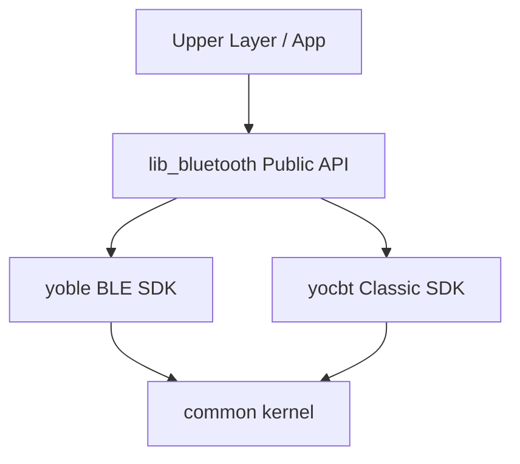
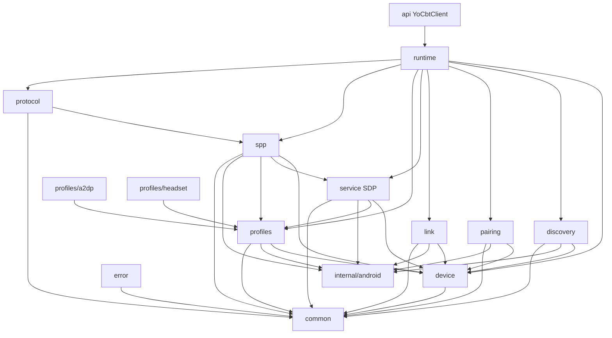

# lib_bluetooth Android SDK 全量重构提示词：经典蓝牙能力域架构版

> 适用对象：代码 Agent / Cursor / Codex / 人工架构评审  
> 目标项目：`lib_bluetooth`  
> 重点模块：`yocbt` 经典蓝牙  
> 生成日期：2026-06-16  
> 本版目标：在保留完整功能要求的基础上，按“能力域优先 + 端口/适配器 + 运行时组件”组织，重点解决 `common` 与各模块中“为了划分而划分”、单文件目录过多、model 垃圾桶、万能 manager、状态混用等问题。  

---

## 0. 使用说明

本文档是 `lib_bluetooth` 全量重构的架构指导。功能范围仍覆盖 Classic discovery、bond、ACL、SDP、Profile、A2DP、Headset/HFP、SPP、Channel、多连接、状态机、错误码、线程、生命周期、测试和验收。本文重写的是架构组织方式。

本版主要修正：

- 不再把每个模块机械拆成 `api/domain/data/platform/internal`。
- 不再鼓励 `common` 下出现大量只有一个文件的子目录。
- 不再把 model 集中到无边界的 `model` 包。
- 不再让 manager 承担过多职责。
- 不再把 A2DP / Headset / ACL / SPP 混成一个连接状态。
- 不再把 SPP 字节流与业务命令协议混在一起。
- 不再让 hidden API 反射细节泄漏到 domain 或 public API。

本文仍坚持：文档先行、代码后置；不做最小改动；不兼容旧 API；不兼容旧代码；不处理应用层适配。


## 1. 外部资料调研结论与架构吸收

本节不是资料堆砌，而是把调研资料转化为 `lib_bluetooth` 的架构约束。

### 1.1 Android 官方蓝牙资料形成的约束

- Android 蓝牙权限在 Android 12 / API 31 起拆分为 `BLUETOOTH_SCAN`、`BLUETOOTH_CONNECT`、`BLUETOOTH_ADVERTISE`；旧权限需要按 `maxSdkVersion=30` 隔离，新权限要进入运行时权限检查模型。因此权限不能散落在扫描、连接、Profile 查询代码里，而应由 `common/permission` 与 `yocbt/internal/android/permission` 统一封装。
- `BluetoothProfile` 是 Android 对 Profile service proxy 的抽象。`A2DP`、`HEADSET`、`HID_HOST`、`HEARING_AID`、`LE_AUDIO` 等不能被设计成 SPP 的附属状态，必须进入 Profile 子系统。
- `BluetoothAdapter.getProfileConnectionState(profile)` 是 profile 聚合状态；`BluetoothProfile.getConnectionState(device)` 才是 per-device profile 状态。因此 SDK 不能只暴露一个全局 `isConnected()`。
- `BluetoothDevice.fetchUuidsWithSdp()` 是异步服务发现流程，结果通过 `ACTION_UUID` 返回；`getUuids()` 返回缓存，不等于实时服务发现。因此 SDP 必须是独立模块，不能藏在 SPP connect 里。
- `BluetoothDevice.createRfcommSocketToServiceRecord(UUID)` 会使用 SDP 查找 UUID 对应的 RFCOMM channel；`BluetoothSocket.connect()` 是阻塞调用；连接后通过 `InputStream` / `OutputStream` 进行字节流通信；`close()` 应作为中断 connect/read/write 的释放手段。因此 SPP 连接必须有独立调度线程、状态机、transport 与 lifecycle。
- 非 SDK / hidden API 从 Android 9 开始受到限制，反射访问可能失败，且不同 targetSdk 与 ROM 行为不同。按 channel 创建 RFCOMM socket 的能力只能放在 `internal/android/hiddenapi` 或 `spp/channel` 的内部适配器里，不能污染 domain 与 public API。

### 1.2 Bluetooth SIG / 协议事实形成的约束

- SPP 基于 RFCOMM，用来模拟串口线缆；SPP 是字节流能力，不是业务命令协议。
- SDP 用于发现远端服务及其属性，包括服务 UUID 与可能的 RFCOMM channel 信息；SDP 结果表示能力，不表示连接状态。
- 一个经典蓝牙设备可以同时拥有 A2DP、AVRCP、HFP/HSP、HID、PBAP、MAP、OPP、PAN、SPP 等多个 Profile 或 profile-like 能力。
- 同一个设备可能暴露多个 RFCOMM 服务、多个 SPP UUID、多个 channel；SDK 架构不能预设“一个设备只有一个 SPP”。
- Classic BR/EDR、BLE、Dual Mode 地址与能力不能粗暴混用；双模设备归并是设备身份解析问题，不是扫描结果去重问题。

### 1.3 优秀 Android / Clean Architecture 资料形成的约束

- Android 官方架构指南强调分层与关注点分离，domain 层用于封装复杂或可复用业务逻辑，data/repository 用于集中数据源、冲突解决和对外暴露数据。SDK 场景没有 UI 层，但仍需要 `api -> capability domain -> platform adapter` 的依赖方向。
- 本项目不能机械复制 `api/domain/data/platform` 到每个小包。优秀架构不是目录层数，而是稳定边界、依赖方向、可替换性与测试性。
- 新架构采用“能力域优先 + 端口/适配器 + 运行时组件”的方式：先按蓝牙事实划分能力域，再在能力域内部按需要引入 domain、repository、platform adapter、state machine、test fake。目录只在形成稳定职责族时创建。

### 1.4 本文使用的调研来源

- Android Bluetooth overview: https://developer.android.com/develop/connectivity/bluetooth
- Android Bluetooth permissions: https://developer.android.com/develop/connectivity/bluetooth/bt-permissions
- Android Bluetooth profiles: https://developer.android.com/develop/connectivity/bluetooth/profiles
- Android BluetoothDevice API: https://developer.android.com/reference/android/bluetooth/BluetoothDevice
- Android BluetoothSocket API: https://developer.android.com/reference/android/bluetooth/BluetoothSocket
- Android BluetoothProfile API: https://developer.android.com/reference/android/bluetooth/BluetoothProfile
- Android non-SDK interface restrictions: https://developer.android.com/guide/app-compatibility/restrictions-non-sdk-interfaces
- Android app architecture guide: https://developer.android.com/topic/architecture
- Android data layer guide: https://developer.android.com/topic/architecture/data-layer
- AOSP Bluetooth framework source: https://android.googlesource.com/platform/frameworks/base/+/master/core/java/android/bluetooth/
- AOSP Bluetooth module source: https://android.googlesource.com/platform/packages/modules/Bluetooth/
- Bluetooth SIG specifications: https://www.bluetooth.com/specifications/specs/
- Bluetooth SIG Serial Port Profile: https://www.bluetooth.com/specifications/specs/serial-port-profile-1-1/
- Bluetooth SIG Assigned Numbers: https://www.bluetooth.com/specifications/assigned-numbers/


## 2. 重构任务边界与最高原则

### 2.1 任务性质

本文档用于指导代码 Agent / Cursor / Codex / 人工架构评审，对 `lib_bluetooth` Android 蓝牙 SDK 进行全量架构重构。

本任务不是：

- 不是补丁任务。
- 不是最小改动任务。
- 不是旧 API 兼容任务。
- 不是为了让旧应用层临时跑通。
- 不是把旧目录换个名字。
- 不是把 `api/domain/data/platform` 复制到每个模块。

本任务是：

- 从蓝牙底层事实出发。
- 从 Android 官方 API 和 AOSP 行为出发。
- 从长期 SDK 架构出发。
- 重新建立 `common` / `yoble` / `yocbt` 的模块边界。
- 重点重建经典蓝牙 `yocbt` 的设备身份、发现、配对、ACL、SDP、Profile、A2DP、Headset/HFP、SPP、Channel、命令协议、多连接隔离、状态机、错误码、线程与生命周期。

### 2.2 不兼容原则

本次重构明确不兼容旧代码，不兼容旧 API，不兼容旧目录结构，不处理应用层适配。

禁止：

- 为旧 API 保留兼容层。
- 为旧调用方式保留 adapter。
- 为旧 model 做桥接。
- 为旧 manager 做 wrapper。
- 为旧 callback 做转换。
- 为旧目录保留 facade。
- 为应用层临时编译通过污染 SDK 架构。

允许并鼓励：

- 全量重建目录结构。
- 删除旧代码。
- 重建 public API。
- 重建 model。
- 拆解万能 manager。
- 合并无意义的小目录。
- 重建状态机、错误码、线程模型和测试替身。

### 2.3 文档先行原则

架构文档完成前禁止修改业务代码。

必须先完成：

- 现有项目代码只读审查。
- `common` / `yoble` / `yocbt` 目录审查。
- Gradle 与 public API 审查。
- Android 官方蓝牙资料调研。
- Bluetooth SIG / SDP / RFCOMM / SPP / Profile 资料调研。
- AOSP 与 hidden API 风险调研。
- ADB / logcat / HCI snoop 真机验证计划。
- 多份细粒度架构文档。
- 全量重建计划与最终验证报告模板。

### 2.4 证据原则

所有结论必须有证据。

证据来源包括：

- 实际代码路径。
- 类名。
- 方法名。
- 调用链。
- Gradle 配置。
- Android 官方文档。
- Bluetooth SIG 资料。
- AOSP 源码。
- ADB 输出。
- logcat 日志。
- HCI snoop log。
- 真机联调结果。

如果无法确认，必须标记为：

```text
待验证项：
- 问题：
- 当前无法确认原因：
- 需要验证的设备：
- 需要使用的工具：
- 可能影响的模块：
- 后续处理建议：
```

### 2.5 目录创建原则：反对“为了划分而划分”

这是本次新架构最重要的修正。

禁止：

- 每个能力域都机械创建 `api/domain/data/platform/internal`。
- 一个目录里只有一个文件且没有明确扩展点。
- 只因为概念名字不同就单独建包。
- 把所有 model 放到一个 `model` 包。
- 把所有 manager 放到一个层里。
- 把 platform adapter 与业务状态机混在一起。

创建目录必须满足至少两个条件：

1. 该目录代表稳定的业务能力、协议层或运行时边界。
2. 该目录内预期存在一组强相关文件，而不是单个孤立文件。
3. 该目录可以被独立测试或替换。
4. 该目录可以表达依赖方向或隐藏平台细节。
5. 该目录有明确 owner，不会变成垃圾桶。

不满足以上条件时，文件直接放在所属能力域根目录，并用清晰类名表达职责。

示例：

```text
错误：
yocbt/acl/model/YoCbtAclState.java       # model 目录只有一个文件

yocbt/acl/domain/YoCbtAclTracker.java   # domain 目录只有一个文件

yocbt/acl/platform/YoCbtAclReceiver.java # platform 目录只有一个文件

更好：
yocbt/link/
├── YoCbtAclState.java
├── YoCbtAclEvent.java
├── YoCbtAclTracker.java
├── YoCbtAclReceiverAdapter.java
└── YoCbtAclRepository.java
```

当 `link` 继续扩大，出现多个 Android receiver、多种 fake source、多个 mapper 时，再拆：

```text
yocbt/link/
├── state/
├── receiver/
└── testing/
```


## 3. 蓝牙底层事实与分层模型

### 3.1 必须区分的技术层级

经典蓝牙设备不能只用一个“连接状态”表示。必须分层：

```text
物理设备 Physical Device
↓
无线能力 Radio / Transport Capability
↓
系统发现 Discovery Observation
↓
配对绑定 Bond
↓
ACL 底层链路 ACL Link
↓
SDP 服务发现 Service Discovery
↓
Profile 能力 Profile Capability
↓
Android Profile Proxy
↓
Profile 连接状态 Profile Connection State
↓
Profile 运行时状态 Profile Runtime State
↓
SPP RFCOMM Socket
↓
SPP Byte Transport
↓
业务命令协议 Command Protocol
```

架构约束：

- Discovery 只表示系统观察到设备，不表示可连接。
- Bond 只表示配对绑定，不表示 ACL、Profile、SPP 已连接。
- ACL 表示底层链路，不表示 A2DP、Headset、SPP 已连接。
- SDP 表示服务能力，不表示当前连接状态。
- Profile capability 与 Profile connection state 必须分开。
- SPP 是 RFCOMM 字节流，不是业务命令协议。
- Command Protocol 必须绑定某个 SPP connectionId，不能绑定全局设备。

### 3.2 Classic / BLE / Dual Mode 身份事实

必须明确：

- Classic BR/EDR 设备使用经典蓝牙地址。
- BLE 设备可能使用 public address、random static address、resolvable private address、non-resolvable private address。
- Dual Mode 设备在 Android 上可能表现为同一地址，也可能表现为不同地址。
- `BluetoothDevice.getType()` 可以返回 `DEVICE_TYPE_CLASSIC`、`DEVICE_TYPE_LE`、`DEVICE_TYPE_DUAL`、`DEVICE_TYPE_UNKNOWN`。
- name / alias 不是稳定 ID。
- MAC 地址不是跨协议绝对唯一物理设备 ID。
- BLE scan result 不能直接当作经典蓝牙 connect target。
- Classic scan result 不能直接当作 BLE GATT target。

### 3.3 Profile 事实

必须支持并分层建模：

- `A2DP`：高质量音频流 Profile。
- `AVRCP`：音频/视频远程控制，常与 A2DP 配合。
- `HEADSET / HSP`：基础耳机通话 Profile。
- `HFP`：免提 Profile，常用于通话控制。
- `SCO`：通话音频链路状态，不等于 Headset profile connection。
- `HID_HOST`：人机输入设备。
- `HEARING_AID`：助听设备 Profile。
- `LE_AUDIO`：LE Audio 能力。
- `PBAP / MAP / OPP / PAN`：电话簿、短信、对象推送、网络相关能力。
- `SPP`：基于 RFCOMM 的串口模拟能力。

必须禁止：

- 用 `isConnected` 表示所有连接。
- 用 `isA2dpConnected` 代表设备整体连接。
- 用 `isHeadsetConnected` 代表 SCO audio active。
- 用 `SPP connected` 推断 A2DP 或 Headset 已连接。
- 用 SDP UUID 推断当前 profile 已连接。

### 3.4 SPP / RFCOMM / Channel 事实

SPP 必须建模为端点 + 连接实例：

```text
YoCbtSppEndpoint
├── endpointType: UUID | RFCOMM_CHANNEL
├── uuid
├── channel
├── securityMode: SECURE | INSECURE
├── source: USER_SPECIFIED | SDP_RESOLVED | DEFAULT_SPP | VENDOR_CONFIG | DEBUG_TOOL_CONFIRMED
└── metadata

YoCbtSppConnectionKey
├── deviceIdentity
├── endpoint
├── securityMode
├── role
└── policy

YoCbtSppConnectionId
└── SDK 生成的连接实例 ID，用于区分同一设备同一端点的不同连接代次
```

一个设备可以有：

```text
设备 A -> UUID 1 -> Connection 1
设备 A -> UUID 2 -> Connection 2
设备 A -> Channel 3 -> Connection 3
设备 B -> UUID 1 -> Connection 4
设备 B -> Channel 5 -> Connection 5
```

SDK 不能在架构上禁止单设备多 SPP 或多设备多 SPP。是否成功由远端设备、固件、ROM、蓝牙栈和 channel/service 实现决定。


## 4. 总体架构：能力域优先 + 端口/适配器 + 运行时组件

### 4.1 总体依赖方向



禁止依赖：

```text
common -> yoble
common -> yocbt
yoble -> yocbt
yocbt -> yoble
yocbt/internal/android -> yocbt/api
platform adapter -> public facade
protocol -> android.bluetooth.*
command session -> global current connection
```

### 4.2 新目标目录结构

该结构不是机械三层，也不是把每个概念拆成一个目录。它按“能力域”聚合，目录只在形成一组稳定职责时出现。

```text
lib_bluetooth/
├── common/
│   ├── bluetooth/              # 蓝牙 Adapter、开关状态、能力探测的通用抽象
│   ├── permission/             # Android 版本差异、权限声明、运行时检查、缺失权限错误
│   ├── result/                 # YoResult、YoFailure、成功/失败封装
│   ├── error/                  # 通用错误基类、错误上下文
│   ├── diagnostics/            # log、trace、event timeline、dump
│   ├── concurrency/            # dispatcher、serial executor、scheduler、timeout task
│   ├── lifecycle/              # release、close、scope、idempotent disposer
│   ├── state/                  # 状态机基础设施、状态事件基类
│   └── testing/                # fake clock、fake dispatcher、fake bluetooth adapter
│
├── yoble/                      # BLE 能力域，保持与 yocbt 隔离
│   └── ...
│
├── yocbt/
│   ├── api/                    # YoCbtClient、public facade、public observer contracts
│   ├── device/                 # 经典蓝牙设备身份、地址、类型、能力、快照
│   ├── discovery/              # Classic discovery / scan observation
│   ├── pairing/                # Bonded devices 与 bond state
│   ├── link/                   # ACL link state tracking
│   ├── service/                # SDP / UUID / service record / service cache
│   ├── profiles/               # Profile 抽象、proxy、state、A2DP、Headset、扩展 Profile
│   │   ├── core/
│   │   ├── proxy/
│   │   ├── state/
│   │   ├── a2dp/
│   │   ├── headset/
│   │   └── extensions/
│   ├── spp/                    # SPP/RFCOMM 连接、endpoint、transport、多连接隔离
│   │   ├── endpoint/
│   │   ├── connection/
│   │   ├── transport/
│   │   ├── io/
│   │   ├── channel/
│   │   └── registry/
│   ├── protocol/               # packet、codec、command、matcher、retry、timeout
│   ├── runtime/                # yocbt 运行时编排、资源释放、统一事件汇聚
│   ├── error/                  # YoCbtErrorCode、YoCbtException、错误上下文
│   ├── diagnostics/            # yocbt 专属日志、dump、trace
│   ├── internal/
│   │   └── android/            # Android Framework 适配器、receiver、hidden API 隔离
│   └── testing/                # fake platform、fake socket、fake profile proxy
│
└── docs/
```

### 4.3 为什么这样比原结构更好

原文档功能覆盖全面，但目录层面容易出现：

```text
common/xxx/只有一个文件
yocbt/scan/api/只有一个接口
yocbt/scan/domain/只有一个 controller
yocbt/scan/data/只有一个 repository
yocbt/scan/platform/只有一个 receiver
```

这种结构看起来“分层”，实际会导致：

- 文件跳转成本增加。
- 职责没有变清晰，只是目录变多。
- 每个能力域都复制一套层，造成样板化。
- 小目录过早固化，后续真正扩展时反而难调整。
- common 被迫放入不够通用的内容。

新结构的核心是：

- `device`、`discovery`、`pairing`、`link`、`service`、`profiles`、`spp`、`protocol` 是经典蓝牙真实能力域。
- 每个能力域内部优先聚合相关模型、状态、服务、mapper、observer。
- 只有当平台细节足够多时才拆到 `internal/android` 或能力域内部适配器。
- `profiles` 内聚所有 Profile 抽象，A2DP / Headset 是 Profile 插件，不是 SPP 的兄弟工具类。
- `spp` 内聚 RFCOMM transport 与多连接，但业务 packet/command 放到 `protocol`。
- `common` 是 kernel，不是所有公共类垃圾桶。

### 4.4 架构边界规则

```text
api 层：只暴露 SDK 使用者需要的稳定契约。
capability domain：表达蓝牙事实、状态机、连接身份、能力模型。
internal/android：封装 android.bluetooth.*、BroadcastReceiver、Intent、hidden API、权限调用。
runtime：编排多个能力域，不承载底层细节。
testing：提供 fake adapter、fake socket、fake profile proxy，不依赖真机。
```

### 4.5 Android 类型暴露规则

public API 禁止暴露：

- `BluetoothDevice`
- `BluetoothSocket`
- `BluetoothProfile`
- `BluetoothA2dp`
- `BluetoothHeadset`
- `BroadcastReceiver`
- `Intent`
- `InputStream`
- `OutputStream`
- hidden API method name

允许在内部适配层使用 Android 类型，但必须马上映射成 SDK 类型。


## 5. common 与 yoble 边界

### 5.1 common：共享 kernel，不是共享垃圾桶

`common` 只放 BLE 与 Classic 都真正复用的基础设施。

允许：

```text
common/bluetooth/
- YoBluetoothAdapterProvider
- YoBluetoothPowerState
- YoBluetoothCapability
- YoBluetoothAvailabilityChecker

common/permission/
- YoBluetoothPermission
- YoBluetoothPermissionChecker
- YoBluetoothPermissionRequirement
- YoPermissionDeniedFailure

common/result/
- YoResult<T>
- YoSuccess<T>
- YoFailure

common/error/
- YoErrorCode
- YoErrorContext
- YoException

common/diagnostics/
- YoBluetoothLogger
- YoTraceId
- YoEventTimeline
- YoDumpable

common/concurrency/
- YoDispatcher
- YoSerialExecutor
- YoTaskScheduler
- YoTimeoutHandle

common/lifecycle/
- YoReleasable
- YoCloseGuard
- YoLifecycleScope

common/state/
- YoStateMachine
- YoStateTransition
- YoStateEvent

common/testing/
- FakeClock
- FakeDispatcher
- FakeBluetoothAdapterProvider
```

禁止：

- SPP、GATT、A2DP、Headset 放入 common。
- BLE ScanResult 放入 common。
- Classic discovery result 放入 common。
- Profile proxy 放入 common。
- 业务 packet / command 放入 common。
- 只因为 yoble 和 yocbt 都有 device，就建立一个大而全 `CommonDeviceModel`。

### 5.2 yoble 边界

`yoble` 保留 BLE 专属能力：

- BLE scan。
- advertising data parse。
- GATT connection。
- service / characteristic / descriptor discovery。
- MTU。
- notification / indication。
- read / write。
- BLE pairing / bond。
- BLE state machine。
- BLE error code。

`yoble` 不依赖 `yocbt`。

如果 BLE 与 Classic 需要归并同一物理设备，只能通过：

```text
common/bluetooth weak identity
+ yocbt/device YoCbtDeviceIdentity
+ yoble/device YoBleDeviceIdentity
+ 上层或独立 resolver 做弱关联
```

禁止 yoble 直接读取 yocbt 的 device model，也禁止 yocbt 直接读取 yoble 的 scan result。


## 6. yocbt 总体架构

### 6.1 能力域列表

```text
yocbt/api          对外入口，不暴露 Android 细节
yocbt/device       设备身份、地址、类型、能力、快照
yocbt/discovery    经典蓝牙发现观察，不承担连接
yocbt/pairing      已配对设备与 bond state
yocbt/link         ACL 底层链路状态
yocbt/service      SDP / UUID / service record / cache
yocbt/profiles     Profile 抽象、proxy 生命周期、per-device 状态、A2DP、Headset、扩展
yocbt/spp          RFCOMM / SPP endpoint、connection、transport、io、多连接隔离
yocbt/protocol     packet / command / matcher / retry / timeout
yocbt/runtime      SDK 运行时编排与 release
yocbt/error        错误码与异常
yocbt/diagnostics  日志、trace、dump
yocbt/internal     Android Framework 适配与 hidden API 隔离
yocbt/testing      fake 实现与模块测试工具
```

### 6.2 yocbt 内部依赖方向



### 6.3 yocbt 禁止行为

- `discovery` 直接创建 SPP socket。
- `pairing` 直接判断 A2DP connected。
- `link` 把 ACL connected 上报成 Profile connected。
- `service` 把 SDP UUID 上报成 SPP connected。
- `profiles/a2dp` 依赖 `spp`。
- `spp` 关闭 A2DP / Headset profile proxy。
- `protocol` 使用 Android Bluetooth 类型。
- `runtime` 直接反射 hidden API。
- public API 直接返回内部 mutable state。


## 7. 必须输出的细粒度架构文档

重构前必须在 `lib_bluetooth/docs/` 下输出以下文档。与原文相比，本文档保留全部功能要求，但把目录组织调整为新架构。

```text
lib_bluetooth/docs/
├── 00_project_audit.md
├── 01_bluetooth_foundation.md
├── 02_android_bluetooth_api_research.md
├── 03_overall_architecture.md
├── 04_common_kernel_architecture.md
├── 05_yoble_boundary.md
├── 06_yocbt_overall_architecture.md
├── 07_yocbt_device_identity_architecture.md
├── 08_yocbt_discovery_architecture.md
├── 09_yocbt_pairing_architecture.md
├── 10_yocbt_acl_link_architecture.md
├── 11_yocbt_service_discovery_architecture.md
├── 12_yocbt_profile_core_architecture.md
├── 13_yocbt_profile_proxy_architecture.md
├── 14_yocbt_profile_state_snapshot_architecture.md
├── 15_yocbt_a2dp_profile_architecture.md
├── 16_yocbt_headset_hfp_profile_architecture.md
├── 17_yocbt_profile_extensions_architecture.md
├── 18_yocbt_spp_core_architecture.md
├── 19_yocbt_spp_multi_connection_architecture.md
├── 20_yocbt_spp_channel_architecture.md
├── 21_yocbt_spp_connection_isolation.md
├── 22_yocbt_command_protocol_architecture.md
├── 23_yocbt_state_machine.md
├── 24_yocbt_error_code.md
├── 25_yocbt_threading_lifecycle.md
├── 26_yocbt_public_api.md
├── 27_yocbt_testing_strategy.md
├── 28_full_rebuild_plan.md
└── 29_verification_report.md
```

每份文档必须包含：

- 主题与边界。
- 当前代码证据。
- 新架构职责。
- 关键类与接口。
- 数据流。
- 状态流。
- 错误流。
- 线程与生命周期。
- 测试方案。
- 未验证项。


## 8. docs/00_project_audit.md：项目现状审查报告

由于当前只拿到重构提示词，没有拿到完整项目源码，Agent 执行时必须先审查源码，不能跳过。

必须审查：

1. 当前 `lib_bluetooth` 总目录结构。
2. 当前 `common` 目录结构，特别是只有一个文件的子目录。
3. 当前 `yoble` 目录结构。
4. 当前 `yocbt` 目录结构。
5. 当前所有 model 清单。
6. 当前所有 manager 清单。
7. 当前所有 callback / listener 清单。
8. 当前所有 public API 清单。
9. 当前 Gradle module 与依赖关系。
10. 当前扫描流程。
11. 当前 bonded device 流程。
12. 当前 ACL 监听流程。
13. 当前 SDP 流程。
14. 当前 Profile 支持情况。
15. 当前 A2DP 状态查询能力。
16. 当前 Headset/HFP 状态查询能力。
17. 当前多 Profile 状态快照能力。
18. 当前 SPP 连接流程。
19. 当前 SPP 收发流程。
20. 当前多连接支持情况。
21. 当前是否支持单设备多 SPP。
22. 当前是否支持多设备多 SPP。
23. 当前是否支持 Channel 号连接。
24. 当前错误处理方式。
25. 当前状态管理方式。
26. 当前线程模型。
27. 当前资源释放方式。
28. 当前命名问题。
29. 当前违反高内聚低耦合的位置。
30. 当前必须删除或重建的代码。

每一项必须使用统一表格：

```text
- 代码路径：
- 类名：
- 方法名：
- 调用关系：
- 当前职责：
- 问题描述：
- 架构影响：
- 是否保留：
- 是否重建：
- 迁入新模块：
- 删除理由：
```

必须额外输出“目录反模式清单”：

```text
目录路径 | 文件数量 | 当前文件 | 是否为了划分而划分 | 新架构处理方式
```

处理方式只能是：

- 合并到所属能力域根目录。
- 合并到 common kernel 某个已有职责族。
- 删除。
- 保留并说明扩展点。
- 延迟拆分，等待文件族形成。


## 9. docs/01_bluetooth_foundation.md：蓝牙底层事实文档

必须讲清楚并形成架构结论：

1. BR/EDR 是什么。
2. BLE 是什么。
3. Classic Bluetooth 与 BLE 的根本区别。
4. Single Mode 设备是什么。
5. Dual Mode 设备是什么。
6. 经典蓝牙地址是什么。
7. BLE public address / random address 是什么。
8. 双模设备地址为什么不能粗暴混用。
9. Class of Device / Major Device Class / Minor Device Class / Service Class 是什么。
10. Bond 是什么。
11. ACL Link 是什么。
12. SDP 是什么。
13. RFCOMM 是什么。
14. RFCOMM Channel 是什么。
15. SPP 是什么。
16. UUID 是什么。
17. Profile 是什么。
18. A2DP / AVRCP / HSP / HFP / SCO / HID / PBAP / MAP / OPP / PAN 是什么。
19. 为什么 SPP 不等于业务协议。
20. 为什么一个设备可能有多个 RFCOMM 服务。
21. 为什么一个设备可能有多个 SPP UUID。
22. 为什么一个设备可能有多个 RFCOMM Channel。
23. 为什么一个经典蓝牙设备可能同时存在多个 Profile 状态。
24. 为什么 SDK 不能假设单设备单连接。

必须输出“架构约束”小节，把事实转为代码设计规则。

## 10. docs/02_android_bluetooth_api_research.md：Android 蓝牙 API 调研文档

必须调研并记录：

1. `BluetoothAdapter` 职责。
2. `BluetoothManager` 职责。
3. `BluetoothDevice` 职责。
4. `BluetoothClass` 职责。
5. `BluetoothSocket` / `BluetoothServerSocket` 职责。
6. `BluetoothProfile` 职责。
7. `BluetoothA2dp` 职责。
8. `BluetoothHeadset` 职责。
9. `BluetoothHidHost` / `BluetoothHearingAid` / `BluetoothLeAudio` 职责。
10. `startDiscovery()` / `cancelDiscovery()` 行为。
11. `getBondedDevices()` 意义。
12. `getType()` 返回值与权限。
13. `getBondState()` 意义。
14. `ACTION_ACL_CONNECTED` / `ACTION_ACL_DISCONNECTED` 行为。
15. `getUuids()` 与 `fetchUuidsWithSdp()` 区别。
16. `ACTION_UUID` timeout / empty / cached 情况。
17. `getProfileProxy()` / `closeProfileProxy()` 生命周期。
18. `getProfileConnectionState(profile)` 的聚合局限。
19. `BluetoothProfile.getConnectedDevices()` 与 `getConnectionState(device)` 的 per-profile 意义。
20. `createRfcommSocketToServiceRecord(UUID)` 行为。
21. `createInsecureRfcommSocketToServiceRecord(UUID)` 行为。
22. hidden `createRfcommSocket(int channel)` 与 `createInsecureRfcommSocket(int channel)` 风险。
23. `connect()` 阻塞问题。
24. `InputStream` / `OutputStream` 收发模型。
25. `close()` 对阻塞操作的中断意义。
26. Android 12+ 权限变化。
27. 非 SDK 接口限制。
28. 不同 ROM 差异风险。

必须给出表格：

```text
Android API | 所属新模块 | 是否允许 public 暴露 | 是否需要适配器 | 权限 | 风险 | 测试方式
```


## 11. docs/03_overall_architecture.md：lib_bluetooth 总体架构文档

必须定义：

1. `lib_bluetooth` 长期目标。
2. `common` / `yoble` / `yocbt` 模块边界。
3. 依赖方向。
4. 禁止依赖方向。
5. 公共能力沉淀规则。
6. BLE 专属能力边界。
7. Classic 专属能力边界。
8. 对外 API 暴露规则。
9. 内部实现隐藏规则。
10. 测试替换规则。
11. 目录创建规则。
12. 目录合并规则。

必须特别说明：`common` 不是为了减少重复 import 而存在，而是为了沉淀跨 BLE / Classic 稳定复用的 kernel 能力。

## 12. docs/04_common_kernel_architecture.md：common kernel 架构文档

建议结构：

```text
common/
├── bluetooth/
├── permission/
├── result/
├── error/
├── diagnostics/
├── concurrency/
├── lifecycle/
├── state/
└── testing/
```

必须明确：

- 每个目录的职责族。
- 进入 common 的准入标准。
- 禁止进入 common 的内容。
- 权限检查如何兼容 Android 12+。
- Result / Error 如何统一。
- 日志与 trace 如何携带 deviceId、profileType、connectionId。
- concurrency 如何支持 connect/read/write/timeout。
- lifecycle 如何实现幂等 release。
- common fake 如何支持单元测试。

目录准入标准：

```text
只有当一个概念被 yoble 与 yocbt 同时使用，且不包含任何 BLE 或 Classic 专属语义，才能进入 common。
```

## 13. docs/05_yoble_boundary.md：yoble 边界文档

必须说明：

1. `yoble` 当前结构。
2. `yoble` 保留哪些 BLE 专属能力。
3. `yoble` 不依赖 `yocbt`。
4. `yoble` 不把 BLE device model 暴露给 `yocbt`。
5. BLE 地址模型与 Classic 地址模型区别。
6. 双模设备如何通过弱 identity 归并。
7. 哪些内容应该下沉到 `common`。
8. 哪些内容必须留在 `yoble`。
9. BLE GATT 与 Classic SPP 的协议边界。

## 14. docs/06_yocbt_overall_architecture.md：yocbt 总体架构文档

必须使用本文新目录：

```text
yocbt/
├── api/
├── device/
├── discovery/
├── pairing/
├── link/
├── service/
├── profiles/
├── spp/
├── protocol/
├── runtime/
├── error/
├── diagnostics/
├── internal/
└── testing/
```

每个能力域必须说明：

- 职责。
- 输入。
- 输出。
- 上游依赖。
- 下游依赖。
- 禁止依赖。
- 核心类。
- 核心接口。
- 数据流。
- 状态流。
- 错误流。
- 测试方式。

必须明确：不再对每个能力域机械建立 `api/domain/data/platform/internal`。只有当能力域内部形成一组稳定文件族时，才拆子目录。


## 15. docs/07_yocbt_device_identity_architecture.md：设备身份架构

设备身份是 yocbt 的底层核心。

### 15.1 目标

必须重新定义经典蓝牙设备身份，不允许粗暴使用一个 MAC 表示一切。

核心类型：

```text
YoCbtAddress
YoCbtAddressType
YoCbtDeviceType
YoCbtDeviceIdentity
YoCbtObservedDevice
YoCbtBondedDevice
YoCbtAclDevice
YoCbtResolvedDevice
YoCbtProfileCapableDevice
YoCbtDeviceCapability
YoCbtDeviceClass
YoCbtDeviceAlias
YoCbtDeviceSnapshot
YoCbtDeviceProfileSnapshot
```

### 15.2 必须区分

1. 经典蓝牙地址。
2. BLE 地址。
3. 未知地址类型。
4. 单模经典蓝牙设备。
5. 单模 BLE 设备。
6. 双模设备。
7. Android `getType()` 返回的 DUAL。
8. 实际物理设备归属。
9. 系统已配对设备。
10. 扫描观察到的设备。
11. ACL 当前连接设备。
12. 可连接设备。
13. 已解析能力设备。
14. 具有 Profile 能力的设备。
15. 当前 Profile 已连接设备。
16. 当前 SPP 已连接设备。

### 15.3 YoCbtDeviceSnapshot

只读快照，不承载业务逻辑：

```text
YoCbtDeviceSnapshot
├── identity
├── displayName
├── alias
├── address
├── addressType
├── deviceType
├── bluetoothClass
├── bondState
├── aclState
├── discoveredUuids
├── supportedProfiles
├── profileConnectionStates
├── a2dpState
├── headsetState
├── sppConnections
├── lastSeenTime
├── lastResolvedTime
└── source
```

### 15.4 禁止

- BLE MAC 和 Classic MAC 直接混用。
- 只用 name 合并设备。
- 只用 MAC 判断物理设备唯一性。
- 把 scan result 当 connectable device。
- 把 bonded device 当 scan result。
- 把 ACL connected 当所有 profile connected。
- 把 A2DP connected 当整个设备 connected。
- 把 UUID 直接塞到普通 device model 里。

### 15.5 目录建议

```text
yocbt/device/
├── YoCbtAddress.java
├── YoCbtDeviceIdentity.java
├── YoCbtDeviceType.java
├── YoCbtDeviceClass.java
├── YoCbtDeviceCapability.java
├── YoCbtDeviceSnapshot.java
├── YoCbtDeviceIdentityResolver.java
├── YoCbtDeviceSnapshotStore.java
└── YoCbtAndroidDeviceMapper.java
```

如果后续文件增多，再拆：

```text
yocbt/device/identity/
yocbt/device/snapshot/
yocbt/device/capability/
```


## 16. docs/08_yocbt_discovery_architecture.md：经典蓝牙发现架构

原 `scan` 建议改名为 `discovery`，原因是 Classic `startDiscovery()` 是 BR/EDR inquiry 与系统发现，不等同 BLE scan。

核心类：

```text
YoCbtDiscoveryController
YoCbtDiscoveryConfig
YoCbtDiscoveryFilter
YoCbtDiscoverySession
YoCbtDiscoveryState
YoCbtDiscoveryEvent
YoCbtDiscoveryResult
YoCbtDiscoveryResultMerger
YoCbtDiscoveryReceiverAdapter
YoCbtDiscoveryFailure
```

必须覆盖：

1. 发现启动。
2. 发现停止。
3. 发现超时。
4. 重复发现处理。
5. `ACTION_FOUND`。
6. `ACTION_DISCOVERY_STARTED`。
7. `ACTION_DISCOVERY_FINISHED`。
8. `BluetoothDevice` 提取与映射。
9. `BluetoothClass` 提取。
10. RSSI 提取。
11. name / alias 提取。
12. device type 提取。
13. result 去重。
14. result 更新。
15. bonded device 合并策略。
16. 权限检查。
17. 蓝牙关闭处理。
18. receiver 注册与释放。
19. 连接前 `cancelDiscovery()` 规则。
20. 失败错误码。

数据流：

```text
discover(config)
→ permission check
→ adapter state check
→ register discovery receiver
→ BluetoothAdapter.startDiscovery()
→ ACTION_FOUND
→ Android BluetoothDevice
→ YoCbtObservedDevice
→ YoCbtDiscoveryResult
→ merge/update
→ observer
→ ACTION_DISCOVERY_FINISHED
→ release receiver/session
```

禁止 discovery 直接连接 SPP 或直接触发 SDP，除非通过显式策略交给 runtime 编排。

## 17. docs/09_yocbt_pairing_architecture.md：已配对与 Bond 架构

核心类：

```text
YoCbtBondedDeviceProvider
YoCbtBondedDeviceRepository
YoCbtBondStateObserver
YoCbtBondStateReceiverAdapter
YoCbtBondedDeviceMapper
YoCbtBondedDeviceRefresher
YoCbtBondOperationController
YoCbtBondSnapshot
```

必须支持：

- 获取系统已配对设备。
- 过滤 classic / dual mode 经典蓝牙能力。
- bond state 监听。
- bonded device 转 resolved device。
- 已配对设备直接回连。
- bonded device 与 discovery result 合并。
- bonded device UUID 缓存读取。
- bonded device 主动 SDP。
- 取消配对后的状态更新。
- bond state 变化后刷新 device snapshot。

必须明确：

```text
已配对 ≠ 扫描发现
已配对 ≠ 当前 ACL 已连接
已配对 ≠ 当前 Profile 已连接
已配对 ≠ 支持 SPP
已配对 ≠ 支持 A2DP
已配对 ≠ 支持 Headset
```

## 18. docs/10_yocbt_acl_link_architecture.md：ACL 链路架构

ACL 模块命名为 `link`，避免把 ACL 与 Profile 或 SPP 状态混用。

核心类：

```text
YoCbtAclLinkTracker
YoCbtAclLinkState
YoCbtAclLinkEvent
YoCbtAclLinkSnapshot
YoCbtAclLinkRepository
YoCbtAclReceiverAdapter
```

必须监听：

```text
BluetoothDevice.ACTION_ACL_CONNECTED
BluetoothDevice.ACTION_ACL_DISCONNECTED
BluetoothDevice.ACTION_ACL_DISCONNECT_REQUESTED
```

数据流：

```text
register ACL receiver
→ ACTION_ACL_CONNECTED / DISCONNECTED
→ extract BluetoothDevice
→ map YoCbtDeviceIdentity
→ update YoCbtAclLinkRepository
→ update YoCbtDeviceSnapshot
→ notify observers
→ trigger profile state refresh if needed
```

必须明确：

- ACL connected 是底层链路状态。
- ACL disconnected 可能导致多个 Profile 同时断开。
- ACL disconnected 不能代替 Profile proxy 查询。
- SPP socket 断开与 ACL 断开不是简单一一对应。

## 19. docs/11_yocbt_service_discovery_architecture.md：SDP 服务发现架构

原 `sdp` 建议放在 `service` 能力域中，原因是该模块不只是 UUID 数组，还包含 service record、service cache、profile capability mapping、endpoint policy。

核心类：

```text
YoCbtServiceDiscoveryClient
YoCbtSdpResolver
YoCbtSdpRequest
YoCbtSdpResult
YoCbtSdpRecord
YoCbtServiceRecord
YoCbtServiceCache
YoCbtSdpReceiverAdapter
YoCbtUuidSelector
YoCbtProfileUuidMapper
YoCbtSppEndpointResolver
YoCbtSppUuidPolicy
```

必须支持：

1. 主动触发 SDP。
2. `fetchUuidsWithSdp()`。
3. `ACTION_UUID` 监听。
4. SDP 超时。
5. SDP 结果缓存。
6. SDP 失败处理。
7. UUID 为空处理。
8. 指定 UUID 匹配。
9. 默认 SPP UUID fallback。
10. 自定义 UUID 策略。
11. Profile 能力解析。
12. SDP 与设备能力合并。
13. A2DP / Headset / HID 等 UUID 映射。
14. SDP 解析 RFCOMM channel 的可行性调研。
15. UUID 与 channel 映射关系维护。

数据流：

```text
discoverServices(device)
→ fetchUuidsWithSdp()
→ ACTION_UUID
→ ParcelUuid[]
→ YoCbtSdpResult
→ YoCbtProfileUuidMapper
→ YoCbtProfileCapability[]
→ YoCbtDeviceCapability
→ YoCbtResolvedDevice
→ optional YoCbtSppEndpointResolver
```


## 20. docs/12_yocbt_profile_core_architecture.md：Profile 核心架构

`yocbt` 不能只为 SPP 写死，必须建立 Profile 抽象。

建议结构：

```text
yocbt/profiles/
├── core/
├── proxy/
├── state/
├── a2dp/
├── headset/
└── extensions/
```

核心类型：

```text
YoCbtProfileType
YoCbtProfileDescriptor
YoCbtProfileCapability
YoCbtProfileRegistry
YoCbtProfileResolver
YoCbtProfileConnectionState
YoCbtProfileRuntimeState
YoCbtProfileEvent
YoCbtProfileStateSource
```

Profile 类型至少包含：

```text
SPP
A2DP
HEADSET
HFP
HSP
AVRCP
HID_HOST
PAN
PBAP
MAP
OPP
HEARING_AID
LE_AUDIO
UNKNOWN
```

必须区分：

- Android framework profile constant。
- Bluetooth SIG profile name。
- SDK 内部 profile type。
- SDP UUID 推断出来的 profile capability。
- Android proxy 查询到的 profile connection state。
- SDK 自己维护的 SPP connection state。
- 业务自定义 UUID / Channel 能力。

禁止：

- 把所有经典蓝牙能力塞进 SPP。
- 把 Profile 类型写死成 SPP。
- UUID 判断散落在各处。
- 用一个 `isConnected` 表示所有 Profile 状态。

## 21. docs/13_yocbt_profile_proxy_architecture.md：Profile Proxy 架构

必须统一管理 Android Profile proxy。

核心类：

```text
YoCbtProfileProxyManager
YoCbtProfileProxySession
YoCbtProfileProxyHandle
YoCbtProfileProxyState
YoCbtProfileProxyServiceListenerAdapter
YoCbtProfileProxyCache
YoCbtProfileProxyLifecycle
```

必须支持：

- `BluetoothAdapter.getProfileProxy()`。
- `BluetoothAdapter.closeProfileProxy()`。
- `BluetoothProfile.ServiceListener` 统一管理。
- proxy 可用状态。
- proxy 失效重连。
- 多 profile proxy 并存。
- 引用计数或 lifecycle scope。
- release 时关闭所有 proxy。

禁止：

- 业务类零散调用 `getProfileProxy()`。
- 每次查询都创建 proxy 不释放。
- 把 proxy 暴露给 public API。
- profile proxy 生命周期与 SPP socket 生命周期混在一起。

生命周期流：

```text
requestProfileProxy(profileType)
→ permission check
→ get framework profile id
→ BluetoothAdapter.getProfileProxy(context, listener, id)
→ onServiceConnected
→ store proxy handle
→ mark proxy ready
→ query connected devices / per-device state
→ closeProfileProxy on release
```

## 22. docs/14_yocbt_profile_state_snapshot_architecture.md：Profile 状态与快照架构

必须支持聚合状态与 per-device 状态。

聚合状态：

```text
YoCbtProfileAggregateState
├── profileType
├── aggregateConnectionState
├── connectedCount
├── queryTime
└── source
```

per-device 状态：

```text
YoCbtDeviceProfileState
├── deviceIdentity
├── profileType
├── connectionState
├── runtimeState
├── active
├── connectedAt
├── lastChangedAt
└── source
```

设备 Profile 快照：

```text
YoCbtDeviceProfileSnapshot
├── deviceIdentity
├── bondState
├── aclState
├── supportedProfiles
├── connectedProfiles
├── a2dpState
├── headsetState
├── sppConnectionStates
├── profileStates
├── lastUpdatedAt
└── source
```

状态来源：

```text
ANDROID_PROFILE_PROXY
PROFILE_BROADCAST
ACL_BROADCAST_INFERRED
SPP_CONNECTION_REGISTRY
SDP_CAPABILITY_ONLY
CACHED
UNKNOWN
```

必须明确：

- SDP capability 不能当 connected state。
- ACL disconnected 可触发 profile 状态刷新，但不能替代 proxy 查询。
- SPP 状态来自 SDK 自己的 `YoCbtSppConnectionRegistry`。

API 方向：

```java
getProfileAggregateState(YoCbtProfileType.A2DP)
getDeviceProfileState(deviceId, YoCbtProfileType.A2DP)
getDeviceProfileState(deviceId, YoCbtProfileType.HEADSET)
getDeviceProfileSnapshot(deviceId)
getConnectedProfiles(deviceId)
observeProfileState(deviceId, observer)
```

## 23. docs/15_yocbt_a2dp_profile_architecture.md：A2DP 架构

A2DP 是 Profile 插件，不是 SPP 模块，也不是全局连接状态。

核心类：

```text
YoCbtA2dpProfileController
YoCbtA2dpStateProvider
YoCbtA2dpStateObserver
YoCbtA2dpDeviceState
YoCbtA2dpConnectionSnapshot
YoCbtA2dpActiveDeviceProvider
YoCbtA2dpCodecStateProvider
YoCbtA2dpPlatformProxyAdapter
```

必须支持：

- 获取 A2DP connected devices。
- 查询单个设备 A2DP connection state。
- 监听 A2DP connection state changed。
- 查询 active A2DP device，如公开 API 支持。
- 查询 codec state，如公开 API 支持。
- 合并到 `YoCbtDeviceSnapshot`。
- 合并到 `YoCbtDeviceProfileSnapshot`。

必须明确：

- 普通三方 app 多数场景主要能查询状态。
- connect/disconnect A2DP 可能需要系统权限、系统签名或 hidden API。
- 若 SDK 运行在系统级，可预留 privileged connector，但必须隔离。
- 非特权场景不能假装支持 connect/disconnect。

## 24. docs/16_yocbt_headset_hfp_profile_architecture.md：Headset / HFP / HSP 架构

核心类：

```text
YoCbtHeadsetProfileController
YoCbtHeadsetStateProvider
YoCbtHeadsetStateObserver
YoCbtHeadsetDeviceState
YoCbtHeadsetAudioState
YoCbtHeadsetConnectionSnapshot
YoCbtHeadsetPlatformProxyAdapter
YoCbtScoAudioStateTracker
YoCbtVendorHeadsetEventParser
```

Headset 状态必须分层：

```text
Headset profile connection state
SCO audio state
Voice recognition state
Vendor specific event
```

数据模型：

```text
YoCbtHeadsetDeviceState
├── deviceIdentity
├── profileState
├── scoAudioState
├── voiceRecognitionActive
├── vendorEvents
├── lastChangedAt
└── source
```

禁止只用一个 `isHeadsetConnected` 表示全部。

## 25. docs/17_yocbt_profile_extensions_architecture.md：Profile 扩展架构

扩展目录：

```text
yocbt/profiles/extensions/
├── hid/
├── hearingaid/
├── leaudio/
├── pbap/
├── map/
├── pan/
└── opp/
```

每个扩展 Profile 遵守统一模型：

```text
YoCbtProfileController
YoCbtProfileStateProvider
YoCbtProfileStateObserver
YoCbtProfilePlatformProxy
YoCbtProfileDeviceState
YoCbtProfileConnectionSnapshot
```

能力来源：

```text
SDP
CLASS_OF_DEVICE_HINT
ANDROID_PROFILE_PROXY
BONDED_CACHE
USER_CONFIG
VENDOR_CONFIG
DEVICE_VERIFICATION
UNKNOWN
```

必须为能力来源标记置信度，避免把 hint 当事实。


## 26. docs/18_yocbt_spp_core_architecture.md：SPP 核心架构

SPP 是 `yocbt` 的核心模块，但不能代表整个经典蓝牙。

建议结构：

```text
yocbt/spp/
├── endpoint/
├── connection/
├── transport/
├── io/
├── channel/
└── registry/
```

核心类型：

```text
YoCbtSppClient
YoCbtSppConnectionManager
YoCbtSppConnectionRegistry
YoCbtSppConnector
YoCbtSppConnection
YoCbtSppConnectionId
YoCbtSppConnectionKey
YoCbtSppEndpoint
YoCbtSppEndpointType
YoCbtSppSecurityMode
YoCbtSppSession
YoCbtSppConfig
YoCbtSppSocketFactory
YoCbtSppSocket
YoCbtSppTransport
YoCbtSppReader
YoCbtSppWriter
YoCbtSppWriteQueue
YoCbtSppStateMachine
YoCbtSppConnectionState
YoCbtSppEvent
YoCbtSppFailure
YoCbtSppCloseReason
```

必须支持：

1. 默认 SPP UUID。
2. 指定 UUID。
3. SDP 后选择 UUID。
4. 指定 RFCOMM Channel。
5. SDP 或配置解析出的 RFCOMM Channel。
6. Secure RFCOMM。
7. Insecure RFCOMM。
8. 连接超时。
9. 连接取消。
10. 主动断开。
11. 远端断开。
12. 异常断开。
13. socket 创建失败。
14. socket connect 失败。
15. stream 打开失败。
16. reader loop。
17. writer queue。
18. 二进制数据发送。
19. 二进制数据接收。
20. 多设备多 SPP 连接。
21. 单设备多 SPP 连接。
22. 同设备不同 UUID 多连接。
23. 同设备不同 Channel 多连接。
24. UUID 连接与 Channel 连接同时存在。
25. 完整资源释放。

SPP 数据流：

```text
YoCbtResolvedDevice
→ YoCbtSppConfig
→ YoCbtSppEndpoint
→ YoCbtSppConnectionKey
→ optional service discovery
→ cancelDiscovery
→ create socket by UUID or Channel
→ socket.connect on connect dispatcher
→ open input/output stream
→ create YoCbtSppTransport
→ create YoCbtSppConnection
→ register into YoCbtSppConnectionRegistry
→ start reader
→ start writer
→ state = Connected
```

## 27. docs/19_yocbt_spp_multi_connection_architecture.md：SPP 多连接架构

必须支持以下连接形态：

```text
设备 A -> SPP UUID 1 -> Connection 1
设备 A -> SPP UUID 2 -> Connection 2
设备 A -> RFCOMM Channel 3 -> Connection 3
设备 B -> SPP UUID 1 -> Connection 4
设备 B -> RFCOMM Channel 5 -> Connection 5
设备 C -> SPP UUID 1 -> Connection 6
```

连接身份模型：

```text
YoCbtSppEndpoint
├── type: UUID | RFCOMM_CHANNEL
├── uuid
├── channel
├── profileType
├── serviceName
├── source: USER_SPECIFIED | SDP_RESOLVED | DEFAULT_SPP | VENDOR_CONFIG | DEBUG_CHANNEL
└── metadata

YoCbtSppConnectionKey
├── deviceIdentity
├── endpoint
├── securityMode
├── role
└── connectionPolicy
```

`YoCbtSppConnectionId` 必须是 SDK 内部生成的连接实例 ID，不能由 MAC、UUID、channel 拼接代替。

核心职责：

```text
YoCbtSppConnectionManager
- 对外承接 connect/disconnect/send/query
- 不直接持有 Android Socket 细节
- 不直接执行 read/write loop
- 协调 connector、registry、lifecycle

YoCbtSppConnectionRegistry
- 保存所有活跃连接
- 按 connectionId 查询
- 按 deviceId 查询
- 按 endpoint 查询
- 防止 key 冲突
- 输出连接快照

YoCbtSppConnection
- 表示一个独立连接实例
- 持有独立状态机
- 持有独立 transport
- 持有独立 reader/writer/session
```

必须支持查询：

```text
getConnection(connectionId)
getConnectionsByDevice(deviceId)
getConnectionsByEndpoint(deviceId, endpoint)
getAllConnections()
hasActiveConnection(connectionKey)
```

禁止 API：

```java
send(bytes)
isConnected()
getCurrentDevice()
getCurrentSocket()
```

必须使用：

```java
send(connectionId, bytes)
isConnected(connectionId)
getConnections(deviceId)
```

## 28. docs/20_yocbt_spp_channel_architecture.md：SPP Channel 连接架构

连接方式：

```text
UUID 端点
- 公开 API createRfcommSocketToServiceRecord(UUID)
- Android 内部通过 SDP 查找 RFCOMM channel

Channel 端点
- hidden API createRfcommSocket(int channel)
- hidden API createInsecureRfcommSocket(int channel)
- 直接指定 RFCOMM channel
```

Socket Factory：

```text
YoCbtSppSocketFactory
YoCbtSppUuidSocketFactory
YoCbtSppChannelSocketFactory
YoCbtSppHiddenApiSocketFactory
YoCbtSppSocketCreateStrategy
YoCbtSppHiddenApiAvailabilityChecker
YoCbtHiddenApiPolicy
```

内部结构：

```text
yocbt/spp/channel/
├── YoCbtSppChannelEndpoint.java
├── YoCbtSppChannelPolicy.java
├── YoCbtSppChannelFailure.java
└── YoCbtSppChannelVerification.md

yocbt/internal/android/hiddenapi/
├── YoCbtHiddenApiInvoker.java
├── YoCbtRfcommChannelMethodResolver.java
└── YoCbtHiddenApiAvailabilityChecker.java
```

Hidden API 原则：

1. 只存在于 internal/android/hiddenapi。
2. domain 只看到 `YoCbtSppEndpoint.channel(channel)`。
3. public API 不暴露反射细节。
4. 失败必须返回结构化错误。
5. 必须有 capability check。
6. 必须记录 ROM / Android 版本验证结果。
7. fallback 默认关闭，必须由 config 显式开启。

错误分类：

```text
YO_CBT_SPP_CHANNEL_HIDDEN_API_NOT_AVAILABLE
YO_CBT_SPP_CHANNEL_HIDDEN_API_BLOCKED
YO_CBT_SPP_CHANNEL_REFLECTION_FAILED
YO_CBT_SPP_CHANNEL_INVALID
YO_CBT_SPP_CHANNEL_SOCKET_CREATE_FAILED
YO_CBT_SPP_CHANNEL_CONNECT_FAILED
YO_CBT_SPP_CHANNEL_UNSUPPORTED_ON_ROM
```

Channel 来源：

```text
USER_SPECIFIED
SDP_RESOLVED
VENDOR_CONFIG
DEBUG_TOOL_CONFIRMED
BONDED_CACHE
UNKNOWN
```

禁止无来源地硬编码 channel。

策略：

```text
UUID_ONLY
CHANNEL_ONLY
UUID_THEN_CHANNEL
CHANNEL_THEN_UUID
SDP_UUID_ONLY
SDP_CHANNEL_ONLY
USER_SPECIFIED_ONLY
```

## 29. docs/21_yocbt_spp_connection_isolation.md：SPP 连接隔离架构

每个连接必须独立拥有：

```text
connectionId
endpoint
socket
inputStream
outputStream
reader
writer
writeQueue
commandQueue
responseMatcher
timeoutScheduler
retryPolicy
stateMachine
lifecycle
error channel
log context
close reason
```

禁止多个连接共享：

```text
socket
stream
reader loop
writer queue
command queue
response matcher
mutable state
close flag
```

数据收发必须携带 connectionId：

```text
send(connectionId, bytes)
sendCommand(connectionId, command)
onDataReceived(connectionId, bytes)
onPacketReceived(connectionId, packet)
onCommandResponse(connectionId, response)
onConnectionError(connectionId, error)
onConnectionStateChanged(connectionId, state)
```

生命周期：

```text
disconnect(connectionId)
disconnectDevice(deviceId)
disconnectAll()
release(connectionId)
releaseDevice(deviceId)
releaseAll()
```

日志必须包含：

```text
connectionId
deviceId
address
endpointType
uuid/channel
securityMode
state
thread
traceId
```

## 30. docs/22_yocbt_command_protocol_architecture.md：命令协议架构

SPP 是字节流，不等于业务命令协议。

建议结构：

```text
yocbt/protocol/
├── packet/
├── codec/
├── command/
├── matcher/
├── retry/
└── timeout/
```

核心类型：

```text
YoCbtPacket
YoCbtPacketCodec
YoCbtCommand
YoCbtCommandRequest
YoCbtCommandResponse
YoCbtCommandSession
YoCbtCommandQueue
YoCbtResponseMatcher
YoCbtCommandTimeout
YoCbtRetryPolicy
```

必须支持：

1. 原始 byte[] 发送。
2. packet 编码。
3. packet 解码。
4. 粘包处理。
5. 拆包处理。
6. 请求响应匹配。
7. 命令超时。
8. 命令重试。
9. 命令取消。
10. 单向通知。
11. 上行数据分发。
12. 协议扩展。
13. 每个 SPP 连接独立命令队列。
14. 每个 SPP 连接独立 Response Matcher。
15. 每个 SPP 连接独立 timeout/retry 策略。

禁止：

- response matcher 写进 reader。
- codec 依赖 Android API。
- command session 不绑定 connectionId。
- 不同 connectionId 的命令共用队列。


## 31. docs/23_yocbt_state_machine.md：状态机设计

必须为 Discovery、Bond、ACL、SDP、Profile Proxy、Profile Connection、A2DP、Headset、SPP 分别设计状态机。

### 31.1 Discovery 状态

```text
Idle
Preparing
Discovering
Stopping
Finished
Failed
Released
```

### 31.2 Bond 状态

```text
Unknown
None
Bonding
Bonded
BondFailed
Removed
```

### 31.3 ACL 状态

```text
Unknown
Disconnected
ConnectingInferred
Connected
DisconnectRequested
DisconnectedByRemote
DisconnectedByLocal
```

### 31.4 SDP 状态

```text
Idle
Preparing
Discovering
Resolved
Empty
Failed
Timeout
Released
```

### 31.5 Profile Proxy 状态

```text
Idle
RequestingProxy
ProxyConnected
ProxyDisconnected
ProxyFailed
Closing
Closed
```

### 31.6 Profile Connection 状态

```text
Disconnected
Connecting
Connected
Disconnecting
Unknown
Error
```

### 31.7 A2DP Runtime 状态

```text
ProfileDisconnected
ProfileConnected
ActiveDevice
Playing
CodecAvailable
CodecUnknown
```

### 31.8 Headset Runtime 状态

```text
ProfileDisconnected
ProfileConnected
AudioDisconnected
AudioConnecting
AudioConnected
VoiceRecognitionActive
VendorEventReceived
```

### 31.9 SPP 连接状态

每个 SPP 连接必须有独立状态机。

```text
Idle
Preparing
ResolvingService
CreatingSocket
ConnectingSocket
OpeningStream
StartingReader
StartingWriter
Connected
Disconnecting
Disconnected
Failed
Released
```

### 31.10 SPP 多连接管理状态

```text
Idle
Active
PartiallyFailed
ReleasingAll
Released
```

禁止：

- 用 boolean `isConnected` 管理复杂连接状态。
- 用 null socket 判断状态。
- 异常断开和主动断开混为一谈。
- 多连接共用一个状态机。
- 全局连接状态覆盖单连接状态。
- 一个连接失败导致所有连接 failed。
- 把 ACL connected 当 A2DP connected。
- 把 Headset connected 当 SCO audio connected。

## 32. docs/24_yocbt_error_code.md：错误码体系

错误码分组：

```text
COMMON
PERMISSION
DISCOVERY
PAIRING
ACL_LINK
SERVICE_DISCOVERY
PROFILE
PROFILE_PROXY
A2DP
HEADSET
SPP
SPP_MULTI_CONNECTION
SPP_CHANNEL
PROTOCOL
LIFECYCLE
```

示例错误码：

```text
COMMON
- YO_CBT_BLUETOOTH_NOT_SUPPORTED
- YO_CBT_BLUETOOTH_DISABLED
- YO_CBT_OPERATION_CANCELLED
- YO_CBT_TIMEOUT
- YO_CBT_RELEASED
- YO_CBT_INTERNAL_ERROR

PERMISSION
- YO_CBT_PERMISSION_SCAN_DENIED
- YO_CBT_PERMISSION_CONNECT_DENIED
- YO_CBT_PERMISSION_LOCATION_DENIED

DISCOVERY
- YO_CBT_DISCOVERY_ALREADY_RUNNING
- YO_CBT_DISCOVERY_START_FAILED
- YO_CBT_DISCOVERY_STOP_FAILED
- YO_CBT_DISCOVERY_TIMEOUT
- YO_CBT_DISCOVERY_RECEIVER_ERROR

PAIRING
- YO_CBT_BONDED_DEVICE_NOT_FOUND
- YO_CBT_BOND_STATE_UNKNOWN
- YO_CBT_BOND_DEVICE_NOT_CONNECTABLE

ACL_LINK
- YO_CBT_ACL_STATE_UNKNOWN
- YO_CBT_ACL_DISCONNECTED
- YO_CBT_ACL_RECEIVER_ERROR

SERVICE_DISCOVERY
- YO_CBT_SDP_START_FAILED
- YO_CBT_SDP_TIMEOUT
- YO_CBT_SDP_UUID_EMPTY
- YO_CBT_SDP_UUID_NOT_MATCHED
- YO_CBT_SDP_ACTION_UUID_NOT_RECEIVED
- YO_CBT_SDP_CHANNEL_NOT_RESOLVED

PROFILE
- YO_CBT_PROFILE_UNSUPPORTED
- YO_CBT_PROFILE_STATE_UNKNOWN
- YO_CBT_PROFILE_DEVICE_NOT_CONNECTED
- YO_CBT_PROFILE_CAPABILITY_UNKNOWN

PROFILE_PROXY
- YO_CBT_PROFILE_PROXY_GET_FAILED
- YO_CBT_PROFILE_PROXY_NOT_READY
- YO_CBT_PROFILE_PROXY_DISCONNECTED
- YO_CBT_PROFILE_PROXY_CLOSE_FAILED

A2DP
- YO_CBT_A2DP_PROXY_NOT_READY
- YO_CBT_A2DP_STATE_QUERY_FAILED
- YO_CBT_A2DP_ACTIVE_DEVICE_UNAVAILABLE
- YO_CBT_A2DP_CODEC_STATE_UNAVAILABLE

HEADSET
- YO_CBT_HEADSET_PROXY_NOT_READY
- YO_CBT_HEADSET_STATE_QUERY_FAILED
- YO_CBT_HEADSET_AUDIO_STATE_UNKNOWN
- YO_CBT_HEADSET_SCO_STATE_UNAVAILABLE

SPP
- YO_CBT_SPP_DEVICE_INVALID
- YO_CBT_SPP_UUID_INVALID
- YO_CBT_SPP_CHANNEL_INVALID
- YO_CBT_SPP_SOCKET_CREATE_FAILED
- YO_CBT_SPP_CONNECT_FAILED
- YO_CBT_SPP_CONNECT_TIMEOUT
- YO_CBT_SPP_STREAM_OPEN_FAILED
- YO_CBT_SPP_WRITE_FAILED
- YO_CBT_SPP_READ_FAILED
- YO_CBT_SPP_REMOTE_CLOSED
- YO_CBT_SPP_LOCAL_CLOSED
- YO_CBT_SPP_ALREADY_CONNECTED
- YO_CBT_SPP_NOT_CONNECTED

SPP_MULTI_CONNECTION
- YO_CBT_SPP_CONNECTION_ID_NOT_FOUND
- YO_CBT_SPP_CONNECTION_KEY_CONFLICT
- YO_CBT_SPP_CONNECTION_LIMIT_REACHED
- YO_CBT_SPP_CONNECTION_ALREADY_EXISTS
- YO_CBT_SPP_CONNECTION_NOT_OWNED_BY_DEVICE
- YO_CBT_SPP_CONNECTION_RELEASE_FAILED

SPP_CHANNEL
- YO_CBT_SPP_CHANNEL_HIDDEN_API_NOT_AVAILABLE
- YO_CBT_SPP_CHANNEL_HIDDEN_API_BLOCKED
- YO_CBT_SPP_CHANNEL_REFLECTION_FAILED
- YO_CBT_SPP_CHANNEL_SOCKET_CREATE_FAILED
- YO_CBT_SPP_CHANNEL_CONNECT_FAILED
- YO_CBT_SPP_CHANNEL_UNSUPPORTED_ON_ROM

PROTOCOL
- YO_CBT_PACKET_ENCODE_FAILED
- YO_CBT_PACKET_DECODE_FAILED
- YO_CBT_COMMAND_TIMEOUT
- YO_CBT_COMMAND_CANCELLED
- YO_CBT_RESPONSE_NOT_MATCHED
```

每个错误必须包含：

```text
errorCode
message
cause
recoverable
retryable
sourceModule
rawException
deviceId
profileType
connectionId
endpoint
suggestedAction
traceId
```

## 33. docs/25_yocbt_threading_lifecycle.md：线程与生命周期

必须设计：

1. API 调用线程。
2. 回调线程。
3. Discovery receiver 线程。
4. Bond receiver 线程。
5. ACL receiver 线程。
6. SDP receiver 线程。
7. Profile proxy ServiceListener 线程。
8. Profile state query 调度线程。
9. A2DP / Headset receiver 线程。
10. Socket connect 线程。
11. 每个连接独立 Reader 线程或任务。
12. 每个连接独立 Writer 线程或任务。
13. 每个连接独立 Command timeout 调度。
14. 状态机线程安全。
15. Profile proxy release 顺序。
16. 单连接 release 顺序。
17. 全部连接 release 顺序。

必须明确：

- connect 不能阻塞主线程。
- read loop 如何退出。
- write queue 如何停止。
- close 是否可以中断 connect/read/write。
- receiver 何时注册和注销。
- profile proxy 何时打开和关闭。
- release 后调用 API 返回什么错误。
- 多次 release 是否安全。
- 一个连接 reader 崩溃不影响其他连接。
- A2DP proxy 失效不影响 SPP socket registry。
- SPP socket 断开不应自动关闭 A2DP / Headset proxy。

## 34. docs/26_yocbt_public_api.md：对外 API 设计

本次不兼容旧 API，必须重新设计。

示例：

```java
YoCbtClient client = YoBluetooth.classicClient();

client.discover(discoveryConfig, observer);
client.stopDiscovery();

client.getBondedDevices();
client.observeBondState(observer);

client.observeAclLinkState(observer);

client.discoverServices(deviceId, serviceDiscoveryConfig);

client.prepareProfileProxy(YoCbtProfileType.A2DP);
client.prepareProfileProxy(YoCbtProfileType.HEADSET);

client.getProfileAggregateState(YoCbtProfileType.A2DP);
client.getDeviceProfileState(deviceId, YoCbtProfileType.A2DP);
client.getDeviceProfileState(deviceId, YoCbtProfileType.HEADSET);
client.getDeviceProfileSnapshot(deviceId);
client.getConnectedProfiles(deviceId);
client.observeProfileState(deviceId, observer);

YoCbtSppEndpoint uuidEndpoint = YoCbtSppEndpoint.uuid(uuid);
YoCbtSppEndpoint channelEndpoint = YoCbtSppEndpoint.channel(channel);

client.connectSpp(deviceId, uuidEndpoint, sppConfig, listener);
client.disconnectSpp(connectionId);
client.disconnectSppByDevice(deviceId);
client.disconnectAllSpp();

client.send(connectionId, data);
client.observeSppState(connectionId, observer);
client.getActiveSppConnections();
client.getSppConnections(deviceId);

client.release();
```

必须明确：

- API 命名。
- 参数模型。
- 返回值模型。
- 异步方式。
- 回调线程。
- 错误返回。
- 取消方式。
- 生命周期。
- 多 Profile 状态查询。
- A2DP / Headset 查询。
- 多设备多 SPP。
- 单设备多 SPP。
- UUID endpoint。
- Channel endpoint。
- 测试替换方式。

禁止暴露 Android Framework 类型和 hidden API 细节。

## 35. docs/27_yocbt_testing_strategy.md：测试策略

必须设计完整测试体系：

1. 单元测试。
2. fake platform 测试。
3. discovery result merge 测试。
4. bonded device mapper 测试。
5. ACL link tracker 测试。
6. SDP UUID selector 测试。
7. Profile UUID mapper 测试。
8. Profile proxy manager 测试。
9. Profile aggregate state 测试。
10. per-device profile state 测试。
11. A2DP state provider 测试。
12. Headset state provider 测试。
13. Device profile snapshot 测试。
14. SPP state machine 测试。
15. SPP connection manager 测试。
16. SPP connection registry 测试。
17. SPP endpoint key 测试。
18. SPP writer queue 测试。
19. packet codec 测试。
20. command timeout 测试。
21. release 幂等测试。
22. 权限失败测试。
23. 蓝牙关闭测试。
24. socket 连接失败测试。
25. read 异常测试。
26. write 异常测试。
27. 多设备多连接测试。
28. 单设备多连接测试。
29. UUID 与 Channel 并存测试。
30. Hidden API 不可用测试。
31. A2DP + Headset + SPP 多 Profile 并存测试。
32. ACL 断开后的 profile 状态刷新测试。
33. 真机集成测试。
34. ADB 验证脚本。
35. HCI log 验证项。
```


## 36. docs/28_full_rebuild_plan.md：全量重建计划

这不是兼容迁移计划，而是全量重建计划。

### 36.1 阶段计划

```text
阶段 0：只读冻结
- 不修改任何代码
- 不做最小修复
- 不做临时补丁
- 不动应用层
- 不动旧 API

阶段 1：代码通读
- 阅读 common
- 阅读 yoble
- 阅读 yocbt
- 阅读 Gradle
- 阅读当前 public API
- 阅读当前测试或 Demo

阶段 2：现状审查
- 输出 docs/00_project_audit.md
- 标记所有为了划分而划分的目录
- 标记所有万能 manager
- 标记所有 model 垃圾桶

阶段 3：资料调研
- 输出 docs/01_bluetooth_foundation.md
- 输出 docs/02_android_bluetooth_api_research.md

阶段 4：总体架构
- 输出 docs/03_overall_architecture.md
- 输出 docs/04_common_kernel_architecture.md
- 输出 docs/05_yoble_boundary.md
- 输出 docs/06_yocbt_overall_architecture.md

阶段 5：yocbt 细粒度架构
- 输出 docs/07 到 docs/27

阶段 6：全量重建计划
- 输出 docs/28_full_rebuild_plan.md

阶段 7：等待确认
- 架构文档确认前禁止开发

阶段 8：按新架构重构
- 重建 common kernel
- 重建 yocbt/device
- 重建 yocbt/discovery
- 重建 yocbt/pairing
- 重建 yocbt/link
- 重建 yocbt/service
- 重建 yocbt/profiles
- 重建 yocbt/profiles/a2dp
- 重建 yocbt/profiles/headset
- 重建 yocbt/spp
- 重建 yocbt/protocol
- 重建 yocbt/runtime
- 重建 yocbt/api
- 删除旧结构

阶段 9：测试与真机验证
- 单元测试
- 模块测试
- ADB 验证
- HCI log 验证
- 真机联调
- 输出 docs/29_verification_report.md
```

### 36.2 删除与保留原则

删除：

- 旧 API 兼容层。
- 旧 model 垃圾桶。
- 旧万能 manager。
- 旧全局 current device / socket / connection 状态。
- 无意义单文件目录。
- 直接暴露 Android 类型的 public API。
- 分散的 hidden API 反射调用。

可保留：

- 经过审查后仍正确的纯算法代码。
- 与 Android 无关的 packet codec。
- 可复用的日志抽象。
- 可复用的线程调度抽象。
- 已有测试中仍适用于新架构的 fake。

保留必须写明代码路径与理由。

## 37. docs/29_verification_report.md：最终验证报告

重构完成后必须输出验证报告。

必须包含：

1. 编译结果。
2. 单元测试结果。
3. 模块测试结果。
4. 真机设备型号。
5. Android 版本。
6. 蓝牙芯片信息，如可获得。
7. Discovery 验证结果。
8. bonded device 验证结果。
9. ACL 状态验证结果。
10. SDP 验证结果。
11. Profile proxy 获取与释放验证结果。
12. A2DP 状态查询验证结果。
13. Headset/HFP 状态查询验证结果。
14. SCO audio state 验证结果。
15. 多 Profile 设备快照验证结果。
16. SPP UUID 连接验证结果。
17. SPP Channel 连接验证结果。
18. 多设备多 SPP 验证结果。
19. 单设备多 SPP 验证结果。
20. UUID 与 Channel 并存验证结果。
21. SPP 收发验证结果。
22. 断连验证结果。
23. 蓝牙关闭验证结果。
24. 权限失败验证结果。
25. Hidden API 可用性验证结果。
26. Hidden API 不可用时错误上报验证结果。
27. 多连接隔离验证结果。
28. A2DP 断开是否影响 SPP 验证结果。
29. Headset 断开是否影响 SPP 验证结果。
30. ACL 断开后各 Profile 状态刷新验证结果。
31. 未验证项。
32. 已知限制。
33. 后续优化建议。
```

报告中禁止写“已验证”但不附设备、Android 版本、命令、日志或测试结果。


## 38. ADB / 真机验证要求

如果当前环境可以连接 Android 设备，必须验证。

建议命令：

```bash
adb devices
adb shell dumpsys bluetooth_manager
adb shell dumpsys bluetooth_manager | grep -i bond
adb shell dumpsys bluetooth_manager | grep -i profile
adb shell dumpsys bluetooth_manager | grep -i adapter
adb shell dumpsys bluetooth_manager | grep -i a2dp
adb shell dumpsys bluetooth_manager | grep -i headset
adb shell dumpsys bluetooth_manager | grep -i hfp
adb shell dumpsys bluetooth_manager | grep -i hid
adb shell settings get global bluetooth_on
adb logcat | grep -i bluetooth
adb logcat | grep -i bt
adb logcat | grep -i a2dp
adb logcat | grep -i headset
adb logcat | grep -i hfp
adb logcat | grep -i sco
adb logcat | grep -i spp
adb logcat | grep -i rfcomm
adb logcat | grep -i sdp
```

HCI snoop log 需验证：

- Inquiry。
- Paging。
- ACL connection。
- Pairing。
- Encryption。
- SDP。
- Profile connection。
- A2DP signaling。
- Headset / HFP signaling。
- SCO audio。
- RFCOMM。
- RFCOMM Channel。
- Socket connect。
- Disconnect。
- SPP data。

必须验证清单：

1. 经典蓝牙发现结果字段。
2. BLE 扫描结果字段。
3. 双模设备是否一个地址还是两个地址。
4. `BluetoothDevice.getType()` 实际返回值。
5. `BluetoothClass` 实际可用信息。
6. 已配对设备是否能不扫描直接回连。
7. 已配对设备 UUID 是否存在缓存。
8. `fetchUuidsWithSdp()` 是否触发 `ACTION_UUID`。
9. SDP 失败时 Android 返回什么。
10. ACL connected / disconnected 广播触发时机。
11. A2DP connected devices 查询结果。
12. 单设备 A2DP connection state 查询结果。
13. Headset connected devices 查询结果。
14. 单设备 Headset connection state 查询结果。
15. SCO audio state 广播或查询结果。
16. 一个设备同时 A2DP + Headset + SPP 的状态快照。
17. A2DP 断开是否影响 SPP。
18. Headset 断开是否影响 SPP。
19. ACL 断开时各 Profile 状态如何变化。
20. SPP 默认 UUID 是否可连接。
21. 自定义 UUID 是否可连接。
22. Secure RFCOMM 与 Insecure RFCOMM 差异。
23. 连接前不 `cancelDiscovery()` 是否影响连接。
24. 断连时是否能可靠感知。
25. 蓝牙关闭时各模块状态如何变化。
26. 多设备多 SPP 连接是否可并行。
27. 单设备多 SPP 连接是否可并行。
28. 同设备不同 UUID 是否能同时连接。
29. 同设备不同 RFCOMM Channel 是否能同时连接。
30. UUID 连接与 Channel 连接是否能同时存在。
31. Hidden API Channel 连接在目标设备与目标 Android 版本是否可用。
32. Hidden API 失败时异常类型和错误路径。
33. 多连接场景下读写是否隔离。
34. 一个连接断开是否影响其他连接。
35. `release(connectionId)` 是否只释放指定连接。
```

如果无法真机验证，必须列入 `docs/29_verification_report.md` 的未验证项。


## 39. 最终验收标准

### 39.1 架构验收

必须满足：

1. `common` / `yoble` / `yocbt` 边界清晰。
2. `common` 不再存在无意义单文件目录。
3. `yocbt` 按能力域聚合，而不是机械层级复制。
4. 设备身份模型清晰。
5. BLE / Classic / Dual Mode 不混用。
6. Discovery / Bond / ACL / SDP / Profile / SPP 分层清晰。
7. Discovery 模块独立。
8. Pairing 模块独立。
9. ACL link 模块独立。
10. Service discovery 模块独立。
11. Profile 抽象独立。
12. Profile proxy 管理独立。
13. A2DP 状态查询独立。
14. Headset/HFP 状态查询独立。
15. 多 Profile 快照模型完整。
16. SPP transport 与 command protocol 解耦。
17. 多设备多 SPP 支持。
18. 单设备多 SPP 支持。
19. UUID / Channel 端点模型完整。
20. Hidden API 隔离完整。
21. 状态机完整。
22. 错误码完整。
23. 线程模型清晰。
24. 生命周期释放可靠。
25. public API 干净。
26. 没有万能 manager。
27. 没有 model 垃圾桶。
28. 没有旧 API 兼容层。
29. 没有旧目录兼容层。
30. 没有应用层污染。
31. 没有临时补丁。

### 39.2 功能验收

必须支持：

1. 经典蓝牙发现。
2. 发现结果更新。
3. 发现结果去重。
4. 已配对设备获取。
5. 已配对设备直接进入可连接流程。
6. Bond state 监听。
7. ACL state 监听。
8. 双模设备识别。
9. 设备能力解析。
10. SDP 服务发现。
11. Profile capability 解析。
12. Profile proxy 获取与释放。
13. A2DP connected devices 查询。
14. 单设备 A2DP state 查询。
15. Headset connected devices 查询。
16. 单设备 Headset state 查询。
17. SCO audio state 查询或监听。
18. 单设备多 Profile 快照。
19. 查询设备当前已连接 Profile 列表。
20. 查询设备是否同时 A2DP + Headset + SPP。
21. SPP UUID 选择。
22. 默认 SPP UUID。
23. 自定义 SPP UUID。
24. RFCOMM Channel 连接。
25. Secure RFCOMM。
26. Insecure RFCOMM。
27. SPP 连接。
28. SPP 断开。
29. SPP 发送。
30. SPP 接收。
31. SPP 异常断开。
32. SPP 状态回调。
33. SPP 错误上报。
34. 多设备多 SPP 连接。
35. 单设备多 SPP 连接。
36. UUID 与 Channel 并存。
37. 命令队列。
38. 响应匹配。
39. 超时。
40. 重试。
41. 资源释放。

### 39.3 文档验收

必须存在第 7 节列出的 30 份文档，并且每份文档要体现新架构目录，不得回退到机械 `api/domain/data/platform` 复制模式。

### 39.4 质量验收

必须满足：

1. 所有判断有代码证据。
2. 所有蓝牙事实有资料依据。
3. 所有架构调整有设计理由。
4. 所有删除旧代码的地方有说明。
5. 所有未验证项有标记。
6. 所有模块有清晰边界。
7. 所有数据流有说明。
8. 所有状态流转有说明。
9. 所有错误有归类。
10. 所有线程有归属。
11. 每个 Profile 的 capability 与 connection state 分开。
12. 每个设备的 Profile 状态可查询。
13. 每个 SPP connection 有独立 connectionId。
14. 每个 SPP connection 的收发、状态、错误、生命周期隔离。
15. Hidden API 风险被明确隔离和验证。
16. common 只沉淀真正跨 BLE / Classic 的 kernel 能力。
17. 新目录结构能解释为什么每个目录存在。
18. 对单文件目录必须合并或说明扩展依据。

## 40. 第一次响应要求

代码 Agent 第一次响应不得写代码，只能说明：

```text
1. 已进入 lib_bluetooth 全量重构只读审查阶段。
2. 本次不做最小改动。
3. 本次不兼容旧代码。
4. 本次不兼容旧 API。
5. 本次不处理应用层适配。
6. 将先阅读 common / yoble / yocbt 全部代码。
7. 将先联网调研 Android 蓝牙、Profile、A2DP、Headset、ACL、SPP、SDP、RFCOMM、Channel、Hidden API 资料。
8. 将先输出 docs 下的多份细粒度架构文档。
9. 架构文档确认前不会修改代码。
10. 如果缺少项目代码，将要求补齐目录树、源码、Gradle、当前 API、Demo 调用、设备日志。
```

## 41. 核心提醒

本次重构目标不是“让旧代码继续工作”。

本次重构目标是：

```text
从蓝牙底层事实出发，
从 Android 官方 API 出发，
从完整 SDK 架构出发，
重新建立 lib_bluetooth 的 common / yoble / yocbt 分层体系，
重点重建经典蓝牙 yocbt 的设备发现、配对、ACL、SDP、Profile、A2DP、Headset/HFP、SPP、多连接、命令收发、状态机、错误码、线程与生命周期架构。
```

不要被历史包袱限制。

不要为了兼容旧调用污染新架构。

不要为了少改代码牺牲长期设计。

不要在架构文档完成前写代码。

不要把 discovery、bond、ACL、SDP、Profile、SPP、protocol 继续混在一起。

不要把 A2DP、Headset、SPP 的状态混为一个“连接状态”。

不要把所有类型继续塞进 model。

不要继续创建万能 manager。

不要创建没有架构意义的单文件目录。

最终必须交付一个结构清晰、边界清晰、职责清晰、命名统一、功能完整、可测试、可扩展的 `lib_bluetooth` 蓝牙 SDK。

---

## 附录 A：原文功能要求保留映射表

本附录用于确认：本版不是删减原文，而是把原文的功能要求迁移到新架构中。

| 原文主题 | 新架构承载位置 | 是否保留 | 新架构说明 |
|---|---|---:|---|
| 使用说明 | 第 0 节 | 是 | 保留文档先行、全量重构、不兼容旧 API 的原则。 |
| 官方资料前置阅读 | 第 1 节 | 是 | 增加 Android 架构指南、data layer 指南、Bluetooth SIG assigned numbers。 |
| 项目定位 | 第 2、4 节 | 是 | `lib_bluetooth` 仍是 BLE + Classic SDK，不是 API 工具类。 |
| 最高原则 | 第 2 节 | 是 | 保留不做最小改动、不兼容旧代码、证据原则。 |
| 当前核心问题 | 第 2.5、4.3、39 节 | 是 | 明确补充“单文件目录反模式”。 |
| common / yoble / yocbt 定位 | 第 5 节 | 是 | common 改为 kernel，不再机械小目录。 |
| 经典蓝牙分层模型 | 第 3 节 | 是 | 完整保留 Discovery/Bond/ACL/SDP/Profile/SPP/Protocol 分层。 |
| Android API 调研 | 第 1、10 节 | 是 | 保留并强化 API -> 模块映射表。 |
| ADB / 真机验证 | 第 38 节 | 是 | 保留全部验证项。 |
| 多份细粒度文档 | 第 7 节 | 是 | 保留 00-29 文档，但文件名更新为新架构能力域命名。 |
| 项目审查报告 | 第 8 节 | 是 | 增加目录反模式清单。 |
| 蓝牙底层事实 | 第 9 节 | 是 | 保留 BR/EDR、BLE、Dual Mode、SDP、RFCOMM、SPP、Profile。 |
| Android API 研究 | 第 10 节 | 是 | 保留 Adapter、Device、Socket、Profile、hidden API、权限。 |
| 总体架构 | 第 11 节 | 是 | 改为能力域优先。 |
| common 架构 | 第 12 节 | 是 | 改为 common kernel。 |
| yoble 边界 | 第 13 节 | 是 | 保留 BLE 与 Classic 隔离。 |
| yocbt 总体架构 | 第 14 节 | 是 | 改名 discovery/pairing/link/service/profiles/spp/protocol。 |
| 设备身份 | 第 15 节 | 是 | 保留并强化 Identity/Snapshot。 |
| 扫描架构 | 第 16 节 | 是 | 改名 Classic discovery，避免与 BLE scan 混淆。 |
| 已配对设备 | 第 17 节 | 是 | 改名 pairing，但保留 BondedDeviceProvider 等要求。 |
| ACL 架构 | 第 18 节 | 是 | 改名 link，保留 ACL receiver 与 tracker。 |
| SDP 架构 | 第 19 节 | 是 | 放入 service 能力域，保留 SDP/UUID/Channel 解析。 |
| Profile 总体架构 | 第 20 节 | 是 | 放入 profiles/core。 |
| Profile Proxy | 第 21 节 | 是 | 放入 profiles/proxy。 |
| Profile 状态查询 | 第 22 节 | 是 | 放入 profiles/state。 |
| A2DP 架构 | 第 23 节 | 是 | 放入 profiles/a2dp。 |
| Headset/HFP 架构 | 第 24 节 | 是 | 放入 profiles/headset。 |
| Profile 扩展 | 第 25 节 | 是 | 放入 profiles/extensions。 |
| SPP 架构 | 第 26 节 | 是 | 放入 spp 能力域。 |
| SPP 多连接 | 第 27 节 | 是 | 保留多设备多连接、单设备多连接。 |
| SPP Channel | 第 28 节 | 是 | 保留 hidden API 隔离、fallback 策略。 |
| SPP 连接隔离 | 第 29 节 | 是 | 保留 connectionId 隔离。 |
| 命令协议 | 第 30 节 | 是 | 独立 protocol 能力域。 |
| 状态机 | 第 31 节 | 是 | 保留所有状态机。 |
| 错误码体系 | 第 32 节 | 是 | 保留错误分组，按新命名调整。 |
| 线程与生命周期 | 第 33 节 | 是 | 保留 connect/read/write/release 要求。 |
| 对外 API | 第 34 节 | 是 | 保留并改用 discovery/link/service 命名。 |
| 测试策略 | 第 35 节 | 是 | 保留 35 项测试。 |
| 全量重建计划 | 第 36 节 | 是 | 保留 0-9 阶段。 |
| 最终验证报告 | 第 37 节 | 是 | 保留 33 项报告。 |
| 推荐目标目录 | 第 4、42 节 | 是 | 更新为新目录结构。 |
| 严格执行顺序 | 第 36 节 | 是 | 保留只读 -> 文档 -> 重构 -> 验证。 |
| 第一次响应要求 | 第 40 节 | 是 | 完整保留。 |
| 最终验收标准 | 第 39 节 | 是 | 完整保留并增加目录质量验收。 |
| 核心提醒 | 第 41 节 | 是 | 完整保留并增加不要创建单文件目录。 |

---

## 附录 B：完整目标目录树与目录存在理由

本目录树是目标参考，不要求机械照抄；如果实际代码规模不足以支撑某个子目录，应先合并到所属能力域根目录。

```text
lib_bluetooth/
├── common/
│   ├── bluetooth/
│   │   ├── YoBluetoothAdapterProvider.java
│   │   ├── YoBluetoothPowerState.java
│   │   ├── YoBluetoothStateObserver.java
│   │   └── YoBluetoothCapabilityChecker.java
│   │
│   ├── permission/
│   │   ├── YoBluetoothPermission.java
│   │   ├── YoBluetoothPermissionRequirement.java
│   │   ├── YoBluetoothPermissionChecker.java
│   │   ├── YoBluetoothPermissionResult.java
│   │   └── YoPermissionDeniedFailure.java
│   │
│   ├── result/
│   │   ├── YoResult.java
│   │   ├── YoSuccess.java
│   │   ├── YoFailure.java
│   │   └── YoResultCallback.java
│   │
│   ├── error/
│   │   ├── YoErrorCode.java
│   │   ├── YoErrorContext.java
│   │   ├── YoException.java
│   │   └── YoRecoverability.java
│   │
│   ├── diagnostics/
│   │   ├── YoBluetoothLogger.java
│   │   ├── YoLogLevel.java
│   │   ├── YoTraceId.java
│   │   ├── YoEventTimeline.java
│   │   └── YoDumpable.java
│   │
│   ├── concurrency/
│   │   ├── YoDispatcher.java
│   │   ├── YoSerialExecutor.java
│   │   ├── YoTaskScheduler.java
│   │   ├── YoTimeoutHandle.java
│   │   └── YoThreadChecker.java
│   │
│   ├── lifecycle/
│   │   ├── YoReleasable.java
│   │   ├── YoCloseGuard.java
│   │   ├── YoLifecycleScope.java
│   │   └── YoReleaseState.java
│   │
│   ├── state/
│   │   ├── YoStateMachine.java
│   │   ├── YoStateTransition.java
│   │   ├── YoStateEvent.java
│   │   └── YoStateObserver.java
│   │
│   └── testing/
│       ├── FakeClock.java
│       ├── FakeDispatcher.java
│       ├── FakeBluetoothAdapterProvider.java
│       └── FakePermissionChecker.java
│
├── yoble/
│   └── ...
│
├── yocbt/
│   ├── api/
│   │   ├── YoCbtClient.java
│   │   ├── YoCbtClientFactory.java
│   │   ├── YoCbtClientConfig.java
│   │   ├── YoCbtObserver.java
│   │   └── YoCbtOperationHandle.java
│   │
│   ├── device/
│   │   ├── YoCbtAddress.java
│   │   ├── YoCbtAddressType.java
│   │   ├── YoCbtDeviceType.java
│   │   ├── YoCbtDeviceIdentity.java
│   │   ├── YoCbtDeviceClass.java
│   │   ├── YoCbtDeviceAlias.java
│   │   ├── YoCbtDeviceCapability.java
│   │   ├── YoCbtObservedDevice.java
│   │   ├── YoCbtBondedDevice.java
│   │   ├── YoCbtResolvedDevice.java
│   │   ├── YoCbtDeviceSnapshot.java
│   │   ├── YoCbtDeviceProfileSnapshot.java
│   │   ├── YoCbtDeviceIdentityResolver.java
│   │   ├── YoCbtDeviceSnapshotStore.java
│   │   └── YoCbtAndroidDeviceMapper.java
│   │
│   ├── discovery/
│   │   ├── YoCbtDiscoveryController.java
│   │   ├── YoCbtDiscoveryConfig.java
│   │   ├── YoCbtDiscoveryFilter.java
│   │   ├── YoCbtDiscoverySession.java
│   │   ├── YoCbtDiscoveryState.java
│   │   ├── YoCbtDiscoveryEvent.java
│   │   ├── YoCbtDiscoveryResult.java
│   │   ├── YoCbtDiscoveryResultMerger.java
│   │   ├── YoCbtDiscoveryReceiverAdapter.java
│   │   └── YoCbtDiscoveryFailure.java
│   │
│   ├── pairing/
│   │   ├── YoCbtBondedDeviceProvider.java
│   │   ├── YoCbtBondedDeviceRepository.java
│   │   ├── YoCbtBondState.java
│   │   ├── YoCbtBondStateObserver.java
│   │   ├── YoCbtBondStateReceiverAdapter.java
│   │   ├── YoCbtBondedDeviceMapper.java
│   │   ├── YoCbtBondedDeviceRefresher.java
│   │   ├── YoCbtBondOperationController.java
│   │   └── YoCbtBondSnapshot.java
│   │
│   ├── link/
│   │   ├── YoCbtAclLinkTracker.java
│   │   ├── YoCbtAclLinkState.java
│   │   ├── YoCbtAclLinkEvent.java
│   │   ├── YoCbtAclLinkSnapshot.java
│   │   ├── YoCbtAclLinkRepository.java
│   │   └── YoCbtAclReceiverAdapter.java
│   │
│   ├── service/
│   │   ├── YoCbtServiceDiscoveryClient.java
│   │   ├── YoCbtSdpResolver.java
│   │   ├── YoCbtSdpRequest.java
│   │   ├── YoCbtSdpResult.java
│   │   ├── YoCbtSdpRecord.java
│   │   ├── YoCbtServiceRecord.java
│   │   ├── YoCbtServiceCache.java
│   │   ├── YoCbtSdpReceiverAdapter.java
│   │   ├── YoCbtUuidSelector.java
│   │   ├── YoCbtProfileUuidMapper.java
│   │   ├── YoCbtSppEndpointResolver.java
│   │   └── YoCbtSppUuidPolicy.java
│   │
│   ├── profiles/
│   │   ├── core/
│   │   │   ├── YoCbtProfileType.java
│   │   │   ├── YoCbtProfileDescriptor.java
│   │   │   ├── YoCbtProfileCapability.java
│   │   │   ├── YoCbtProfileRegistry.java
│   │   │   ├── YoCbtProfileResolver.java
│   │   │   └── YoCbtCapabilitySource.java
│   │   ├── proxy/
│   │   │   ├── YoCbtProfileProxyManager.java
│   │   │   ├── YoCbtProfileProxySession.java
│   │   │   ├── YoCbtProfileProxyHandle.java
│   │   │   ├── YoCbtProfileProxyState.java
│   │   │   ├── YoCbtProfileProxyServiceListenerAdapter.java
│   │   │   ├── YoCbtProfileProxyCache.java
│   │   │   └── YoCbtProfileProxyLifecycle.java
│   │   ├── state/
│   │   │   ├── YoCbtProfileAggregateState.java
│   │   │   ├── YoCbtDeviceProfileState.java
│   │   │   ├── YoCbtProfileConnectionState.java
│   │   │   ├── YoCbtProfileRuntimeState.java
│   │   │   ├── YoCbtProfileStateSource.java
│   │   │   ├── YoCbtProfileStateRepository.java
│   │   │   └── YoCbtDeviceProfileSnapshotBuilder.java
│   │   ├── a2dp/
│   │   │   ├── YoCbtA2dpProfileController.java
│   │   │   ├── YoCbtA2dpStateProvider.java
│   │   │   ├── YoCbtA2dpStateObserver.java
│   │   │   ├── YoCbtA2dpDeviceState.java
│   │   │   ├── YoCbtA2dpConnectionSnapshot.java
│   │   │   ├── YoCbtA2dpActiveDeviceProvider.java
│   │   │   ├── YoCbtA2dpCodecStateProvider.java
│   │   │   └── YoCbtA2dpPlatformProxyAdapter.java
│   │   ├── headset/
│   │   │   ├── YoCbtHeadsetProfileController.java
│   │   │   ├── YoCbtHeadsetStateProvider.java
│   │   │   ├── YoCbtHeadsetStateObserver.java
│   │   │   ├── YoCbtHeadsetDeviceState.java
│   │   │   ├── YoCbtHeadsetAudioState.java
│   │   │   ├── YoCbtHeadsetConnectionSnapshot.java
│   │   │   ├── YoCbtHeadsetPlatformProxyAdapter.java
│   │   │   ├── YoCbtScoAudioStateTracker.java
│   │   │   └── YoCbtVendorHeadsetEventParser.java
│   │   └── extensions/
│   │       ├── hid/
│   │       ├── hearingaid/
│   │       ├── leaudio/
│   │       ├── pbap/
│   │       ├── map/
│   │       ├── pan/
│   │       └── opp/
│   │
│   ├── spp/
│   │   ├── endpoint/
│   │   │   ├── YoCbtSppEndpoint.java
│   │   │   ├── YoCbtSppEndpointType.java
│   │   │   ├── YoCbtSppEndpointSource.java
│   │   │   ├── YoCbtSppSecurityMode.java
│   │   │   ├── YoCbtSppEndpointPolicy.java
│   │   │   └── YoCbtSppConnectStrategy.java
│   │   ├── connection/
│   │   │   ├── YoCbtSppConnection.java
│   │   │   ├── YoCbtSppConnectionId.java
│   │   │   ├── YoCbtSppConnectionKey.java
│   │   │   ├── YoCbtSppConnectionRole.java
│   │   │   ├── YoCbtSppConnectionGeneration.java
│   │   │   ├── YoCbtSppConnectionState.java
│   │   │   ├── YoCbtSppConnectionSnapshot.java
│   │   │   ├── YoCbtSppConnectionManager.java
│   │   │   ├── YoCbtSppConnector.java
│   │   │   └── YoCbtSppConnectionLifecycleController.java
│   │   ├── transport/
│   │   │   ├── YoCbtSppTransport.java
│   │   │   ├── YoCbtSppSocket.java
│   │   │   ├── YoCbtSppSocketFactory.java
│   │   │   ├── YoCbtSppUuidSocketFactory.java
│   │   │   └── YoCbtSppChannelSocketFactory.java
│   │   ├── io/
│   │   │   ├── YoCbtSppReader.java
│   │   │   ├── YoCbtSppWriter.java
│   │   │   ├── YoCbtSppWriteQueue.java
│   │   │   └── YoCbtSppIoFailure.java
│   │   ├── channel/
│   │   │   ├── YoCbtSppChannelEndpoint.java
│   │   │   ├── YoCbtSppChannelPolicy.java
│   │   │   ├── YoCbtSppChannelFailure.java
│   │   │   └── YoCbtSppChannelVerification.md
│   │   └── registry/
│   │       ├── YoCbtSppConnectionRegistry.java
│   │       ├── YoCbtSppConnectionStore.java
│   │       └── YoCbtSppConnectionSelector.java
│   │
│   ├── protocol/
│   │   ├── packet/
│   │   │   ├── YoCbtPacket.java
│   │   │   ├── YoCbtPacketFrame.java
│   │   │   └── YoCbtPacketBoundaryDetector.java
│   │   ├── codec/
│   │   │   ├── YoCbtPacketCodec.java
│   │   │   ├── YoCbtPacketEncoder.java
│   │   │   └── YoCbtPacketDecoder.java
│   │   ├── command/
│   │   │   ├── YoCbtCommand.java
│   │   │   ├── YoCbtCommandRequest.java
│   │   │   ├── YoCbtCommandResponse.java
│   │   │   ├── YoCbtCommandSession.java
│   │   │   └── YoCbtCommandQueue.java
│   │   ├── matcher/
│   │   │   ├── YoCbtResponseMatcher.java
│   │   │   └── YoCbtResponseMatchResult.java
│   │   ├── retry/
│   │   │   ├── YoCbtRetryPolicy.java
│   │   │   └── YoCbtRetryDecision.java
│   │   └── timeout/
│   │       ├── YoCbtCommandTimeout.java
│   │       └── YoCbtTimeoutScheduler.java
│   │
│   ├── runtime/
│   │   ├── YoCbtRuntime.java
│   │   ├── YoCbtRuntimeConfig.java
│   │   ├── YoCbtRuntimeScope.java
│   │   ├── YoCbtEventHub.java
│   │   └── YoCbtReleaseCoordinator.java
│   │
│   ├── error/
│   │   ├── YoCbtErrorCode.java
│   │   ├── YoCbtErrorContext.java
│   │   ├── YoCbtException.java
│   │   └── YoCbtFailure.java
│   │
│   ├── diagnostics/
│   │   ├── YoCbtLogger.java
│   │   ├── YoCbtLogContext.java
│   │   ├── YoCbtConnectionTrace.java
│   │   └── YoCbtDumpReport.java
│   │
│   ├── internal/
│   │   └── android/
│   │       ├── YoCbtAndroidBluetoothAdapter.java
│   │       ├── YoCbtAndroidPermissionAdapter.java
│   │       ├── YoCbtAndroidReceiverRegistry.java
│   │       ├── YoCbtAndroidDeviceMapper.java
│   │       ├── YoCbtAndroidProfileProxyAdapter.java
│   │       ├── YoCbtAndroidSppSocketFactory.java
│   │       └── hiddenapi/
│   │           ├── YoCbtHiddenApiInvoker.java
│   │           ├── YoCbtHiddenApiAvailabilityChecker.java
│   │           ├── YoCbtRfcommChannelMethodResolver.java
│   │           └── YoCbtHiddenApiPolicy.java
│   │
│   └── testing/
│       ├── FakeYoCbtPlatform.java
│       ├── FakeYoCbtSppSocket.java
│       ├── FakeYoCbtProfileProxy.java
│       ├── FakeYoCbtDiscoverySource.java
│       └── FakeYoCbtSdpSource.java
│
└── docs/
```

### B.1 目录存在理由

| 目录 | 存在理由 | 不应放入 |
|---|---|---|
| `common/bluetooth` | BLE 与 Classic 都需要 Adapter 状态与蓝牙能力探测 | GATT、SPP、A2DP |
| `common/permission` | Android 版本权限差异必须统一处理 | 某个具体操作的业务策略 |
| `common/concurrency` | connect/read/write/timeout 都需要可替换调度 | yocbt 专属状态机 |
| `yocbt/device` | 设备身份是所有能力域根基 | discovery session、SPP socket |
| `yocbt/discovery` | Classic 发现独立于连接 | SDP、SPP connect |
| `yocbt/pairing` | Bond 是独立系统状态 | Profile connected 判断 |
| `yocbt/link` | ACL 是底层链路 | A2DP active、SCO audio |
| `yocbt/service` | SDP 与 UUID/service record 解析 | Profile proxy lifecycle |
| `yocbt/profiles` | Profile capability/state/proxy 聚合 | SPP byte transport |
| `yocbt/spp` | RFCOMM/SPP transport 与连接实例 | packet 业务协议 |
| `yocbt/protocol` | 命令协议独立于 transport | Android socket |
| `yocbt/runtime` | 编排能力域与统一释放 | 具体 Android API 调用 |
| `yocbt/internal/android` | 隐藏 Android Framework 细节 | public API model |

---

## 附录 C：关键数据流全景

### C.1 发现到设备快照

```text
YoCbtClient.discover(config)
→ YoCbtRuntime
→ YoCbtDiscoveryController
→ permission check
→ adapter state check
→ Android startDiscovery
→ ACTION_FOUND
→ YoCbtAndroidDeviceMapper
→ YoCbtObservedDevice
→ YoCbtDeviceIdentityResolver
→ YoCbtDiscoveryResultMerger
→ YoCbtDeviceSnapshotStore.update(lastSeen, name, class, type)
→ observer.onDiscoveryResult(result)
```

### C.2 已配对设备到可连接设备

```text
YoCbtClient.getBondedDevices()
→ YoCbtBondedDeviceProvider
→ BluetoothAdapter.getBondedDevices
→ YoCbtAndroidDeviceMapper
→ YoCbtBondedDevice
→ YoCbtDeviceIdentityResolver
→ YoCbtDeviceSnapshotStore.update(bondState=BONDED)
→ optional service cache getUuids()
→ return List<YoCbtBondedDevice>
```

### C.3 SDP 到 Profile 能力

```text
YoCbtClient.discoverServices(deviceId)
→ YoCbtServiceDiscoveryClient
→ YoCbtSdpResolver
→ BluetoothDevice.fetchUuidsWithSdp()
→ ACTION_UUID
→ YoCbtSdpResult
→ YoCbtProfileUuidMapper
→ YoCbtProfileCapability
→ YoCbtDeviceCapability
→ YoCbtDeviceSnapshotStore.update(supportedProfiles, uuids)
```

### C.4 Profile proxy 到 per-device state

```text
YoCbtClient.prepareProfileProxy(A2DP)
→ YoCbtProfileProxyManager
→ BluetoothAdapter.getProfileProxy(A2DP)
→ onServiceConnected(BluetoothA2dp)
→ YoCbtProfileProxyHandle
→ YoCbtA2dpStateProvider.query(deviceId)
→ BluetoothA2dp.getConnectionState(BluetoothDevice)
→ YoCbtDeviceProfileState(profile=A2DP)
→ YoCbtProfileStateRepository.update
→ YoCbtDeviceProfileSnapshotBuilder
```

### C.5 SPP UUID 连接

```text
YoCbtClient.connectSpp(deviceId, YoCbtSppEndpoint.uuid(uuid), config)
→ YoCbtSppConnectionManager
→ YoCbtSppConnectionKey(deviceId, endpoint, securityMode)
→ optional service discovery / UUID validation
→ cancelDiscovery if active
→ YoCbtSppUuidSocketFactory
→ BluetoothDevice.createRfcommSocketToServiceRecord(uuid)
→ connect dispatcher: socket.connect()
→ open streams
→ YoCbtSppTransport
→ YoCbtSppConnection(connectionId)
→ registry.add(connectionId)
→ reader.start()
→ writer.start()
→ observer.onConnected(connectionId)
```

### C.6 SPP Channel 连接

```text
YoCbtClient.connectSpp(deviceId, YoCbtSppEndpoint.channel(channel), config)
→ YoCbtSppConnectionManager
→ endpoint source validation
→ hidden api availability check
→ YoCbtSppChannelSocketFactory
→ YoCbtHiddenApiInvoker.createRfcommSocket(channel)
→ socket.connect()
→ open streams
→ register connection
→ start reader/writer
```

### C.7 SPP 命令请求响应

```text
sendCommand(connectionId, command)
→ YoCbtCommandSession(connectionId)
→ YoCbtPacketCodec.encode(command)
→ YoCbtCommandQueue.enqueue
→ YoCbtSppWriter.write(bytes)
→ remote device
→ YoCbtSppReader.read(bytes)
→ YoCbtPacketCodec.decode(bytes)
→ YoCbtResponseMatcher.match(connectionId, packet)
→ complete command future/callback
```

---

## 附录 D：命名规范

### D.1 经典蓝牙统一前缀

经典蓝牙 SDK 内部统一使用 `YoCbt` 前缀。

允许：

```text
YoCbtDeviceIdentity
YoCbtDiscoveryResult
YoCbtBondedDeviceProvider
YoCbtAclLinkTracker
YoCbtServiceDiscoveryClient
YoCbtSdpResolver
YoCbtProfileProxyManager
YoCbtA2dpStateProvider
YoCbtHeadsetStateProvider
YoCbtSppConnectionManager
YoCbtSppConnectionId
YoCbtSppEndpoint
YoCbtCommandSession
YoCbtErrorCode
```

禁止混用：

```text
ClassicBluetoothXxx
BtXxx
BluetoothXxx
CbtXxx
YoClassicXxx
BlueXxx
```

例外：只有 Android Framework 适配器类可以明确带 `Android`：

```text
YoCbtAndroidDeviceMapper
YoCbtAndroidProfileProxyAdapter
YoCbtAndroidSppSocketFactory
```

### D.2 能力域命名

使用能够表达蓝牙事实的词：

```text
discovery  经典蓝牙发现
pairing    配对 / bond
link       ACL 链路
service    SDP 服务发现
profiles   Profile 能力和状态
spp        RFCOMM/SPP transport
protocol   业务命令协议
runtime    SDK 运行时编排
```

不建议：

```text
scan       容易与 BLE scan 混淆
manager    如果无明确职责，容易万能化
model      如果作为大目录，容易垃圾桶化
utils      无边界
helper     无边界
```

---

## 附录 E：Public API 模型草案

### E.1 Client

```java
public interface YoCbtClient extends YoReleasable {
    YoCbtOperationHandle discover(YoCbtDiscoveryConfig config, YoCbtDiscoveryObserver observer);
    YoResult<Void> stopDiscovery();

    YoResult<List<YoCbtBondedDevice>> getBondedDevices();
    YoCbtOperationHandle observeBondState(YoCbtBondStateObserver observer);

    YoCbtOperationHandle observeAclLinkState(YoCbtAclLinkObserver observer);

    YoCbtOperationHandle discoverServices(YoCbtDeviceId deviceId, YoCbtServiceDiscoveryConfig config, YoCbtServiceDiscoveryObserver observer);

    YoResult<Void> prepareProfileProxy(YoCbtProfileType profileType);
    YoResult<YoCbtProfileAggregateState> getProfileAggregateState(YoCbtProfileType profileType);
    YoResult<YoCbtDeviceProfileState> getDeviceProfileState(YoCbtDeviceId deviceId, YoCbtProfileType profileType);
    YoResult<YoCbtDeviceProfileSnapshot> getDeviceProfileSnapshot(YoCbtDeviceId deviceId);
    YoResult<List<YoCbtProfileType>> getConnectedProfiles(YoCbtDeviceId deviceId);
    YoCbtOperationHandle observeProfileState(YoCbtDeviceId deviceId, YoCbtProfileStateObserver observer);

    YoCbtOperationHandle connectSpp(YoCbtDeviceId deviceId, YoCbtSppEndpoint endpoint, YoCbtSppConfig config, YoCbtSppConnectionObserver observer);
    YoResult<Void> disconnectSpp(YoCbtSppConnectionId connectionId);
    YoResult<Void> disconnectSppByDevice(YoCbtDeviceId deviceId);
    YoResult<Void> disconnectAllSpp();

    YoResult<Void> send(YoCbtSppConnectionId connectionId, byte[] data);
    YoResult<YoCbtCommandResult> sendCommand(YoCbtSppConnectionId connectionId, YoCbtCommand command);
    YoCbtOperationHandle observeSppState(YoCbtSppConnectionId connectionId, YoCbtSppStateObserver observer);
    YoResult<List<YoCbtSppConnectionSnapshot>> getActiveSppConnections();
    YoResult<List<YoCbtSppConnectionSnapshot>> getSppConnections(YoCbtDeviceId deviceId);

    YoResult<Void> release();
}
```

### E.2 禁止出现的旧式 API

```java
boolean isConnected();
BluetoothDevice getCurrentDevice();
BluetoothSocket getCurrentSocket();
void send(byte[] bytes);
void connect(String mac);
void connect(String mac, String uuid);
void connectByChannel(String mac, int channel); // 如果不携带 endpoint source/security/policy，不允许
```

替代方式：

```java
YoCbtSppEndpoint endpoint = YoCbtSppEndpoint.uuid(uuid)
    .secure()
    .source(YoCbtSppEndpointSource.USER_SPECIFIED);

client.connectSpp(deviceId, endpoint, config, observer);
client.send(connectionId, bytes);
```

---

## 附录 F：测试矩阵

| 测试域 | 用例 | Fake 依赖 | 真机验证 |
|---|---|---|---|
| discovery | start/stop/timeout/result merge | FakeDiscoverySource | startDiscovery + ACTION_FOUND |
| pairing | getBondedDevices/bond changed | FakeBondSource | getBondedDevices + ACTION_BOND_STATE_CHANGED |
| link | ACL connected/disconnected | FakeAclReceiver | ACTION_ACL_CONNECTED/DISCONNECTED |
| service | fetch UUID success/empty/timeout | FakeSdpSource | fetchUuidsWithSdp + ACTION_UUID |
| profiles/proxy | get/close proxy/reconnect | FakeProfileProxy | getProfileProxy/closeProfileProxy |
| profiles/state | aggregate/per-device state | FakeProfileStateProvider | A2DP/Headset getConnectionState |
| A2DP | connected/active/codec unavailable | FakeA2dpProxy | BluetoothA2dp proxy |
| Headset | connected/SCO/audio state | FakeHeadsetProxy | BluetoothHeadset proxy + audio state broadcast |
| SPP UUID | socket create/connect/read/write | FakeSppSocket | default SPP UUID connection |
| SPP Channel | hidden API available/blocked | FakeHiddenApiInvoker | target ROM channel connection |
| SPP multi | deviceA uuid1+uuid2/deviceB uuid | FakeSocketFactory | 多设备多 SPP |
| protocol | encode/decode/match/timeout | FakeScheduler | 可选 |
| lifecycle | release idempotent/partial failure | FakeDispatcher | 蓝牙关闭/远端断开 |

---

## 附录 G：架构反模式与整改策略

| 反模式 | 典型表现 | 风险 | 新架构整改 |
|---|---|---|---|
| 单文件目录 | `common/time/YoClock.java` | 为划分而划分，跳转成本高 | 合并到 `common/concurrency` 或 `common/lifecycle`，除非形成时间职责族 |
| model 垃圾桶 | `yocbt/model/*` 混放扫描、SPP、Profile | 低内聚，高耦合 | model 跟随能力域，如 `device/YoCbtDeviceSnapshot`、`spp/endpoint/YoCbtSppEndpoint` |
| 万能 Manager | 一个 manager 扫描、连接、收发、状态、错误 | 难测试，难维护 | 拆成 capability controller + registry + runtime coordinator |
| 全局 current socket | `currentSocket` / `currentDevice` | 无法支持多连接 | 使用 `connectionId -> connection` registry |
| 单一 isConnected | 一个 boolean 代表所有连接 | ACL/Profile/SPP 混用 | 使用分层状态机和 per-device profile state |
| platform 泄漏 | public API 返回 `BluetoothDevice` | 调用方被 Android 细节绑死 | 映射为 `YoCbtDeviceIdentity` / snapshot |
| hidden API 泄漏 | 上层直接反射 channel socket | Android 版本风险扩散 | 隔离到 `internal/android/hiddenapi` |
| SPP 与协议混合 | reader 直接做命令匹配 | 多协议难扩展，难测试 | `spp` 只负责 bytes，`protocol` 负责 packet/command |
| Profile 与 SPP 混合 | SPP manager 查询 A2DP/Headset | 职责错乱 | `profiles` 统一管理 Profile，SPP 只贡献自己的 profile-like 状态 |
| Callback 无上下文 | `onData(bytes)` | 多连接无法定位 | 所有事件携带 connectionId/deviceId/profileType |

---

## 附录 H：执行检查清单

开发前必须逐项勾选：

```text
[ ] 已完整阅读 common 源码
[ ] 已完整阅读 yoble 源码
[ ] 已完整阅读 yocbt 源码
[ ] 已审查 Gradle 与依赖关系
[ ] 已列出 public API 清单
[ ] 已列出所有 manager 清单
[ ] 已列出所有 model 清单
[ ] 已列出所有 callback/listener 清单
[ ] 已列出所有单文件目录
[ ] 已输出 docs/00_project_audit.md
[ ] 已完成 Android 蓝牙官方资料调研
[ ] 已完成 Bluetooth SIG / SDP / RFCOMM / SPP 调研
[ ] 已完成 hidden API 风险调研
[ ] 已输出 docs/01 与 docs/02
[ ] 已输出 docs/03 到 docs/06
[ ] 已输出 docs/07 到 docs/27
[ ] 已输出 docs/28_full_rebuild_plan.md
[ ] 架构文档已确认
[ ] 未开始代码修改前没有改动任何业务代码
```

重构后必须逐项勾选：

```text
[ ] common 无无意义单文件目录
[ ] yocbt 无万能 manager
[ ] yocbt 无全局 current socket/current device
[ ] public API 不暴露 Android Bluetooth 类型
[ ] hidden API 仅在 internal/android/hiddenapi
[ ] Discovery/Bond/ACL/SDP/Profile/SPP/Protocol 分层清晰
[ ] 每个 SPP 连接有独立 connectionId
[ ] 所有 SPP 数据/状态/错误事件携带 connectionId
[ ] A2DP 状态独立
[ ] Headset/SCO 状态独立
[ ] Profile capability 与 connection state 分开
[ ] 错误码完整
[ ] release 幂等
[ ] 单元测试通过
[ ] 模块测试通过
[ ] 真机验证记录完成
[ ] docs/29_verification_report.md 完成
```
